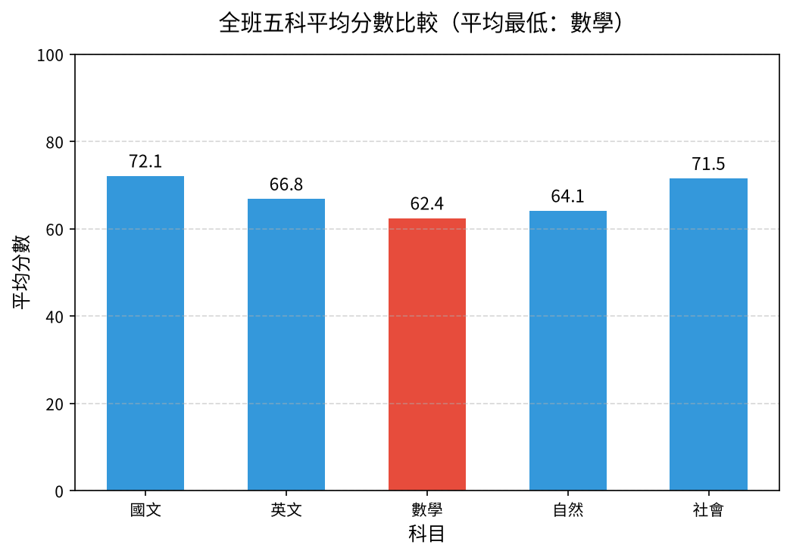

# 📊 01｜班級段考成績：第一次完整走完五步驟

[](https://colab.research.google.com/github/roberthsu2003/PythonForDataAnalysis/blob/master/AI%E5%8D%94%E4%BD%9C%E8%B3%87%E6%96%99%E5%88%86%E6%9E%90_12%E5%80%8B%E7%AF%84%E4%BE%8B/01_class_scores/lesson.ipynb) 👉 **[開啟本例筆記本 lesson.ipynb](./lesson.ipynb)**

| （第一例） | [🏠 範例庫目錄](../README.md) | [02 便利商店銷售 ➡️](../02_store_sales/README.md) |
| :--- | :---: | ---: |

## 📌 本例速覽

| 項目 | 內容 |
| :--- | :--- |
| 所在階段 | 🟢 第一段：熟悉流程 |
| 資料 | `scores.csv`（45 位學生 × 5 科） |
| 一列代表 | 一位學生 |
| 必做問題 | **哪一科全班平均最低？** |
| 必做圖表 | 垂直長條圖 |
| 🆕 本例新學 | 第一次把前一章的五步驟**真的做一遍**；並學會一條最重要的紅線：**缺考（空白）不是 0 分**。 |
| 📘 想看懂程式在做什麼？ | 對應程式碼篇：[第 6 章 pandas 的基礎功能](../../pandas的基礎功能/README.md)（描述統計、排序與排名）；[第 12 章 直接使用 pandas 繪製圖表](../../直接使用pandas繪制圖表/README.md)（從表格直接畫長條圖） |

### 🎯 完成主線後，你會畫出這張圖



> [!TIP]
> 每一例都用同一套五步驟：**① 欄位貼標籤 ➔ ② 套提問積木 ➔ ③ 邊界檢核 ➔ ④ 選對圖表 ➔ ⑤ 指揮 AI 並驗收**。你負責想問題和檢查答案，程式交給 AI。
> 卡住時，打開 📇 [資料分析速查卡](../../看懂資料與選對圖表/圖解/資料分析速查卡.svg) 對照；Colab 出錯請看 🧯 [常見問題排解](../常見問題排解.md)。

---

## 1️⃣ 本例怎麼學

這是第一個實作範例，資料刻意選得很簡單：45 位學生、5 科成績，大家都看得懂。問題也只有一個——「哪一科全班平均最低？」。你要練的不是畫圖技巧，而是**照順序思考**：先貼標籤、再提問、再檢查邊界、再選圖，最後才請 AI 動手，並親自核對數字。

| 已經會的（前面範例學過，直接沿用） | 本例新學的（只多這一步） |
| :--- | :--- |
| 欄位角色：指標／條件／標識（前導章節第 1 課） | 在真實表格上貼標籤：座號、姓名是標識，五科分數是指標 |
| 邊界檢核（前導章節第 3 課） | 發現**缺考空白**，計算平均時排除、不補 0 |
| 比較用長條圖、從 0 開始（前導章節第 4～6 課） | 第一次請 AI 在 Colab 畫出長條圖，並**核對圖和表格的數字** |

**學習路線**（做完一層再往下）：

1. **必做主線（單元一～三）**：看懂 45 位學生的成績、辨認缺考、計算五科平均，最後用**一張垂直長條圖**回答「哪一科平均最低？」。單元三後先停下來驗收。
2. **報表應用（單元四～五）**：計算個人總分與排名（缺考者暫不排名），再匯出 Excel 成績報表。
3. **選做挑戰（單元六～七）**：觀察數學分數的分布，或比較數學與自然兩科的關係。第一堂課不必全部完成。

---

## 2️⃣ 資料專案設定：五步 SOP 的前四步

資料：`data/scores.csv`（請先閱讀[本例資料卡](./data/DATA_CARD.md)）。**一列代表：一位學生的五科段考成績**，共 45 位。空白代表缺考。

### ① 欄位貼標籤
| 欄位名稱 | 資料類型 | 欄位角色 (Data Role) | 說明與規則 |
| :--- | :--- | :--- | :--- |
| **座號** | 數字流水號 | ⚪ **標識 (Identifier)** | 只代表學生身分，**只能計數，不能加總或平均**。 |
| **姓名** | 文字 | ⚪ **標識 (Identifier)** | 學生姓名，不參與任何數值運算。 |
| **國文、英文、數學、自然、社會** | 整數（0～100 分） | 🟢 **指標 (Metric)** | 五科分數；英文有 1 人缺考、數學有 2 人缺考（空白）。 |

### ② 套提問積木
- 🎯 **比較（必做）**：哪一科全班平均最高？哪一科最低？
- 📊 **分布（選做）**：平均最低的數學，分數主要集中在哪個區間？有沒有極端低分？
- 🔗 **關係（選做）**：數學成績好的人，自然成績也比較好嗎？

### ③ 邊界檢核（分析紅線）
- ⚠️ **缺考不是 0 分**：空白代表缺考，計算科目平均時要排除，不能補 0。
- ⚠️ **標識不運算**：座號與姓名不參與任何統計。
- ⚠️ **缺考者暫不排名**：個人總分只算已考科目，五科沒考齊的人不能和考齊的人直接比總分。
- ⚠️ **平均最低 ≠ 題目最難**：平均分受很多因素影響，不能只憑這張圖說哪一科「出得最難」。
- ⚠️ **相關不推因果**：數學和自然有關聯，也不能說「數學好造成自然好」。

### ④ 選對圖表
- **5 科比平均高低** ➔ **垂直長條圖**（類別少；Y 軸從 0 開始，上限 100）。
- **數學分數集中在哪（選做）** ➔ **直方圖**看區間、**箱形圖**抓極端低分。
- **數學 vs 自然（選做）** ➔ **散佈圖**（點不連線）。

---

## 3️⃣ 在 Colab 操作（第 ⑤ 步：指揮 AI 並驗收）

1. **開啟筆記本**：點上方的 Open in Colab 徽章，開啟 [`lesson.ipynb`](./lesson.ipynb)。
2. **執行第 0 步**：點儲存格左側的 ▶，自動下載 `scores.csv`，並設定繁體中文字型。下載失敗時，請從本例 `data/` 資料夾手動上傳。
3. **一次只問一個單元**：複製該單元的 Prompt，貼到 Colab 右側的 Gemini 對話框；先依序完成單元一至三；主線驗收後，再做單元四～五的報表，或選做單元六、七。
4. **對照與驗收**：把 AI 的程式和筆記本裡的參考程式對照，執行後檢查表格、圖表與文字說法是否一致。

### ✅ 主線驗收（單元三後先停下來）

- [ ] 能指出「座號／姓名」是標識、五科分數是指標；知道缺考欄位沒有被補成 0。
- [ ] 能從表格與長條圖指出平均最低的科目，並核對兩處數字一致；圖的數值軸從 0 開始。
- [ ] 能用一句話解釋：為什麼科目平均最低，不一定代表題目客觀上最難？

---

## 4️⃣ 各單元任務與 Prompt

> 點「📋 展開 Prompt」即可看到完整指令。每次只複製一個單元貼給 Gemini。

### ✅ 必做主線（單元一、二、三）

#### 單元一｜讀取資料與欄位角色檢核（貼標籤）

> 🎯 **思維重點**：確認哪些是「標識」、哪些是「指標」，並統計每科有幾人缺考。

<details>
<summary>📋 展開 Prompt（複製貼給 Colab Gemini）</summary>

```text
請幫我用 pandas 讀取 data/scores.csv：
1. 顯示前 5 筆資料與所有欄位名稱。
2. 檢查各欄位的資料型態。
3. 統計每個科目分別有多少人「缺考」（缺失值 NaN）。
4. 用文字回報：座號與姓名是否為識別標籤，五科成績是否為數值指標。
```

</details>

#### 單元二｜邊界檢核：缺考不當 0 分，計算各科統計

> 🎯 **思維重點**：缺考（空白）絕對不能當成 0 分！計算全班平均時要排除空白。

<details>
<summary>📋 展開 Prompt（複製貼給 Colab Gemini）</summary>

```text
請計算全班 5 科（國文、英文、數學、自然、社會）的統計數據：
1. 先計算每科平均分，四捨五入保留一位小數；有餘裕再看最高分、最低分與標準差。
2. 計算平均時必須「忽略缺考（NaN）」，不可把缺考補 0 分，並在註解說明這樣做的原因。
3. 將 5 科的統計數據整理成美觀的表格顯示。
```

</details>

#### 單元三｜提問積木【比較】— 哪一科平均最低？（必做，垂直長條圖）

> 🎯 **思維重點**：5 個科目比高低，用【垂直長條圖】，Y 軸從 0 開始。

<details>
<summary>📋 展開 Prompt（複製貼給 Colab Gemini）</summary>

```text
請用 matplotlib 畫出 5 科平均成績的「垂直長條圖」：
1. X 軸為科目名稱，Y 軸為平均分數。
2. Y 軸數值起點必須從 0 開始，上限設為 100。
3. 在柱子上方標註具體平均分數數值（保留一位小數）。
4. 平均最低的科目柱子用醒目的顏色標示，標題寫「平均最低科目」，避免把平均分直接當成題目難度。
5. 圖表標題、座標軸與標籤全部使用繁體中文。
```

</details>

### 📄 報表應用（單元四、五）

#### 單元四｜報表應用 — 計算個人總分與排名，找出需關懷學生

> 🎯 **思維重點**：先核對五科是否都考齊；缺考者的已考總分不能和完整五科總分直接比較。

<details>
<summary>📋 展開 Prompt（複製貼給 Colab Gemini）</summary>

```text
請計算全班每位學生的成績表現：
1. 計算每位學生的已考科目總分、平均分與應考科數；缺考不是 0 分。
2. 五科都考齊者依總分排名；有缺考者標「暫不排名」，不要與完整成績直接比較。
3. 列出全班總分前 3 名的優等生名單。
4. 在五科都考齊的學生中，找出平均低於 60 分或有任一科低於 50 分的關懷名單；缺考學生另列待確認名單。
```

</details>

#### 單元五｜報表應用 — 匯出 Excel 成績報表

> 🎯 **思維重點**：把分析結果變成導師可以直接使用的 Excel 報表。

<details>
<summary>📋 展開 Prompt（複製貼給 Colab Gemini）</summary>

```text
請將計算完成的班級成績結果匯出成 Excel 檔案：
1. 存為 output/成績報表.xlsx（若 output 目錄不存在請自動建立）。
2. 工作表包含：座號、姓名、五科分數、應考科數、已考科目總分、平均、班級排名、成績狀態。
3. 先確認缺考學生顯示「暫不排名」；有餘裕再替低於 60 分的科目成績與平均標色，不要標紅座號或排名。
4. 提供 Colab 下載該 Excel 檔案的程式碼。
```

</details>

### 🚀 選做挑戰（單元六、七）

#### 單元六｜選做挑戰【分布】— 數學分數集中在哪裡？（直方圖與箱形圖）

> 🎯 **思維重點**：連續數值看集中區間用【直方圖】，找極端低分用【箱形圖】。

<details>
<summary>📋 展開 Prompt（複製貼給 Colab Gemini）</summary>

```text
針對全班平均最低的「數學」科，請畫出圖表來觀察分數分布：
1. 建立兩張並排的子圖：左邊畫「直方圖（Histogram）」觀察分數集中區間；右邊畫「箱形圖（Box Plot）」觀察中位數與是否有極端低分的離群值。
2. 直方圖請將分數區間（bins）設為適當大小，並畫出平均線。
3. 箱形圖標出五數概括與異常值點。
4. 全圖使用繁體中文標籤，並用圖上的數字描述集中區間；若無明確證據，不必貼上「常態」或「兩極分化」標籤。
```

</details>

#### 單元七｜選做挑戰【關係】— 數學與自然有沒有關聯？（散佈圖）

> 🎯 **思維重點**：兩個成對數值看連動用【散佈圖】（點不連線）；相關不等於因果。

<details>
<summary>📋 展開 Prompt（複製貼給 Colab Gemini）</summary>

```text
請分析「數學」與「自然」這兩科的成績是否有連動關聯：
1. 繪製兩科的「散佈圖（Scatter Plot）」，X 軸為數學成績、Y 軸為自然成績。
2. 每個點代表一位學生，點與點之間「不要連線」。
3. 計算兩科的皮爾森相關係數（Pearson correlation），並將數值顯示於圖表標題。
4. 用文字解讀兩科是否存在正相關，並附註「相關性不等於因果關係」的防呆結論。
```

</details>

---

## 5️⃣ 選做延伸：請本機 AI 封裝成自動化腳本

完成單元四～五的報表並驗證數字後，有餘裕再把 Notebook 中**已驗證**的流程，交給本機 AI 工具（如 Cursor、Windsurf、GitHub Copilot CLI、Antigravity）封裝成可重跑的 `make_report.py`。學生依然不必手寫程式；本資料夾已附一份參考成品，可與 AI 產出的版本比對。

<details>
<summary>📋 展開本機 AI 的 Prompt（在 <code>01_class_scores</code> 資料夾中使用）</summary>

```text
我已經在 Colab 完成了段考成績分析並保存在 lesson.ipynb。請擔任我的 Python 技術助教：
1. 請讀取本目錄下的 lesson.ipynb，將其中經過驗證的資料處理與計算邏輯，整理並封裝為一個乾淨、模組化的自動化腳本 make_report.py。
2. 腳本規範與功能要求：
   - 定義 load_data(), calculate_stats(), calculate_rankings(), export_excel() 等清晰函式。
   - 讀取 data/scores.csv，計算 5 科平均、最高、最低分，嚴守「缺考 NaN 排除、不可補 0」的邊界防呆。
   - 計算學生已考科目總分；五科完整者才參與排名，缺考者標註「暫不排名」，並用 openpyxl 將結果匯出至 output/成績報表.xlsx。
   - 在 Excel 中設置標題深藍色底白字、凍結第一列，只將低於 60 分的科目成績或平均標註淺紅底與紅字。
   - 檔案路徑以腳本所在位置為基準進行相對定位（避免寫死路徑）。
3. 自動執行與驗收：
   - 建立完畢後，請直接在終端機執行：uv run python make_report.py
   - 檢查 output/成績報表.xlsx 是否成功產生，並在終端機印出平均最低科目、全班前 3 名、關懷名單及缺考待確認人數。
```

</details>

<details>
<summary>🖥️ 展開執行結果範例</summary>

AI 助教執行腳本後，你在終端機會看到類似下方的輸出（數字由程式實際算出）：

```text
==================================================
🚀 開始執行班級段考成績自動化分析腳本...
==================================================

📊 【各科平均分比較】
  - 全班平均最低科目：數學（平均 62.4 分）
  - 全班最高科目：國文（平均達 72.1 分）

🏆 【全班前 3 名優等生】
  - 第 1 名：林明明（總分 449，平均 89.8 分）
  - 第 2 名：柯婷欣（總分 437，平均 87.4 分）
  - 第 3 名：黃明芬（總分 432，平均 86.4 分）

⚠️ 【需重點輔導與補救學生】共 15 位
📝 【缺考，暫不排名】共 2 位；總分僅採計已考科目

✅ 成果已成功匯出至：output/成績報表.xlsx
==================================================
```

</details>

---

## 🎯 學習驗收清單

完成目前選擇的層次後，檢查自己能不能做到：

- [ ] **必做主線**：能否說明座號為什麼不能算平均、缺考為什麼不能填 0，並核對長條圖與表格的平均分一致？
- [ ] **報表應用**：缺考學生是否顯示「暫不排名」？Excel 中的數字能否回到原始資料核對？
- [ ] **選做挑戰**：數學與自然若呈正相關，是否能推論「補習數學會讓自然進步」？

---

| （第一例） | [🏠 範例庫目錄](../README.md) | [02 便利商店銷售 ➡️](../02_store_sales/README.md) |
| :--- | :---: | ---: |
