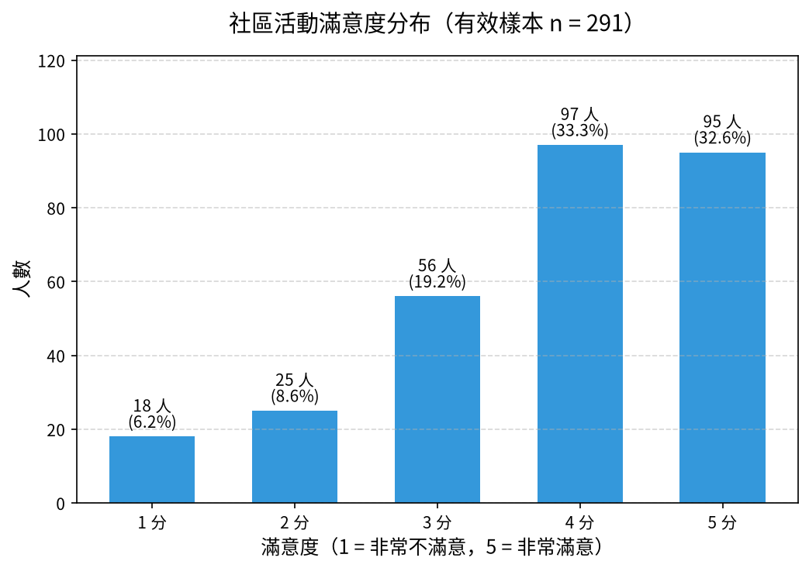

# 📊 04｜社區活動問卷：先清理重複與寫法，再看滿意度

[](https://colab.research.google.com/github/roberthsu2003/PythonForDataAnalysis/blob/master/AI%E5%8D%94%E4%BD%9C%E8%B3%87%E6%96%99%E5%88%86%E6%9E%90_12%E5%80%8B%E7%AF%84%E4%BE%8B/04_survey_cleaning/lesson.ipynb) 👉 **[開啟本例筆記本 lesson.ipynb](./lesson.ipynb)**

| [⬅️ 03 圖書館借閱](../03_library_files/README.md) | [🏠 範例庫目錄](../README.md) | [05 連鎖書店季報 ➡️](../05_bookstore_merge/README.md) |
| :--- | :---: | ---: |

## 📌 本例速覽

| 項目 | 內容 |
| :--- | :--- |
| 所在階段 | 🔵 第二段：把亂資料整理乾淨 |
| 資料 | `survey_raw.csv`（320 份，含重複） |
| 一列代表 | 一份送出的問卷 |
| 必做問題 | **滿意度 1～5 分各有幾人？** |
| 必做圖表 | 垂直長條圖 |
| 🆕 本例新學 | 原始問卷有**重複送出、同義不同寫法、不可能的值**；先訂清理規則、記錄每一步刪改了幾筆，才能計算滿意度。 |

### 🎯 完成主線後，你會畫出這張圖



> [!TIP]
> 每一例都用同一套五步驟：**① 欄位貼標籤 ➔ ② 套提問積木 ➔ ③ 邊界檢核 ➔ ④ 選對圖表 ➔ ⑤ 指揮 AI 並驗收**。你負責想問題和檢查答案，程式交給 AI。
> 卡住時，打開 📇 [資料分析速查卡](../../看懂資料與選對圖表/圖解/資料分析速查卡.svg) 對照。

---

## 1️⃣ 本例怎麼學

01 的缺考只是「空白」；問卷資料亂得多：同一份問卷送了兩次、「5」「5分」「非常滿意」其實是同一個意思、還有人填了不存在的「6 分」。如果直接計數，分母和結果都會錯。這一例的重點不是畫圖，而是**每一個清理決定都要說得出理由、算得出筆數**。

| 已經會的（前面範例學過，直接沿用） | 本例新學的（只多這一步） |
| :--- | :--- |
| 缺值不當 0（01） | 區分三種狀況：**重複**（刪除）、**同義寫法**（統一）、**不可能的值**（設為缺值並記錄） |
| 分組計數、垂直長條圖（01、02） | 每一步清理都印出「處理前 → 處理後」筆數，留下**清理紀錄** |
| 讀取不同格式（03） | 把「多選」欄位拆開後計數，分清楚「人數」與「人次」 |

**學習路線**（做完一層再往下）：

1. **必做主線（單元一～三）**：找出重複與亂寫的滿意度、訂好清理規則，最後用**一張垂直長條圖**回答「1～5 分各有多少人？」。單元三後先停下來驗收。
2. **報表應用（單元四）**：清理其餘欄位（性別、居住區、年齡、電話），匯出乾淨的問卷檔與清理紀錄。
3. **選做挑戰（單元五～六）**：拆開多選欄位統計各活動參加人數，或比較各居住區的滿意度。

---

## 2️⃣ 資料專案設定：五步 SOP 的前四步

資料：`data/survey_raw.csv`（請先閱讀[本例資料卡](./data/DATA_CARD.md)）。**一列代表：一份送出的問卷**（共 320 列，含重複送出）。清理後另存新檔，不得改寫原始檔。

### ① 欄位貼標籤
| 欄位名稱 | 資料類型 | 欄位角色 (Data Role) | 說明與規則 |
| :--- | :--- | :--- | :--- |
| **姓名** | 文字 | ⚪ **標識 (Identifier)** | 只用來辨識填答者，部分前後有空白；不做統計。 |
| **電話** | 文字 | ⚪ **標識 (Identifier)** | 寫法不一（有「-」、+886、少 0）；**電話是文字，不是數值**，只需統一格式。 |
| **填答時間** | 文字（格式混雜） | 🔵 **條件 (Dimension)／時間** | 有「4月3日」這種沒有年份的寫法；本例主線不使用。 |
| **性別** | 文字 | 🔵 **條件 (Dimension)／類別** | 男、M、male、男生……要統一成「男／女」，少數空白。 |
| **居住區** | 文字 | 🔵 **條件 (Dimension)／類別** | 「大安」「 大安區」要統一成「大安區」。 |
| **參加活動** | 文字（多選） | 🔵 **條件 (Dimension)／類別** | 一格有多個活動，分隔符號混用「;」「、」「,」，要拆開才能計數。 |
| **年齡** | 文字 | 🟢 **指標 (Metric)** | 有「25歲」、999（不可能）與空白。 |
| **滿意度** | 文字（應為 1～5） | 🟢 **指標 (Metric)／順序等級** | 混入「5分」「非常滿意」「滿意」、不可能的 6 與空白。 |

### ② 套提問積木
- 🎯 **分布（必做）**：清理後，滿意度 1～5 分各有多少人？哪個分數最多？
- 🔢 **比較（選做）**：各活動分別有多少人參加？哪個活動最多人？
- 🏘️ **比較（選做）**：各居住區的平均滿意度有差別嗎？每區有多少份有效問卷？

### ③ 邊界檢核（分析紅線）
- ⚠️ **先去重複再計數**：15 份是完全相同的重複送出；不刪除，分母就會多算。
- ⚠️ **同義寫法要統一，不可能的值不能硬改**：「5分」→5、「非常滿意」→5、「滿意」→4 是**我們訂的對照規則**，要寫清楚；「6」不在 1～5 範圍內，設為缺值，不能猜成 5。
- ⚠️ **有效樣本數要說清楚**：滿意度的分母是「有效填答數」，不是 320，也不是去重複後的全部份數。
- ⚠️ **人數 ≠ 人次**：多選題拆開後，各活動人數加起來會超過問卷份數，不能說成「總參加人數」。
- ⚠️ **滿意度是等級**：1～5 分是順序，不是等距的測量；平均只能當參考，並一定附上樣本數。

### ④ 選對圖表
- **1～5 分各有多少人** ➔ **垂直長條圖**（分數只有 5 個等級，依 1→5 排列，不可重新排序；Y 軸從 0 開始）。
- **各活動參加人數（選做）** ➔ **水平長條圖**（依人數排序）。
- **各居住區平均滿意度（選做）** ➔ **垂直長條圖**，並在柱子上標出有效樣本數 n。

---

## 3️⃣ 在 Colab 操作（第 ⑤ 步：指揮 AI 並驗收）

1. **開啟筆記本**：點上方的 Open in Colab 徽章，開啟 [`lesson.ipynb`](./lesson.ipynb)。
2. **執行第 0 步**：點儲存格左側的 ▶，自動下載 `survey_raw.csv`，並設定繁體中文字型。下載失敗時，請從本例 `data/` 資料夾手動上傳。
3. **一次只問一個單元**：複製該單元的 Prompt，貼到 Colab 右側的 Gemini 對話框；先依序完成單元一至三；主線驗收後，再做單元四的報表，或選做單元五、六。
4. **對照與驗收**：把 AI 的程式和筆記本裡的參考程式對照，執行後檢查表格、圖表與文字說法是否一致。

### ✅ 主線驗收（單元三後先停下來）

- [ ] 能指出原始資料的三類問題：重複送出、同義不同寫法、不可能的值，並說出各自的處理規則。
- [ ] 能展示每一步清理前後的筆數，說出滿意度的有效樣本數；長條圖與次數表一致，分數依 1→5 排列。
- [ ] 能用一句話解釋：為什麼「6 分」不能直接改成 5 分？

---

## 4️⃣ 各單元任務與 Prompt

> 點「📋 展開 Prompt」即可看到完整指令。每次只複製一個單元貼給 Gemini。

### ✅ 必做主線（單元一、二、三）

#### 單元一｜讀取資料、檢查重複與各種寫法（貼標籤）

> 🎯 **思維重點**：先「看見」髒資料：重複列有幾筆？性別、居住區、滿意度各有幾種寫法？先檢查，不急著改。

<details>
<summary>📋 展開 Prompt（複製貼給 Colab Gemini）</summary>

```text
請幫我用 pandas 讀取 data/survey_raw.csv，所有欄位先以文字讀入：
1. 顯示前 8 筆資料、欄位名稱、總列數與各欄缺值數。
2. 計算有幾列是「整列完全重複」的資料。
3. 分別列出「性別」「居住區」「滿意度」每一種寫法出現的次數（包含空白）。
4. 用文字回報：哪些欄位是標識、條件、指標；滿意度欄位有哪些寫法不是 1～5 的數字？
先不要修改資料，也不要畫圖。
```

</details>

#### 單元二｜邊界檢核：去重複、統一滿意度寫法、排除不可能的值

> 🎯 **思維重點**：依序處理：刪除完全重複 → 把同義寫法對應成 1～5 → 不在 1～5 的值設為缺值。每一步都印出筆數，最後得到「有效樣本數」。

<details>
<summary>📋 展開 Prompt（複製貼給 Colab Gemini）</summary>

```text
請依下列規則清理，並在每一步印出處理前後筆數：
1. 刪除完全重複的列（保留第一筆），不要修改原始 CSV。
2. 統一滿意度寫法：去掉前後空白與「分」字；「非常滿意」對應 5、「滿意」對應 4。請把這個對照規則寫在註解中。
3. 轉成數字後，不在 1～5 範圍內的值（例如 6）設為缺值，不可以猜成其他分數；列出被設為缺值的原始寫法與筆數。
4. 回報：去重複後有幾份問卷？滿意度有效填答幾份？缺值幾份？
```

</details>

#### 單元三｜提問積木【分布】— 滿意度 1～5 分各有多少人？（必做，垂直長條圖）

> 🎯 **思維重點**：5 個有順序的等級看人數分布，用【垂直長條圖】；X 軸固定 1→5，不能依人數重新排序；標題寫出有效樣本數 n。

<details>
<summary>📋 展開 Prompt（複製貼給 Colab Gemini）</summary>

```text
請用清理後的滿意度，畫出 1～5 分人數的垂直長條圖：
1. 先產出次數表：分數 1～5、人數、占有效樣本的百分比（保留一位小數）。
2. X 軸為滿意度分數，固定依 1、2、3、4、5 排列（即使某分數是 0 人也要顯示）；Y 軸為人數，從 0 開始。
3. 在柱子上方標註人數與百分比。
4. 標題寫出有效樣本數 n，圖表文字全部使用繁體中文。
```

</details>

### 📄 報表應用（單元四）

#### 單元四｜報表應用 — 清理其餘欄位，匯出乾淨問卷與清理紀錄

> 🎯 **思維重點**：交付的不只是乾淨資料，還有**清理紀錄**：每個欄位用什麼規則、影響了幾筆，別人才能檢查。

<details>
<summary>📋 展開 Prompt（複製貼給 Colab Gemini）</summary>

```text
請清理其餘欄位，並匯出乾淨問卷與清理紀錄：
1. 姓名去掉前後空白；性別統一為「男」「女」（M、male、男生 → 男；F、female、女生 → 女），空白保留為缺值。
2. 居住區去掉空白，缺「區」字的補上（例如「大安」→「大安區」）。
3. 年齡只取數字；不在 10～100 歲的值（例如 999）設為缺值。
4. 電話只保留數字，+886 開頭改為 0，9 碼且以 9 開頭的前面補 0；最後檢查是否都是 09 開頭的 10 碼。
5. 建立清理紀錄表（欄位、規則、受影響筆數），連同乾淨問卷匯出成 output/問卷清理結果.xlsx 的兩個工作表；匯出後重新讀取核對列數為 305。
```

</details>

### 🚀 選做挑戰（單元五、六）

#### 單元五｜選做挑戰【比較】— 各活動有多少人參加？（多選題拆開計數）

> 🎯 **思維重點**：多選題一格有多個答案，要先拆開再計數；拆開後的加總是「人次」，會大於問卷份數。

<details>
<summary>📋 展開 Prompt（複製貼給 Colab Gemini）</summary>

```text
請統計「參加活動」這個多選欄位：
1. 使用去重複後的 305 份問卷，把分隔符號「;」「、」「,」都視為分隔，拆成一列一個活動，並去掉空白。
2. 計算每個活動的參加人數，畫出水平長條圖（依人數排序，數值軸從 0 開始，標註人數）。
3. 印出：問卷份數、各活動人數加總（人次），並說明兩者為什麼不同。
```

</details>

#### 單元六｜選做挑戰【比較】— 各居住區的平均滿意度（附樣本數）

> 🎯 **思維重點**：居住區要先統一寫法才能分組；每區樣本數不同，平均值旁一定要標 n，差距很小時不要誇大。

<details>
<summary>📋 展開 Prompt（複製貼給 Colab Gemini）</summary>

```text
請使用單元四清理後的資料，比較各居住區的滿意度：
1. 依居住區計算有效滿意度的份數 n 與平均分數（保留兩位小數）。
2. 畫出垂直長條圖，Y 軸從 0 開始、上限 5，柱子上標示平均分與 n。
3. 用文字說明：最高與最低的區差距多少？在樣本數這麼少、滿意度又是等級資料的情況下，結論要怎麼保守描述？
```

</details>

---

## 5️⃣ 選做延伸：請本機 AI 封裝成自動化腳本

完成單元四的清理報表並驗證數字後，有餘裕再把 Notebook 中**已驗證**的流程，交給本機 AI 工具（如 Cursor、Windsurf、GitHub Copilot CLI、Antigravity）封裝成可重跑的 `make_report.py`。學生依然不必手寫程式；本資料夾已附一份參考成品，可與 AI 產出的版本比對。

<details>
<summary>📋 展開本機 AI 的 Prompt（在 <code>04_survey_cleaning</code> 資料夾中使用）</summary>

```text
我已經在 Colab 完成社區活動問卷清理並保存在 lesson.ipynb。請擔任我的 Python 技術助教：
1. 請讀取本目錄下的 lesson.ipynb，將單元一～四已驗證的清理規則封裝為自動化腳本 make_report.py。
2. 腳本規範與功能要求：
   - 定義 load_raw(), drop_duplicates(), clean_satisfaction(), clean_other_fields(), export_excel() 等清晰函式。
   - 所有欄位先以文字讀入；滿意度對照規則（「5分」→5、「非常滿意」→5、「滿意」→4，不在 1～5 設為缺值）寫成常數，方便日後討論修改。
   - 每一步都記錄受影響筆數，連同乾淨問卷匯出至 output/問卷清理結果.xlsx（乾淨問卷、清理紀錄兩個工作表）。
   - 檔案路徑以腳本所在位置為基準進行相對定位（避免寫死路徑）；不得修改原始 CSV。
3. 自動執行與驗收：
   - 建立完畢後，請直接在終端機執行：uv run python make_report.py
   - 在終端機印出原始列數、去重複後份數、滿意度有效份數與 1～5 分人數，以及電話格式是否全部正確。
```

</details>

<details>
<summary>🖥️ 展開執行結果範例</summary>

AI 助教執行腳本後，你在終端機會看到類似下方的輸出（數字由程式實際算出）：

```text
==================================================
🚀 開始執行社區活動問卷清理腳本...
==================================================

🧹 【清理結果】原始 320 列 → 去重複後 305 份
  - 滿意度有效 291 份、缺值 14 份
  - 1～5 分人數：1 分 18 人、2 分 25 人、3 分 56 人、4 分 97 人、5 分 95 人
  - 電話全部為 09 開頭 10 碼：True

📝 【清理紀錄】
  - 全部：刪除完全重複的列（15 筆）
  - 滿意度：同義寫法對應 1～5；不在 1～5 設為缺值（47 筆）
  - 姓名：去除前後空白（25 筆）
  - 性別：統一為男／女（145 筆）
  - 居住區：去空白、補上「區」字（127 筆）
  - 年齡：只取數字；不在 10～100 歲設為缺值（51 筆）
  - 電話：只留數字、+886 改 0、補前導 0（176 筆）

✅ 成果已成功匯出至：output/問卷清理結果.xlsx
==================================================
```

</details>

---

## 🎯 學習驗收清單

完成目前選擇的層次後，檢查自己能不能做到：

- [ ] **必做主線**：能否說出重複、同義寫法、不可能值三種問題的處理規則，並說出滿意度的有效樣本數？
- [ ] **報表應用**：清理紀錄是否寫出每個欄位的規則與受影響筆數？乾淨檔重新讀取後是否仍為 305 份？
- [ ] **選做挑戰**：能分清楚「參加人數」與「人次」嗎？比較居住區時，是否附上每區樣本數？

---

| [⬅️ 03 圖書館借閱](../03_library_files/README.md) | [🏠 範例庫目錄](../README.md) | [05 連鎖書店季報 ➡️](../05_bookstore_merge/README.md) |
| :--- | :---: | ---: |
