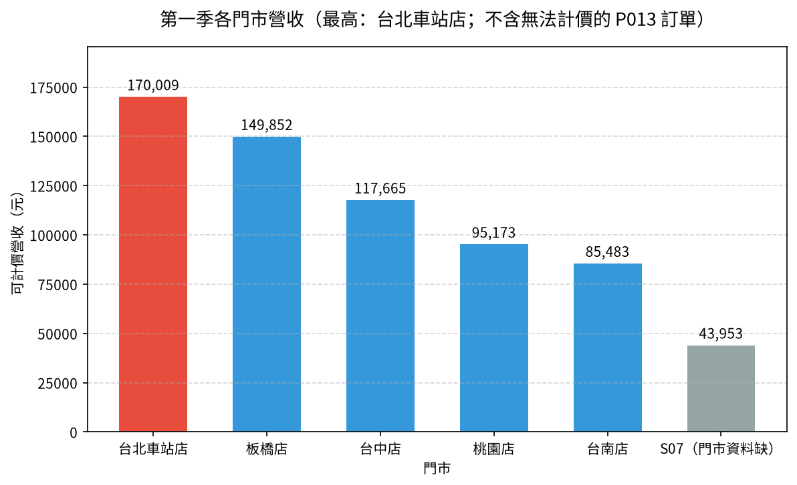

# 📊 05｜連鎖書店季報：多表合併，先核對對不上的資料

[](https://colab.research.google.com/github/roberthsu2003/PythonForDataAnalysis/blob/master/AI%E5%8D%94%E4%BD%9C%E8%B3%87%E6%96%99%E5%88%86%E6%9E%90_12%E5%80%8B%E7%AF%84%E4%BE%8B/05_bookstore_merge/lesson.ipynb) 👉 **[開啟本例筆記本 lesson.ipynb](./lesson.ipynb)**

| [⬅️ 04 社區活動問卷](../04_survey_cleaning/README.md) | [🏠 範例庫目錄](../README.md) | [06 縣市用電 ➡️](../06_power_reshape/README.md) |
| :--- | :---: | ---: |

## 📌 本例速覽

| 項目 | 內容 |
| :--- | :--- |
| 所在階段 | 🔵 第二段：把亂資料整理乾淨 |
| 資料 | 3 個月訂單 ＋ 門市 ＋ 商品，共 5 個檔案 |
| 一列代表 | 一筆訂單 |
| 必做問題 | **第一季哪家門市營收最高？** |
| 必做圖表 | 垂直長條圖 |
| 🆕 本例新學 | 三個月的訂單要**上下接起來**，再**左右對應**門市與商品資料；合併後一定要清點「對不上」的紀錄，並說明它們如何影響營收。 |
| 📘 想看懂程式在做什麼？ | 對應程式碼篇：[第 9 章 連接、合併和重塑](../../數據整理_連接_合併_重塑/README.md)（concat 與 merge） |

### 🎯 完成主線後，你會畫出這張圖



> [!TIP]
> 每一例都用同一套五步驟：**① 欄位貼標籤 ➔ ② 套提問積木 ➔ ③ 邊界檢核 ➔ ④ 選對圖表 ➔ ⑤ 指揮 AI 並驗收**。你負責想問題和檢查答案，程式交給 AI。
> 卡住時，打開 📇 [資料分析速查卡](../../看懂資料與選對圖表/圖解/資料分析速查卡.svg) 對照；Colab 出錯請看 🧯 [常見問題排解](../常見問題排解.md)。

---

## 1️⃣ 本例怎麼學

03 只是用代碼查一張小對照表，而且全部對得上。這一例更像真實的季報：每月一個訂單檔，欄名還不一致；門市代碼大小寫混亂；甚至有訂單的門市、商品不在主檔裡。合併做錯，營收會**悄悄變少**而沒有任何錯誤訊息。所以本例的口訣是：**合併前後都要數筆數，對不上的要列清單。**

| 已經會的（前面範例學過，直接沿用） | 本例新學的（只多這一步） |
| :--- | :--- |
| 衍生營收＝單價 × 數量（02） | 單價不在訂單裡，要先從商品表**合併**過來才能算 |
| 用代碼查表對應名稱（03） | 多檔**上下合併**（concat）、欄名不一致要先統一 |
| 清理寫法不一致（04） | 合併時選 left join 並**清點未匹配**：哪些門市、商品對不上？影響多少筆、多少營收？ |

**學習路線**（做完一層再往下）：

1. **必做主線（單元一～三）**：接起三個月訂單、統一門市代碼、對應門市與商品，清點對不上的資料，最後用**一張垂直長條圖**回答「第一季哪家門市營收最高？」。單元三後先停下來驗收。
2. **報表應用（單元四）**：匯出門市營收與「未匹配清單」，讓主管知道哪些營收還無法計算。
3. **選做挑戰（單元五～六）**：比較各門市三個月的營收變化，或看各門市的書籍類別組成。

---

## 2️⃣ 資料專案設定：五步 SOP 的前四步

資料：`data/orders_2025_01.csv`～`orders_2025_03.csv`（每月訂單）、`data/stores.csv`（門市主檔）、`data/products.csv`（商品主檔）。請先閱讀[本例資料卡](./data/DATA_CARD.md)。**訂單檔的一列代表：一筆訂單（一種書、一個數量）**；門市主檔一列是一家門市，商品主檔一列是一種書。

### ① 欄位貼標籤
| 欄位名稱 | 資料類型 | 欄位角色 (Data Role) | 說明與規則 |
| :--- | :--- | :--- | :--- |
| **訂單編號** | 文字代碼 | ⚪ **標識 (Identifier)** | 三個月連續編號，只能計數。 |
| **門市代碼** | 文字代碼 | ⚪ **標識（對照鑰匙）** | 連到 stores.csv；二月有「s02 」這種小寫加空白的寫法。 |
| **商品編號** | 文字代碼 | ⚪ **標識（對照鑰匙）** | 連到 products.csv。 |
| **日期** | 文字日期 | 🔵 **條件 (Dimension)／時間** | 2025 年 1～3 月，可取出月份。 |
| **門市、縣市** | 文字 | 🔵 **條件 (Dimension)／類別** | 由門市主檔對應而來。 |
| **書名、類別** | 文字 | 🔵 **條件 (Dimension)／類別** | 由商品主檔對應而來。 |
| **數量（三月叫「購買數量」）** | 整數（本） | 🟢 **指標 (Metric)** | 欄名不一致，上下合併前要先統一。 |
| **售價** | 整數（元） | 🟢 **指標 (Metric)** | 在商品主檔；營收＝數量 × 售價。 |

### ② 套提問積木
- 🎯 **比較（必做）**：第一季哪一家門市的營收最高？
- 📅 **比較＋時間（選做）**：各門市 1、2、3 月的營收變化一致嗎？
- 🧩 **組成（選做）**：各門市的營收，由哪些書籍類別組成？

### ③ 邊界檢核（分析紅線）
- ⚠️ **欄名要先統一**：三月的「購買數量」不改名就上下合併，會變成兩個各缺一部分的欄位。
- ⚠️ **鑰匙寫法要一致**：「s02 」和「S02」對電腦來說是不同的值，要先去空白、轉大寫。
- ⚠️ **合併後清點未匹配**：訂單有門市 S07，但門市主檔沒有；有商品 P013，但商品主檔沒有。用 inner join 會**默默刪掉**這些訂單，營收就少算了。
- ⚠️ **無法計價就說無法計價**：P013 沒有售價，不能猜價格補上；營收要註明「不含無法計價的訂單」，並列出影響筆數與本數。
- ⚠️ **沒有訂單 ≠ 營收很差**：S06 高雄店在主檔中卻沒有任何訂單，可能是資料缺漏，不能直接寫成「高雄店營收為 0」。

### ④ 選對圖表
- **6 個門市比營收** ➔ **垂直長條圖**（類別少；Y 軸從 0 開始，單位「元」；S07 用灰色標示「門市資料缺」）。
- **各門市 3 個月營收（選做）** ➔ **分組長條圖**（只有 3 個時間點，用長條比用折線清楚）。
- **各門市的類別組成（選做）** ➔ **百分比堆疊長條圖**（每家門市都是 100%，看結構）。

---

## 3️⃣ 在 Colab 操作（第 ⑤ 步：指揮 AI 並驗收）

1. **開啟筆記本**：點上方的 Open in Colab 徽章，開啟 [`lesson.ipynb`](./lesson.ipynb)。
2. **執行第 0 步**：點儲存格左側的 ▶，自動下載 三個月訂單、`stores.csv`、`products.csv` 共 5 個檔案，並設定繁體中文字型。下載失敗時，請從本例 `data/` 資料夾手動上傳。
3. **一次只問一個單元**：複製該單元的 Prompt，貼到 Colab 右側的 Gemini 對話框；先依序完成單元一至三；主線驗收後，再做單元四的報表，或選做單元五、六。
4. **對照與驗收**：把 AI 的程式和筆記本裡的參考程式對照，執行後檢查表格、圖表與文字說法是否一致。

### ✅ 主線驗收（單元三後先停下來）

- [ ] 能說出訂單、門市、商品三種表「一列代表什麼」，以及用哪個欄位把它們接起來。
- [ ] 能展示合併前後筆數一致，並列出對不上的門市（S07）與商品（P013）各影響幾筆。
- [ ] 能用一句話解釋：為什麼這一例用 left join，而不是 inner join？

---

## 4️⃣ 各單元任務與 Prompt

> 點「📋 展開 Prompt」即可看到完整指令。每次只複製一個單元貼給 Gemini。

### ✅ 必做主線（單元一、二、三）

#### 單元一｜讀取五個檔案，比對欄名與鑰匙寫法（貼標籤）

> 🎯 **思維重點**：合併前先「對照」：三個月的欄名一樣嗎？門市代碼有幾種寫法？主檔裡有哪些門市與商品？

<details>
<summary>📋 展開 Prompt（複製貼給 Colab Gemini）</summary>

```text
請幫我用 pandas 讀取 data/ 中的 5 個檔案：orders_2025_01.csv、orders_2025_02.csv、orders_2025_03.csv、stores.csv、products.csv。
1. 每個檔案顯示列數與欄位名稱，並說明「一列代表什麼」。
2. 比較三個月訂單的欄位名稱是否完全相同。
3. 列出二月訂單「門市代碼」的所有不同寫法。
4. 列出門市主檔與商品主檔的全部內容。
5. 用文字回報：哪些欄位是合併用的鑰匙（標識）、哪些是條件、哪些是指標？
先不要合併，也不要畫圖。
```

</details>

#### 單元二｜邊界檢核：上下合併、統一鑰匙、左右對應並清點未匹配

> 🎯 **思維重點**：先示範「直接合併」會出什麼問題，再依序修正：統一欄名 → 上下合併 → 統一門市代碼 → 用 left join 對應主檔 → 清點對不上的資料。

<details>
<summary>📋 展開 Prompt（複製貼給 Colab Gemini）</summary>

```text
請幫我把三個月訂單整理成一張完整的季報資料：
1. 先示範：不改欄名就直接上下合併，會多出哪些欄位、各有多少缺值？（只示範，不要用這個版本繼續）
2. 把三月的「購買數量」改名為「數量」，再上下合併三個月訂單，印出合併前各月筆數與合併後總筆數。
3. 門市代碼去除前後空白並轉成大寫，印出統一前後的不同寫法數量。
4. 用 left join 依序對應商品主檔（取得書名、類別、售價）與門市主檔（取得門市、縣市），印出合併後筆數，並用 indicator 統計各有幾筆對不上；列出對不上的門市代碼與商品編號。
5. 計算營收＝數量 × 售價；沒有售價的訂單營收保持缺值，不要猜價格。再列出「主檔中有、但沒有任何訂單」的門市。
不要修改原始檔案。
```

</details>

#### 單元三｜提問積木【比較】— 第一季哪家門市營收最高？（必做，垂直長條圖）

> 🎯 **思維重點**：6 個門市比高低，用【垂直長條圖】；標題註明「不含無法計價的訂單」，資料不完整的 S07 用灰色區分。

<details>
<summary>📋 展開 Prompt（複製貼給 Colab Gemini）</summary>

```text
請依門市加總第一季可計價營收，並畫出垂直長條圖：
1. 先產出表格：門市、可計價營收、訂單筆數、無法計價筆數，依營收由高到低排序。
2. X 軸為門市，Y 軸為營收（元），從 0 開始；柱子上方標註金額（千分位）。
3. 營收最高的門市用醒目顏色；門市資料缺的 S07 用灰色。
4. 標題註明「不含無法計價的 P013 訂單」，圖表文字全部使用繁體中文。
```

</details>

### 📄 報表應用（單元四）

#### 單元四｜報表應用 — 匯出門市營收與未匹配清單

> 🎯 **思維重點**：季報要誠實交代缺口：除了門市營收，也附上「未匹配清單」，讓主管知道哪些資料需要補登。

<details>
<summary>📋 展開 Prompt（複製貼給 Colab Gemini）</summary>

```text
請將季報結果匯出成 Excel：
1. 存為 output/第一季門市營收.xlsx（若 output 目錄不存在請自動建立）。
2. 工作表「門市營收」：上一步的門市營收表。
3. 工作表「未匹配清單」：問題類型（訂單缺門市主檔／訂單缺商品主檔／主檔門市無訂單）、代碼、影響訂單筆數、影響本數。
4. 匯出後重新讀取，核對門市營收合計與合併資料的可計價營收一致。
5. 提供 Colab 下載該 Excel 檔案的程式碼。
```

</details>

### 🚀 選做挑戰（單元五、六）

#### 單元五｜選做挑戰【比較＋時間】— 各門市三個月的營收變化（分組長條圖）

> 🎯 **思維重點**：「類別 ＋ 時間 ＋ 指標」看各群體走勢是否一致；只有 3 個月，用【分組長條圖】比折線更清楚，也不宜稱為「趨勢」。

<details>
<summary>📋 展開 Prompt（複製貼給 Colab Gemini）</summary>

```text
請比較各門市 1、2、3 月的可計價營收：
1. 從日期取出月份，依門市與月份加總營收，整理成「列＝門市、欄＝月份」的表格。
2. 畫出分組長條圖：X 軸為門市，每個門市 3 根柱子代表 1、2、3 月，Y 軸從 0 開始，加上圖例。
3. 用文字描述哪些門市的月營收變化方向不同，並提醒只有 3 個月，不能稱為長期趨勢。
```

</details>

#### 單元六｜選做挑戰【組成】— 各門市的書籍類別組成（百分比堆疊長條圖）

> 🎯 **思維重點**：「組成」要先寫清楚分母：這裡的分母是**每家門市自己的可計價營收**，所以每根長條都是 100%。

<details>
<summary>📋 展開 Prompt（複製貼給 Colab Gemini）</summary>

```text
請分析各門市可計價營收的書籍類別組成：
1. 只使用有售價的訂單，依門市與類別加總營收，再除以該門市的可計價營收，換算成百分比。
2. 畫出水平的百分比堆疊長條圖：每家門市一根長條（總和 100%），不同顏色代表類別，加上圖例。
3. 在圖表標題或註解寫明「分母＝該門市可計價營收」。
4. 用文字指出哪一個類別在多數門市占比最高。
```

</details>

---

## 5️⃣ 選做延伸：請本機 AI 封裝成自動化腳本

完成單元四的報表並驗證數字後，有餘裕再把 Notebook 中**已驗證**的流程，交給本機 AI 工具（如 Cursor、Windsurf、GitHub Copilot CLI、Antigravity）封裝成可重跑的 `make_report.py`。學生依然不必手寫程式；本資料夾已附一份參考成品，可與 AI 產出的版本比對。

<details>
<summary>📋 展開本機 AI 的 Prompt（在 <code>05_bookstore_merge</code> 資料夾中使用）</summary>

```text
我已經在 Colab 完成連鎖書店第一季合併分析並保存在 lesson.ipynb。請擔任我的 Python 技術助教：
1. 請讀取本目錄下的 lesson.ipynb，將單元一～四已驗證的邏輯封裝為自動化腳本 make_report.py。
2. 腳本規範與功能要求：
   - 定義 load_orders(), clean_keys(), merge_master(), summarize_stores(), list_unmatched(), export_excel() 等清晰函式。
   - 自動讀取 data/ 中所有 orders_2025_*.csv，統一「購買數量」→「數量」，門市代碼去空白轉大寫。
   - 一律使用 left join；合併前後筆數不同就停止。無售價的訂單營收保持缺值，不得猜價格。
   - 匯出 output/第一季門市營收.xlsx（門市營收、未匹配清單兩個工作表）。
   - 檔案路徑以腳本所在位置為基準進行相對定位（避免寫死路徑）；不得修改原始檔。
3. 自動執行與驗收：
   - 建立完畢後，請直接在終端機執行：uv run python make_report.py
   - 在終端機印出訂單總筆數、營收最高門市、各項未匹配的筆數，以及 inner join 會少算多少營收。
```

</details>

<details>
<summary>🖥️ 展開執行結果範例</summary>

AI 助教執行腳本後，你在終端機會看到類似下方的輸出（數字由程式實際算出）：

```text
==================================================
🚀 開始執行連鎖書店第一季季報腳本...
==================================================

📦 【合併結果】訂單 1,130 筆，合併後 1,130 筆
  - 營收最高門市：台北車站店（170,009 元）

⚠️ 【未匹配清單】
  - 訂單缺門市主檔：S07（82 筆，133 本）
  - 訂單缺商品主檔：P013（190 筆，301 本）
  - 主檔門市無訂單：S06（0 筆，0 本）

💡 left join 可計價營收 662,135 元；inner join 會少算 43,953 元

✅ 成果已成功匯出至：output/第一季門市營收.xlsx
==================================================
```

</details>

---

## 🎯 學習驗收清單

完成目前選擇的層次後，檢查自己能不能做到：

- [ ] **必做主線**：能否說明三月欄名、門市代碼大小寫各會造成什麼問題，並展示合併前後筆數一致？
- [ ] **報表應用**：未匹配清單是否列出 S07、P013、S06 各自的影響？營收是否註明不含無法計價訂單？
- [ ] **選做挑戰**：只有 3 個月時，為什麼用分組長條圖、不稱為趨勢？組成圖的分母是什麼？

---

| [⬅️ 04 社區活動問卷](../04_survey_cleaning/README.md) | [🏠 範例庫目錄](../README.md) | [06 縣市用電 ➡️](../06_power_reshape/README.md) |
| :--- | :---: | ---: |
