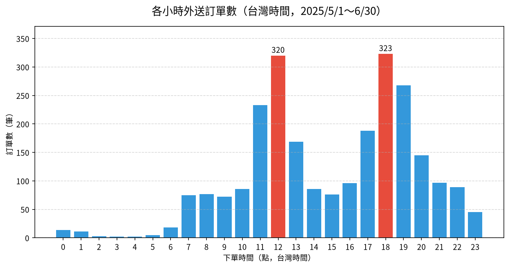

# 📊 08｜外送訂單：先把 UTC 換成台灣時間，再看尖峰時段

[](https://colab.research.google.com/github/roberthsu2003/PythonForDataAnalysis/blob/master/AI%E5%8D%94%E4%BD%9C%E8%B3%87%E6%96%99%E5%88%86%E6%9E%90_12%E5%80%8B%E7%AF%84%E4%BE%8B/08_delivery_time/lesson.ipynb) 👉 **[開啟本例筆記本 lesson.ipynb](./lesson.ipynb)**

| [⬅️ 07 健身房會員](../07_gym_groupby/README.md) | [🏠 範例庫目錄](../README.md) | [09 六城市氣象 ➡️](../09_weather_charts/README.md) |
| :--- | :---: | ---: |

## 📌 本例速覽

| 項目 | 內容 |
| :--- | :--- |
| 所在階段 | 🟡 第三段：數對東西、算對指標 |
| 資料 | `delivery_orders.csv`（2,500 筆，UTC 時間） |
| 一列代表 | 一筆外送訂單 |
| 必做問題 | **一天中幾點訂單最多？** |
| 必做圖表 | 垂直長條圖 |
| 🆕 本例新學 | 時間欄位是 **UTC（世界標準時間）**，比台灣慢 8 小時；直接取「小時」會把午餐尖峰算成凌晨 4 點。要先**轉成台灣時間**，再拆出小時、日期。 |
| 📘 想看懂程式在做什麼？ | 對應程式碼篇：[第 13 章 日期和時間](../../日期和時間/README.md)（時區轉換與 rolling 移動平均） |

### 🎯 完成主線後，你會畫出這張圖



> [!TIP]
> 每一例都用同一套五步驟：**① 欄位貼標籤 ➔ ② 套提問積木 ➔ ③ 邊界檢核 ➔ ④ 選對圖表 ➔ ⑤ 指揮 AI 並驗收**。你負責想問題和檢查答案，程式交給 AI。
> 卡住時，打開 📇 [資料分析速查卡](../../看懂資料與選對圖表/圖解/資料分析速查卡.svg) 對照；Colab 出錯請看 🧯 [常見問題排解](../常見問題排解.md)。

---

## 1️⃣ 本例怎麼學

06 學會把時間變成真正的欄位；但「時間對了嗎？」是另一個問題。很多系統（App、雲端資料庫）一律用 UTC 存時間。如果沒注意，你會得到「外送平台凌晨 4 點最忙」這種荒謬結論——而且程式完全不會報錯。本例的關鍵動作只有一個：**確認時區，再轉換**。

| 已經會的（前面範例學過，直接沿用） | 本例新學的（只多這一步） |
| :--- | :--- |
| 文字日期轉日期格式（03、06） | 辨識結尾的 **Z＝UTC**，轉成 **Asia/Taipei** 台灣時間 |
| 衍生新欄位（02） | 兩個時間相減，衍生「送達分鐘」；從時間拆出「小時」「日期」 |
| 折線圖看趨勢（06） | 每日訂單加上 **7 日移動平均**，看出被特殊日子拉高的走勢 |

**學習路線**（做完一層再往下）：

1. **必做主線（單元一～三）**：發現時間是 UTC、轉成台灣時間，最後用**一張垂直長條圖**回答「一天中哪個時段訂單最多？」。單元三後先停下來驗收。
2. **報表應用（單元四）**：匯出各小時訂單數與占比，作為排班參考。
3. **選做挑戰（單元五～六）**：比較各區送達時間，或觀察每日訂單走勢與特殊節日。

---

## 2️⃣ 資料專案設定：五步 SOP 的前四步

資料：`data/delivery_orders.csv`（請先閱讀[本例資料卡](./data/DATA_CARD.md)）。**一列代表：一筆外送訂單**，共 2,500 筆，期間為台灣時間 2025-05-01～06-30。

### ① 欄位貼標籤
| 欄位名稱 | 資料類型 | 欄位角色 (Data Role) | 說明與規則 |
| :--- | :--- | :--- | :--- |
| **訂單編號** | 文字代碼 | ⚪ **標識 (Identifier)** | 依下單時間排序的流水號，只能計數。 |
| **下單時間_utc** | 文字（ISO 8601） | 🔵 **條件 (Dimension)／時間** | 結尾的 **Z 代表 UTC**；台灣時間＝UTC＋8 小時。 |
| **送達時間_utc** | 文字（ISO 8601） | 🔵 **條件 (Dimension)／時間** | 同樣是 UTC；和下單時間相減得到送達分鐘。 |
| **區域** | 文字（台北市 5 區） | 🔵 **條件 (Dimension)／類別** | 外送目的地所在行政區。 |
| **訂單金額** | 整數（元） | 🟢 **指標 (Metric)** | 每筆訂單的消費金額。 |
| **送達分鐘（需自行計算）** | 數值（分鐘） | 🟢 **衍生指標** | 送達時間 − 下單時間。 |

### ② 套提問積木
- 🎯 **比較（必做）**：以台灣時間來看，一天中哪個小時的訂單最多？
- 🛵 **比較＋分布（選做）**：各區域的送達時間有差別嗎？
- 📈 **趨勢（選做）**：兩個月的每日訂單量怎麼變化？有沒有特別突出的日子？

### ③ 邊界檢核（分析紅線）
- ⚠️ **先確認時區**：時間結尾的 Z 代表 UTC；不轉換就取小時，午餐尖峰會出現在凌晨 3～4 點。
- ⚠️ **日期也會跟著變**：UTC 16:00 之後，在台灣已經是隔天；依日期統計時也要用台灣時間。
- ⚠️ **送達時間不等於外送員效率**：資料沒有距離、天氣、餐廳出餐時間，不能說某區外送員比較慢。
- ⚠️ **特殊日子會拉高走勢**：5/31 端午節訂單特別多，看趨勢時要標出來，不能直接當成成長。

### ④ 選對圖表
- **24 個小時比訂單量** ➔ **垂直長條圖**（小時是有順序的類別，0→23 排列，不可依數量重排；Y 軸從 0 開始）。
- **各區送達分鐘（選做）** ➔ **箱形圖**（多組比較分布）。
- **每日訂單走勢（選做）** ➔ **折線圖**，加上 7 日移動平均線，標出端午節。

---

## 3️⃣ 在 Colab 操作（第 ⑤ 步：指揮 AI 並驗收）

1. **開啟筆記本**：點上方的 Open in Colab 徽章，開啟 [`lesson.ipynb`](./lesson.ipynb)。
2. **執行第 0 步**：點儲存格左側的 ▶，自動下載 `delivery_orders.csv`，並設定繁體中文字型。下載失敗時，請從本例 `data/` 資料夾手動上傳。
3. **一次只問一個單元**：複製該單元的 Prompt，貼到 Colab 右側的 Gemini 對話框；先依序完成單元一至三；主線驗收後，再做單元四的報表，或選做單元五、六。
4. **對照與驗收**：把 AI 的程式和筆記本裡的參考程式對照，執行後檢查表格、圖表與文字說法是否一致。

### ✅ 主線驗收（單元三後先停下來）

- [ ] 能指出時間欄位的 Z 代表 UTC，並說明台灣時間要加 8 小時。
- [ ] 能展示轉換前後的尖峰小時差異，以及有多少筆訂單的「日期」因轉換而改變。
- [ ] 能從長條圖與表格指出台灣時間的兩個尖峰時段，並核對數字一致。

---

## 4️⃣ 各單元任務與 Prompt

> 點「📋 展開 Prompt」即可看到完整指令。每次只複製一個單元貼給 Gemini。

### ✅ 必做主線（單元一、二、三）

#### 單元一｜讀取資料，辨認時間欄位的時區（貼標籤）

> 🎯 **思維重點**：時間欄位看起來像「2025-05-01T03:15:22Z」：T 分隔日期與時間，**Z 代表 UTC**。先看懂格式，再決定怎麼轉換。

<details>
<summary>📋 展開 Prompt（複製貼給 Colab Gemini）</summary>

```text
請幫我用 pandas 讀取 data/delivery_orders.csv：
1. 顯示前 5 筆資料、所有欄位名稱、總列數、資料型態與缺值數。
2. 說明「下單時間_utc」的格式：T 和結尾的 Z 分別代表什麼？台灣時間和 UTC 差幾小時？
3. 用文字說明：一列代表什麼？哪些欄位是標識、條件、指標？
先不要轉換時間，也不要畫圖。
```

</details>

#### 單元二｜邊界檢核：UTC 轉台灣時間，比較轉換前後的尖峰

> 🎯 **思維重點**：先示範「沒轉時區」的錯誤尖峰，再轉成 Asia/Taipei；轉換後拆出小時與日期，並清點日期改變的筆數。

<details>
<summary>📋 展開 Prompt（複製貼給 Colab Gemini）</summary>

```text
請處理時間欄位的時區：
1. 先示範錯誤做法：直接從「下單時間_utc」取出小時，列出訂單最多的前 3 個小時。
2. 正確做法：把下單時間與送達時間解析為 UTC，再轉換成台灣時區（Asia/Taipei），新增「下單時間_台灣」「送達時間_台灣」。
3. 從台灣時間拆出「小時」與「日期」，列出訂單最多的前 3 個小時。
4. 計算有幾筆訂單的日期因為時區轉換而改變（UTC 日期 ≠ 台灣日期），並顯示 3 筆範例。
5. 計算「送達分鐘」＝送達時間 − 下單時間，檢查最小值與最大值是否合理。
不要修改原始 CSV 檔。
```

</details>

#### 單元三｜提問積木【比較】— 一天中哪個時段訂單最多？（必做，垂直長條圖）

> 🎯 **思維重點**：24 個小時是**有順序的類別**，用【垂直長條圖】依 0→23 排列（不能依數量重排）；Y 軸從 0 開始，標題註明「台灣時間」。

<details>
<summary>📋 展開 Prompt（複製貼給 Colab Gemini）</summary>

```text
請用台灣時間的「小時」畫出訂單數的垂直長條圖：
1. 先產出表格：0～23 每個小時的訂單數（沒有訂單的小時也要顯示 0）。
2. X 軸為小時（0～23，依時間順序），Y 軸為訂單數，從 0 開始。
3. 訂單數最多的兩個小時用醒目顏色標示，並在柱子上標註數字。
4. 標題註明「台灣時間」，圖表文字全部使用繁體中文。
```

</details>

### 📄 報表應用（單元四）

#### 單元四｜報表應用 — 匯出各小時訂單數與占比

> 🎯 **思維重點**：排班報表要寫清楚時區；Excel 不支援帶時區的時間，匯出明細前要先轉成一般文字或去除時區資訊。

<details>
<summary>📋 展開 Prompt（複製貼給 Colab Gemini）</summary>

```text
請將時段分析結果匯出成 Excel：
1. 工作表「各小時訂單」：小時（台灣時間）、訂單數、占全部訂單百分比（保留一位小數）。
2. 工作表「訂單明細」：訂單編號、下單時間_台灣、送達時間_台灣、區域、訂單金額、送達分鐘；時間轉成「YYYY-MM-DD HH:MM:SS」文字，避免 Excel 時區問題。
3. 存為 output/外送時段報表.xlsx（若 output 目錄不存在請自動建立），重新讀取核對訂單合計為 2,500。
4. 提供 Colab 下載該 Excel 檔案的程式碼。
```

</details>

### 🚀 選做挑戰（單元五、六）

#### 單元五｜選做挑戰【比較＋分布】— 各區的送達時間（箱形圖）

> 🎯 **思維重點**：比較 5 個區域的送達分鐘「分布」，用【箱形圖】；資料沒有距離與出餐時間，只能描述差異，不能評斷外送員。

<details>
<summary>📋 展開 Prompt（複製貼給 Colab Gemini）</summary>

```text
請比較各區域的「送達分鐘」：
1. 依區域計算訂單數、平均、中位數送達分鐘，依中位數由小到大排序。
2. 畫出箱形圖：X 軸為區域（依中位數排序），Y 軸為送達分鐘。
3. 用文字指出送達時間最長的區域，並說明：資料沒有距離、天氣、出餐時間，不能說該區外送員比較慢。
```

</details>

#### 單元六｜選做挑戰【趨勢】— 每日訂單走勢與 7 日移動平均（折線圖）

> 🎯 **思維重點**：每日訂單受週末影響忽高忽低，**7 日移動平均**能看出整體走勢；特殊日子（端午節）要標出來，避免誤判。

<details>
<summary>📋 展開 Prompt（複製貼給 Colab Gemini）</summary>

```text
請用台灣時間的日期分析每日訂單量：
1. 依台灣日期計算每日訂單數，並計算 7 日移動平均。
2. 畫折線圖：細線為每日訂單數、粗線為 7 日移動平均，X 軸為日期，Y 軸從 0 開始，加上圖例。
3. 找出訂單最多的一天並在圖上標註（2025-05-31 為端午節）。
4. 用文字描述兩個月的整體走勢，並提醒：只有兩個月，且節日會拉高移動平均，不能直接推論長期成長。
```

</details>

---

## 5️⃣ 選做延伸：請本機 AI 封裝成自動化腳本

完成單元四的報表並驗證數字後，有餘裕再把 Notebook 中**已驗證**的流程，交給本機 AI 工具（如 Cursor、Windsurf、GitHub Copilot CLI、Antigravity）封裝成可重跑的 `make_report.py`。學生依然不必手寫程式；本資料夾已附一份參考成品，可與 AI 產出的版本比對。

<details>
<summary>📋 展開本機 AI 的 Prompt（在 <code>08_delivery_time</code> 資料夾中使用）</summary>

```text
我已經在 Colab 完成外送訂單時段分析並保存在 lesson.ipynb。請擔任我的 Python 技術助教：
1. 請讀取本目錄下的 lesson.ipynb，將單元一～四已驗證的邏輯封裝為自動化腳本 make_report.py。
2. 腳本規範與功能要求：
   - 定義 load_data(), convert_timezone(), hourly_orders(), export_excel() 等清晰函式。
   - 時間一律以 UTC 解析後轉為 Asia/Taipei；時區設定寫成常數，不可直接取 UTC 的小時。
   - 匯出 output/外送時段報表.xlsx（各小時訂單、訂單明細兩個工作表；明細時間轉成文字）。
   - 檔案路徑以腳本所在位置為基準進行相對定位（避免寫死路徑）；不得修改原始 CSV。
3. 自動執行與驗收：
   - 建立完畢後，請直接在終端機執行：uv run python make_report.py
   - 在終端機印出訂單總數、台灣時間前 3 個尖峰小時、因時區轉換而改變日期的筆數。
```

</details>

<details>
<summary>🖥️ 展開執行結果範例</summary>

AI 助教執行腳本後，你在終端機會看到類似下方的輸出（數字由程式實際算出）：

```text
==================================================
🚀 開始執行外送時段報表腳本...
==================================================

🕒 【時段分析】訂單 2,500 筆（已轉為台灣時間）
  - 18 點：323 筆（12.9%）
  - 12 點：320 筆（12.8%）
  - 19 點：268 筆（10.7%）

📅 因時區轉換而改變日期：130 筆

✅ 成果已成功匯出至：output/外送時段報表.xlsx
==================================================
```

</details>

---

## 🎯 學習驗收清單

完成目前選擇的層次後，檢查自己能不能做到：

- [ ] **必做主線**：能否說明 Z 代表什麼、為什麼要轉時區，並展示轉換前後尖峰時段的差異？
- [ ] **報表應用**：報表是否註明「台灣時間」？匯出的明細時間是否正確？
- [ ] **選做挑戰**：送達時間的區域差異能不能歸咎外送員？端午節對移動平均有什麼影響？

---

| [⬅️ 07 健身房會員](../07_gym_groupby/README.md) | [🏠 範例庫目錄](../README.md) | [09 六城市氣象 ➡️](../09_weather_charts/README.md) |
| :--- | :---: | ---: |
