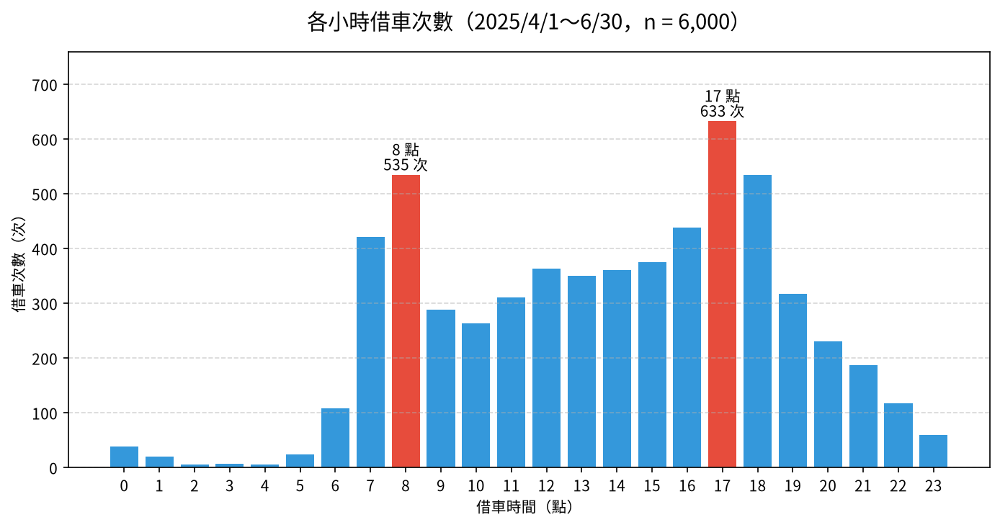

# 📊 12｜共享單車綜合專題：清理決定跟著問題走，最後自己提問

[](https://colab.research.google.com/github/roberthsu2003/PythonForDataAnalysis/blob/master/AI%E5%8D%94%E4%BD%9C%E8%B3%87%E6%96%99%E5%88%86%E6%9E%90_12%E5%80%8B%E7%AF%84%E4%BE%8B/12_bike_capstone/lesson.ipynb) 👉 **[開啟本例筆記本 lesson.ipynb](./lesson.ipynb)**

| [⬅️ 11 業務週報](../11_sales_kpi_style/README.md) | [🏠 範例庫目錄](../README.md) | [13 辦公室資料 ➡️](../13_office_chart_basics/README.md) |
| :--- | :---: | ---: |

## 📌 本例速覽

| 項目 | 內容 |
| :--- | :--- |
| 所在階段 | 🔴 第四段：自己來 |
| 資料 | 騎乘紀錄 ＋ 站點 ＋ 每日天氣 |
| 一列代表 | 一次借還車 |
| 必做問題 | **一天中幾點借車最多？** |
| 必做圖表 | 垂直長條圖 |
| 🆕 本例新學 | 把 01～11 學過的清理技巧整合起來，並學會一件事：**清理決定要跟著問題走**——同一筆問題資料，對某個問題要排除，對另一個問題卻可以保留。最後由你自己提出問題。 |

### 🎯 完成主線後，你會畫出這張圖



> [!TIP]
> 每一例都用同一套五步驟：**① 欄位貼標籤 ➔ ② 套提問積木 ➔ ③ 邊界檢核 ➔ ④ 選對圖表 ➔ ⑤ 指揮 AI 並驗收**。你負責想問題和檢查答案，程式交給 AI。
> 卡住時，打開 📇 [資料分析速查卡](../../看懂資料與選對圖表/圖解/資料分析速查卡.svg) 對照；Colab 出錯請看 🧯 [常見問題排解](../常見問題排解.md)。

---

## 1️⃣ 本例怎麼學

這是總整專題。資料同時有：重複紀錄（04）、時間填反與超長騎乘（10 的異常值）、缺值（01）、要合併的天氣檔（05）、要拆出小時與日期的時間（08）、要注意分母的比較（03、07、11）。你不必每一個都「清掉」：例如忘了還車的 8 筆，騎乘時間不可信，但「借車那一刻」仍是真實的。本例用一張**清理決策表**寫下每個決定影響哪些分析，最後請你**自己提出一個問題**並完整走完五步 SOP。

| 已經會的（前面範例學過，直接沿用） | 本例新學的（只多這一步） |
| :--- | :--- |
| 去重複（04）、異常值（10）、缺值（01）、時間拆解（08） | 用**清理決策表**記錄：問題、筆數、處理方式、影響哪些分析 |
| 多表合併（05）、分母（03、07、11） | 合併天氣後比較「**每日平均**騎乘次數」，分母是天數 |
| 依問題選圖（09） | **自己提出問題**：寫提問卡，再請 AI 執行與驗收 |

**學習路線**（做完一層再往下）：

1. **必做主線（單元一～三）**：讀入三個檔案、完成清理決策表，最後用**一張垂直長條圖**回答「一天中哪個時段借車最多？」。單元三後先停下來驗收。
2. **報表應用（單元四）**：匯出清理決策表、各小時借車數與清理後資料。
3. **選做挑戰（單元五～七）**：比較平日與週末、合併天氣檔比較晴雨，最後**自己提出一個問題**完成專題。

---

## 2️⃣ 資料專案設定：五步 SOP 的前四步

資料：`data/bike_trips.csv`（騎乘紀錄）、`data/stations.csv`（站點）、`data/weather_daily.csv`（每日天氣）。請先閱讀[本例資料卡](./data/DATA_CARD.md)。**騎乘檔的一列代表：一次借還車紀錄**（2025-04-01～06-30）；站點檔一列是一個站，天氣檔一列是一天。

### ① 欄位貼標籤
| 欄位名稱 | 資料類型 | 欄位角色 (Data Role) | 說明與規則 |
| :--- | :--- | :--- | :--- |
| **騎乘編號** | 文字代碼 | ⚪ **標識 (Identifier)** | 重複送出的紀錄編號相同，可用來檢查重複。 |
| **借車站、還車站** | 文字代碼 | ⚪ **標識（對照鑰匙）** | 對應 stations.csv 的站點代碼；還車站有 60 筆空白。 |
| **借車時間、還車時間** | 文字日期時間 | 🔵 **條件 (Dimension)／時間** | 台灣時間；有 25 筆兩個時間被填反。 |
| **使用者類型** | 文字（2 類） | 🔵 **條件 (Dimension)／類別** | 會員、單次。 |
| **年齡層** | 文字（5 組） | 🔵 **條件 (Dimension)／類別** | 18-24 … 55+。 |
| **站名、行政區（站點檔）** | 文字 | 🔵 **條件 (Dimension)／類別** | 由站點代碼對應而來。 |
| **車位數（站點檔）** | 整數（個） | 🟢 **指標 (Metric)** | 站點規模。 |
| **天氣、最高溫、降雨量（天氣檔）** | 類別／°C／毫米 | 🔵 條件／🟢 指標 | 用「日期」與騎乘紀錄合併。 |
| **騎乘分鐘（需自行計算）** | 數值（分鐘） | 🟢 **衍生指標** | 還車時間 − 借車時間；有 8 筆超過 2 天。 |

### ② 套提問積木
- 🎯 **比較（必做）**：一天中哪個時段借車最多？
- 📅 **比較＋分母（選做）**：平日與週末，每天各時段的平均借車數有何不同？
- 🌧️ **比較＋合併（選做）**：晴天、多雲、雨天的每日平均騎乘次數差多少？
- 🙋 **自行提問（選做）**：用五步 SOP 提出並回答你自己的問題。

### ③ 邊界檢核（分析紅線）
- ⚠️ **先去重複**：20 筆完全重複的紀錄要刪除，以下所有筆數都以去重複後為準。
- ⚠️ **時間填反**：25 筆還車時間早於借車時間；本例判斷為兩欄填反，**對調並記錄**，而不是刪除。
- ⚠️ **清理決定跟著問題走**：8 筆騎乘超過 2 天（忘了還車）——算「騎乘時間」時要排除，算「借車時段」時可以保留；60 筆還車站空白——只影響「還車站」相關分析。
- ⚠️ **比較要用相同分母**：平日天數比週末多、雨天和晴天的天數也不同；比較時要用「每日平均」，不是總次數。
- ⚠️ **天氣不是唯一原因**：雨天騎乘較少，但雨天也可能剛好落在平日；只能說「同時出現」，不能直接說「下雨造成減少多少」。

### ④ 選對圖表
- **24 個小時比借車數** ➔ **垂直長條圖**（小時依 0→23 排列；標出早晚兩個尖峰）。
- **平日 vs 週末各小時平均（選做）** ➔ **折線圖**（兩條線，X 軸為小時；比較的是每日平均）。
- **三種天氣的每日平均騎乘（選做）** ➔ **垂直長條圖**（標出各天氣的天數 n）。
- **自行提問（選做）** ➔ 依你的問題類型，用「看懂資料與選對圖表」的規則自己決定。

---

## 3️⃣ 在 Colab 操作（第 ⑤ 步：指揮 AI 並驗收）

1. **開啟筆記本**：點上方的 Open in Colab 徽章，開啟 [`lesson.ipynb`](./lesson.ipynb)。
2. **執行第 0 步**：點儲存格左側的 ▶，自動下載 `bike_trips.csv`、`stations.csv`、`weather_daily.csv` 三個檔案，並設定繁體中文字型。下載失敗時，請從本例 `data/` 資料夾手動上傳。
3. **一次只問一個單元**：複製該單元的 Prompt，貼到 Colab 右側的 Gemini 對話框；先依序完成單元一至三；主線驗收後，再做單元四的報表，或選做單元五～七。
4. **對照與驗收**：把 AI 的程式和筆記本裡的參考程式對照，執行後檢查表格、圖表與文字說法是否一致。

### ✅ 主線驗收（單元三後先停下來）

- [ ] 能說出三個檔案各自「一列代表什麼」，以及騎乘資料的四種問題（重複、時間填反、超長騎乘、還車站空白）。
- [ ] 能用清理決策表說明每個問題的筆數、處理方式，以及它會影響哪些分析、不影響哪些分析。
- [ ] 能從長條圖與表格指出早晚兩個借車尖峰，並核對數字一致。

---

## 4️⃣ 各單元任務與 Prompt

> 點「📋 展開 Prompt」即可看到完整指令。每次只複製一個單元貼給 Gemini。

### ✅ 必做主線（單元一、二、三）

#### 單元一｜讀取三個檔案，盤點資料問題（貼標籤）

> 🎯 **思維重點**：先盤點，不急著清：重複幾筆？時間填反幾筆？超長騎乘幾筆？缺值在哪裡？每個檔案一列代表什麼？

<details>
<summary>📋 展開 Prompt（複製貼給 Colab Gemini）</summary>

```text
請幫我用 pandas 讀取 data/ 中的 bike_trips.csv、stations.csv、weather_daily.csv：
1. 每個檔案顯示前 3 列、列數、欄位名稱與缺值數，並說明「一列代表什麼」。
2. 在騎乘資料中檢查：完全重複的列有幾筆？「騎乘編號」重複幾筆？
3. 把借車時間、還車時間轉成日期時間格式，計算騎乘分鐘；統計騎乘分鐘小於 0 與超過 2 天（2,880 分鐘）的筆數。
4. 用文字回報欄位角色（標識、條件、指標），並列出你發現的資料問題清單。
先不要修改資料，也不要畫圖。
```

</details>

#### 單元二｜邊界檢核：做出清理決策表，決定跟著問題走

> 🎯 **思維重點**：不是「全部清掉」：每個問題都寫下筆數、處理方式、會影響哪些分析。重複要刪、填反要對調、超長騎乘與還車站空白先「標記」，等到需要的問題再排除。

<details>
<summary>📋 展開 Prompt（複製貼給 Colab Gemini）</summary>

```text
請依下列規則清理騎乘資料（不要修改原始檔），並做一張「清理決策表」：
1. 刪除完全重複的列，印出處理前後筆數。
2. 還車時間早於借車時間的紀錄，判斷為兩欄填反：把兩個時間對調，並新增「時間已對調」欄位標記。
3. 重新計算騎乘分鐘；超過 2 天（2,880 分鐘）的紀錄不刪除，新增「超長騎乘」欄位標記。
4. 還車站空白的紀錄不刪除，保留缺值。
5. 從借車時間拆出「借車小時」與「借車日期」。
6. 清理決策表欄位：資料問題、筆數、處理方式、影響的分析、不影響的分析。
```

</details>

#### 單元三｜提問積木【比較】— 一天中哪個時段借車最多？（必做，垂直長條圖）

> 🎯 **思維重點**：24 個小時依時間順序排列，用【垂直長條圖】；借車時段不受「超長騎乘」影響，這 8 筆可以保留。早、晚各標出一個尖峰。

<details>
<summary>📋 展開 Prompt（複製貼給 Colab Gemini）</summary>

```text
請用清理後的資料，畫出各「借車小時」借車次數的垂直長條圖：
1. 先產出 0～23 點的借車次數表（沒有借車的小時也顯示 0）。
2. X 軸為借車小時（0～23，依時間順序），Y 軸為借車次數，從 0 開始。
3. 分別找出上午（0～11 點）與下午（12～23 點）借車最多的小時，用醒目顏色標示並標註次數。
4. 標題寫出資料期間與筆數，圖表文字全部使用繁體中文。
5. 在註解說明：為什麼這個問題不需要排除超長騎乘與還車站空白的紀錄？
```

</details>

### 📄 報表應用（單元四）

#### 單元四｜報表應用 — 匯出清理決策表、各小時借車數與清理後資料

> 🎯 **思維重點**：專題報告要讓別人能重現：清理決策表放在第一個工作表，接著是結果與清理後資料。

<details>
<summary>📋 展開 Prompt（複製貼給 Colab Gemini）</summary>

```text
請將專題成果匯出成 Excel：
1. 存為 output/共享單車專題.xlsx（若 output 目錄不存在請自動建立）。
2. 工作表依序為：「清理決策表」「各小時借車數」「清理後騎乘」（含時間已對調、超長騎乘、騎乘分鐘、借車小時等欄位）。
3. 匯出後重新讀取，核對清理後騎乘為 6,000 筆、各小時借車數合計也是 6,000。
4. 提供 Colab 下載該 Excel 檔案的程式碼。
```

</details>

### 🚀 選做挑戰（單元五、六、七）

#### 單元五｜選做挑戰【比較＋分母】— 平日與週末的借車時段（折線圖）

> 🎯 **思維重點**：平日有 65 天、週末只有 26 天，直接比總次數不公平；改成「每日平均借車數」（分母＝天數），再用兩條折線比較形狀。

<details>
<summary>📋 展開 Prompt（複製貼給 Colab Gemini）</summary>

```text
請比較平日與週末各小時的借車情形：
1. 依借車日期判斷平日（週一～週五）或週末（週六、週日）。
2. 用天氣檔的日期當作完整日曆，計算平日與週末各有幾天。
3. 計算「各小時每日平均借車數」＝該類日子在該小時的借車次數 ÷ 該類日子的天數。
4. 畫折線圖：X 軸為 0～23 點，兩條線分別代表平日與週末，Y 軸從 0 開始，圖例寫出天數。
5. 用文字描述兩條線的形狀差異（例如通勤雙峰 vs 午後單峰）。
```

</details>

#### 單元六｜選做挑戰【比較＋合併】— 晴天、多雲、雨天的每日平均騎乘（垂直長條圖）

> 🎯 **思維重點**：天氣在另一個檔案，要先用「日期」合併；三種天氣的天數不同，比較的是每日平均。再檢查各天氣中週末的比例，避免把週末效果誤當成天氣效果。

<details>
<summary>📋 展開 Prompt（複製貼給 Colab Gemini）</summary>

```text
請合併天氣資料，比較不同天氣的騎乘量：
1. 依借車日期計算每日騎乘次數，與 weather_daily.csv 用日期合併（以天氣檔為主，沒有騎乘的日子算 0）；印出合併前後天數。
2. 依天氣計算：天數、每日平均騎乘次數、其中週末天數的比例。
3. 畫垂直長條圖：X 軸為天氣（晴、多雲、雨），Y 軸為每日平均騎乘次數，從 0 開始，柱子上標註平均值與天數 n。
4. 用文字說明雨天平均少了多少，並提醒：天氣不是唯一因素，不能直接說「下雨造成減少 X%」。
```

</details>

#### 單元七｜選做挑戰【自行提問】— 用五步 SOP 回答你自己的問題

> 🎯 **思維重點**：換你當分析師：先填好「提問卡」，再請 AI 執行。下方參考程式示範一個例子：「會員與單次使用者，每次騎多久？」——這個問題就**必須排除**超長騎乘。

<details>
<summary>📋 展開 Prompt（複製貼給 Colab Gemini）</summary>

```text
請先在下方填好提問卡，再把整段貼給 AI：
【提問卡】
- 我的問題：＿＿＿＿＿＿（例如：會員與單次使用者，每次騎乘時間有什麼不同？）
- 問題類型：比較／組成／分布／關係／趨勢（選一個）
- 需要的欄位與角色：＿＿＿＿＿＿
- 需要排除或特別處理的資料（參考清理決策表）：＿＿＿＿＿＿
- 選擇的圖表與理由：＿＿＿＿＿＿
- 這份資料「不能」回答的延伸推論：＿＿＿＿＿＿

請依提問卡使用清理後的 rides 資料：先產出回答問題的數字表，再畫圖；圖表使用繁體中文並標示單位與樣本數；最後用三句話說明：結論、資料限制、不能推論的事。
```

</details>

---

## 5️⃣ 選做延伸：請本機 AI 封裝成自動化腳本

完成單元四的報表並驗證數字後，有餘裕再把 Notebook 中**已驗證**的流程，交給本機 AI 工具（如 Cursor、Windsurf、GitHub Copilot CLI、Antigravity）封裝成可重跑的 `make_report.py`。學生依然不必手寫程式；本資料夾已附一份參考成品，可與 AI 產出的版本比對。

<details>
<summary>📋 展開本機 AI 的 Prompt（在 <code>12_bike_capstone</code> 資料夾中使用）</summary>

```text
我已經在 Colab 完成共享單車綜合專題並保存在 lesson.ipynb。請擔任我的 Python 技術助教：
1. 請讀取本目錄下的 lesson.ipynb，將單元一～四已驗證的清理與分析邏輯封裝為自動化腳本 make_report.py。
2. 腳本規範與功能要求：
   - 定義 load_data(), clean_rides(), build_decisions(), hourly_counts(), export_excel() 等清晰函式。
   - 依清理決策表處理：刪除完全重複、時間填反對調並標記、超長騎乘（> 2 天）與還車站空白「標記但不刪除」。
   - 匯出 output/共享單車專題.xlsx（清理決策表、各小時借車數、清理後騎乘三個工作表）。
   - 檔案路徑以腳本所在位置為基準進行相對定位（避免寫死路徑）；不得修改原始檔。
3. 自動執行與驗收：
   - 建立完畢後，請直接在終端機執行：uv run python make_report.py
   - 在終端機印出清理決策表摘要、清理後筆數、早晚借車尖峰。
```

</details>

<details>
<summary>🖥️ 展開執行結果範例</summary>

AI 助教執行腳本後，你在終端機會看到類似下方的輸出（數字由程式實際算出）：

```text
==================================================
🚀 開始執行共享單車綜合專題腳本...
==================================================

🧹 【清理決策表】原始 6,020 筆 → 清理後 6,000 筆
  - 完全重複的紀錄：20 筆 → 刪除
  - 還車時間早於借車時間：25 筆 → 判斷為填反，對調並標記
  - 騎乘超過 2 天：8 筆 → 保留並標記
  - 還車站空白：60 筆 → 保留缺值

🚲 【借車尖峰】
  - 早上：8 點（535 次）；傍晚：17 點（633 次）

✅ 成果已成功匯出至：output/共享單車專題.xlsx
==================================================
```

</details>

---

## 🎯 學習驗收清單

完成目前選擇的層次後，檢查自己能不能做到：

- [ ] **必做主線**：清理決策表是否寫出每個問題的筆數、處理方式與影響範圍？借車尖峰是否與表格一致？
- [ ] **報表應用**：Excel 第一個工作表是否為清理決策表，讓別人可以重現你的分析？
- [ ] **選做挑戰**：比較平日／週末、晴雨時，是否使用每日平均？你的自行提問是否完整走完五步 SOP？

---

| [⬅️ 11 業務週報](../11_sales_kpi_style/README.md) | [🏠 範例庫目錄](../README.md) | [13 辦公室資料 ➡️](../13_office_chart_basics/README.md) |
| :--- | :---: | ---: |
