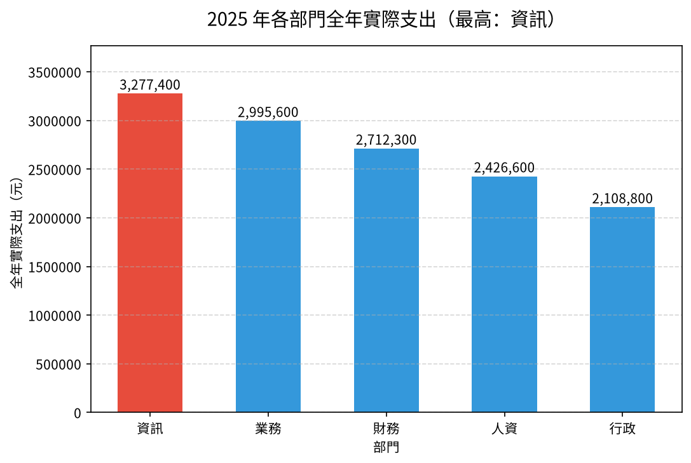

# 📊 13｜辦公室資料：五種提問的整合練習

[](https://colab.research.google.com/github/roberthsu2003/PythonForDataAnalysis/blob/master/AI%E5%8D%94%E4%BD%9C%E8%B3%87%E6%96%99%E5%88%86%E6%9E%90_12%E5%80%8B%E7%AF%84%E4%BE%8B/13_office_chart_basics/lesson.ipynb) 👉 **[開啟本例筆記本 lesson.ipynb](./lesson.ipynb)**

| [⬅️ 12 共享單車](../12_bike_capstone/README.md) | [🏠 範例庫目錄](../README.md) | [14 法務部公開統計 ➡️](../14_moj_public_data/README.md) |
| :--- | :---: | ---: |

## 📌 本例速覽

| 項目 | 內容 |
| :--- | :--- |
| 所在階段 | 🔴 第四段：自己來 |
| 資料 | 前一章的辦公室 Excel（多張表）＋ 採購明細 |
| 一列代表 | 每張表都不同，要逐張確認 |
| 必做問題 | **各部門全年實際支出多少？** |
| 必做圖表 | 垂直長條圖 |
| 🆕 本例新學 | 回到前導章節「看懂資料與選對圖表」的辦公室資料，**一個資料集裡有 4 張不同的表**：每換一張表都要重新回答「一列代表什麼」，再依問題選出比較、趨勢、組成、分布、關係五種圖。 |

### 🎯 完成主線後，你會畫出這張圖



> [!TIP]
> 每一例都用同一套五步驟：**① 欄位貼標籤 ➔ ② 套提問積木 ➔ ③ 邊界檢核 ➔ ④ 選對圖表 ➔ ⑤ 指揮 AI 並驗收**。你負責想問題和檢查答案，程式交給 AI。
> 卡住時，打開 📇 [資料分析速查卡](../../看懂資料與選對圖表/圖解/資料分析速查卡.svg) 對照。

---

## 1️⃣ 本例怎麼學

這份資料你在「看懂資料與選對圖表」已經見過，當時是**只動腦、不寫程式**地練習選圖。學完 01～12 後，現在請你指揮 AI 把當時的想法真的做出來。五種提問各用一張不同的表回答——重點不是畫出五張圖，而是每一張圖都能說出：用哪張表、一列代表什麼、分母是什麼、為什麼選這種圖。

| 已經會的（前面範例學過，直接沿用） | 本例新學的（只多這一步） |
| :--- | :--- |
| 五種問題類型與選圖規則（前導章節） | 用 AI 把五種問題**實際做成圖**，並逐張驗收 |
| 一列代表什麼（01～12） | 同一個 Excel 有多張工作表，**每張表的觀測單位都不同**，不能未核對就混用 |
| 組成要寫分母、期間要核對（03、05、11） | 採購明細混入 **2024 年的資料**，計算 2025 年占比前要先排除 |

**學習路線**（做完一層再往下）：

1. **必做主線（單元一～三）**：讀入所有工作表、說出各自一列代表什麼，最後用**一張垂直長條圖**回答「各部門全年實際支出多少？」。單元三後先停下來驗收。
2. **報表應用（單元四）**：匯出部門全年支出表（預算、實際、執行率、每人支出）。
3. **選做挑戰（單元五～八）**：趨勢、組成、分布、關係各一題，可以只挑一兩題做。

---

## 2️⃣ 資料專案設定：五步 SOP 的前四步

資料：`data/辦公室圖表練習資料.xlsx`（工作表「部門月報」「員工問卷」「專案工時」等）與 `data/辦公室採購明細.csv`，來自前導章節的[學生素材](../../看懂資料與選對圖表/學生素材/)，請先閱讀[本例資料卡](./data/DATA_CARD.md)。**每張表的一列都不同**：部門月報＝一部門一個月、員工問卷＝一位員工、專案工時＝一個專案、採購明細＝一筆採購。

### ① 欄位貼標籤
| 欄位名稱 | 資料類型 | 欄位角色 (Data Role) | 說明與規則 |
| :--- | :--- | :--- | :--- |
| **部門月報：月份、部門** | 日期／文字 | 🔵 **條件 (Dimension)** | 一列是「一個部門的一個月」：5 部門 × 12 個月＝60 列，不是 60 個部門。 |
| **部門月報：預算（元）、實際支出（元）** | 整數（元） | 🟢 **指標 (Metric)** | 可依部門加總成全年；執行率＝實際 ÷ 預算。 |
| **部門月報：人數** | 整數（人） | 🟢 **指標（分母）** | 每月相同；計算「每人支出」的分母，不能 12 個月加總。 |
| **員工問卷：員工代號** | 文字代碼 | ⚪ **標識 (Identifier)** | 一列一位員工，只能計數。 |
| **員工問卷：通勤時間（分鐘）** | 整數（分鐘） | 🟢 **指標 (Metric)** | 看分布。 |
| **專案工時：專案編號** | 文字代碼 | ⚪ **標識 (Identifier)** | 一列一個專案，只能計數。 |
| **專案工時：預估工時、實際工時** | 整數（小時） | 🟢 **指標 (Metric)** | 成對數值，看關係。 |
| **採購明細：日期、類別** | 日期／文字 | 🔵 **條件 (Dimension)** | 有 4 筆日期是 2024-12-31，不屬於 2025 年。 |
| **採購明細：金額（元）** | 整數（元） | 🟢 **指標 (Metric)** | 計算類別占比的分子；分母是 2025 年採購總額。 |

### ② 套提問積木
- 🎯 **比較（必做）**：各部門 2025 年全年實際支出多少？哪個部門最高？
- 📈 **趨勢（選做）**：全公司每月實際支出如何變化？
- 🧩 **組成（選做）**：2025 年採購金額中，各類別各占多少？
- 📊 **分布（選做）**：員工通勤時間大多落在幾分鐘？
- 🔗 **關係（選做）**：專案的預估工時與實際工時是否同步？

### ③ 邊界檢核（分析紅線）
- ⚠️ **60 列不是 60 個部門**：部門月報是 5 個部門 × 12 個月；全年支出要依部門加總。
- ⚠️ **人數不能加總**：每月人數相同，12 個月加總會得到 12 倍；每人支出＝全年支出 ÷ 人數。
- ⚠️ **不同工作表不能直接混用**：問卷、專案、月報的一列意義不同，沒有共同鑰匙前不能合併。
- ⚠️ **組成要先確認期間與分母**：採購明細有 4 筆 2024-12-31 的資料；算 2025 年占比要先排除，並寫明分母。
- ⚠️ **關係不推因果、資料不代表真實組織**：預估與實際工時高度相關，不代表「估得準造成做得快」；本資料為教學用合成資料。

### ④ 選對圖表
- **5 個部門比全年支出** ➔ **垂直長條圖**（Y 軸從 0 開始，單位元）。
- **12 個月走勢（選做）** ➔ **折線圖**（X 軸月份由早到晚）。
- **5 個採購類別占比（選做）** ➔ **百分比堆疊長條圖**（類別超過 4 個，不用圓餅圖；寫明分母）。
- **通勤時間分布（選做）** ➔ **直方圖**（加平均與中位數線）。
- **預估 vs 實際工時（選做）** ➔ **散佈圖**（點不連線，加上「預估＝實際」參考線）。

---

## 3️⃣ 在 Colab 操作（第 ⑤ 步：指揮 AI 並驗收）

1. **開啟筆記本**：點上方的 Open in Colab 徽章，開啟 [`lesson.ipynb`](./lesson.ipynb)。
2. **執行第 0 步**：點儲存格左側的 ▶，自動下載 `辦公室圖表練習資料.xlsx` 與 `辦公室採購明細.csv`（前導章節學生素材），並設定繁體中文字型。下載失敗時，請從本例 `data/` 資料夾手動上傳。
3. **一次只問一個單元**：複製該單元的 Prompt，貼到 Colab 右側的 Gemini 對話框；先依序完成單元一至三；主線驗收後，再做單元四的報表，或從單元五～八挑題選做。
4. **對照與驗收**：把 AI 的程式和筆記本裡的參考程式對照，執行後檢查表格、圖表與文字說法是否一致。

### ✅ 主線驗收（單元三後先停下來）

- [ ] 能說出部門月報、員工問卷、專案工時、採購明細四張表「一列代表什麼」，並說明 60 列不是 60 個部門。
- [ ] 能展示依部門加總後只剩 5 列，長條圖與表格的全年實際支出一致；圖的數值軸從 0 開始。
- [ ] 能用一句話解釋：為什麼「人數」不能和支出一樣 12 個月加總？

---

## 4️⃣ 各單元任務與 Prompt

> 點「📋 展開 Prompt」即可看到完整指令。每次只複製一個單元貼給 Gemini。

### ✅ 必做主線（單元一、二、三）

#### 單元一｜讀取所有工作表，說出每張表一列代表什麼（貼標籤）

> 🎯 **思維重點**：一個 Excel 有多張工作表、每張表的觀測單位都不同。先全部列出來，再逐張說出「一列代表什麼」。

<details>
<summary>📋 展開 Prompt（複製貼給 Colab Gemini）</summary>

```text
請幫我用 pandas 讀取 data/辦公室圖表練習資料.xlsx 的「所有」工作表，以及 data/辦公室採購明細.csv：
1. 列出 Excel 中所有工作表名稱。
2. 針對「部門月報」「員工問卷」「專案工時」與採購明細，各顯示前 3 列、列數與欄位名稱。
3. 用文字說明每張表「一列代表什麼」；部門月報有幾個部門、幾個月份？
4. 逐張標記欄位角色：標識、條件、指標。
先不要合併，也不要畫圖。
```

</details>

#### 單元二｜邊界檢核：依部門加總，人數不能跨月加總

> 🎯 **思維重點**：全年支出要「依部門加總 12 個月」；人數每月都一樣，是分母不是可加總的量。順便計算執行率（實際 ÷ 預算）與每人支出。

<details>
<summary>📋 展開 Prompt（複製貼給 Colab Gemini）</summary>

```text
請用「部門月報」整理各部門 2025 年全年數字：
1. 確認每個部門都有 12 個月份、每個部門的人數是否每月相同。
2. 依部門加總預算與實際支出；人數取每月的值（不要加總），並在註解說明原因。
3. 計算：差異＝實際 − 預算、預算執行率＝實際 ÷ 預算、每人全年支出＝實際 ÷ 人數。
4. 整理成表格，依全年實際支出由高到低排序；金額加千分位，執行率用百分比。
```

</details>

#### 單元三｜提問積木【比較】— 各部門全年實際支出多少？（必做，垂直長條圖）

> 🎯 **思維重點**：5 個部門比高低，部門名稱短，用【垂直長條圖】；Y 軸從 0 開始、單位元，最高的部門用醒目顏色。

<details>
<summary>📋 展開 Prompt（複製貼給 Colab Gemini）</summary>

```text
請用上一步的表畫出各部門「全年實際支出」的垂直長條圖：
1. X 軸為部門，Y 軸為全年實際支出（元），從 0 開始，依金額由高到低排列。
2. 柱子上方標註金額（千分位）。
3. 全年實際支出最高的部門用醒目顏色標示，寫在標題中。
4. 圖表標題、座標軸全部使用繁體中文，並註明資料期間 2025 年。
```

</details>

### 📄 報表應用（單元四）

#### 單元四｜報表應用 — 匯出部門全年支出表

> 🎯 **思維重點**：報表同時放「總額」與「每人支出」：總額回答「誰花最多」，每人支出回答「規模相同時誰花得多」。

<details>
<summary>📋 展開 Prompt（複製貼給 Colab Gemini）</summary>

```text
請將部門全年支出表匯出成 Excel：
1. 欄位：部門、人數、全年預算、全年實際支出、差異、預算執行率、每人全年支出。
2. 存為 output/部門全年支出.xlsx（若 output 目錄不存在請自動建立）。
3. 匯出後重新讀取，核對全年實際支出合計等於部門月報實際支出的總和。
4. 用一句話說明：依「每人全年支出」排序，第一名還是同一個部門嗎？
5. 提供 Colab 下載該 Excel 檔案的程式碼。
```

</details>

### 🚀 選做挑戰（單元五、六、七、八）

#### 單元五｜選做挑戰【趨勢】— 全公司每月實際支出（折線圖）

> 🎯 **思維重點**：「時間 ＋ 指標」看變化，用【折線圖】；先依月份加總 5 個部門。各月差距只有約 1 成，Y 軸從 0 開始可以避免誇大起伏。

<details>
<summary>📋 展開 Prompt（複製貼給 Colab Gemini）</summary>

```text
請用部門月報分析全公司每月實際支出：
1. 依月份加總 5 個部門的實際支出，月份由早到晚排序。
2. 畫折線圖：X 軸為 1月～12月，Y 軸為實際支出（元），從 0 開始，每個點加上圓點；標出最高與最低的月份。
3. 用文字說明：最高與最低月份差多少（金額與百分比）？只有一年資料，能不能說有季節性？
```

</details>

#### 單元六｜選做挑戰【組成】— 2025 年採購金額的類別占比（百分比堆疊長條圖）

> 🎯 **思維重點**：組成要先確認**期間**與**分母**：採購明細有 4 筆 2024-12-31 的資料，排除後才是 2025 年；分母是 2025 年採購總額。類別有 5 個，用百分比堆疊長條圖，不用圓餅圖。

<details>
<summary>📋 展開 Prompt（複製貼給 Colab Gemini）</summary>

```text
請分析 2025 年採購金額的類別組成：
1. 把採購明細的日期轉成日期格式，列出不是 2025 年的紀錄並排除，印出排除前後筆數。
2. 依類別加總 2025 年的金額，計算占 2025 年採購總額的百分比（保留一位小數），由大到小排序。
3. 畫一根水平的百分比堆疊長條圖（總和 100%），每段標示類別與百分比；標題寫明「分母＝2025 年採購總額 X 元」。
4. 說明為什麼這裡不用圓餅圖。
```

</details>

#### 單元七｜選做挑戰【分布】— 員工通勤時間大多多久？（直方圖）

> 🎯 **思維重點**：單一指標看集中區間，用【直方圖】；一列是一位員工，員工代號只能計數。

<details>
<summary>📋 展開 Prompt（複製貼給 Colab Gemini）</summary>

```text
請用「員工問卷」分析通勤時間：
1. 計算通勤時間（分鐘）的描述統計（人數、平均、中位數、四分位數、最小、最大）。
2. 畫直方圖：X 軸為通勤時間（分鐘，每 10 分鐘一組），Y 軸為人數，加上平均線與中位數線。
3. 標題寫出人數 n，用數字描述通勤時間主要集中的區間。
```

</details>

#### 單元八｜選做挑戰【關係】— 預估工時與實際工時同步嗎？（散佈圖）

> 🎯 **思維重點**：兩個成對數值看連動，用【散佈圖】（點不連線）；加一條「預估＝實際」的參考線，線上方的點代表實際做得比預估久。

<details>
<summary>📋 展開 Prompt（複製貼給 Colab Gemini）</summary>

```text
請用「專案工時」分析預估工時與實際工時的關係：
1. 畫散佈圖：X 軸為預估工時、Y 軸為實際工時（小時），每個點代表一個專案，點不要連線。
2. 加上一條「預估＝實際」的虛線參考線。
3. 計算皮爾森相關係數並顯示在標題；統計有幾個專案實際工時超過預估。
4. 用文字解讀關聯強弱，並附註：相關不等於因果，也不能用來評價個人能力。
```

</details>

---

## 5️⃣ 選做延伸：請本機 AI 封裝成自動化腳本

完成單元四的報表並驗證數字後，有餘裕再把 Notebook 中**已驗證**的流程，交給本機 AI 工具（如 Cursor、Windsurf、GitHub Copilot CLI、Antigravity）封裝成可重跑的 `make_report.py`。學生依然不必手寫程式；本資料夾已附一份參考成品，可與 AI 產出的版本比對。

<details>
<summary>📋 展開本機 AI 的 Prompt（在 <code>13_office_chart_basics</code> 資料夾中使用）</summary>

```text
我已經在 Colab 完成辦公室資料五種提問練習並保存在 lesson.ipynb。請擔任我的 Python 技術助教：
1. 請讀取本目錄下的 lesson.ipynb，將單元一～四已驗證的邏輯封裝為自動化腳本 make_report.py。
2. 腳本規範與功能要求：
   - 定義 load_monthly(), summarize_departments(), export_excel() 等清晰函式。
   - 依部門加總預算與實際支出；人數每月相同，取一個月的值，不可加總；計算差異、預算執行率、每人全年支出。
   - 匯出 output/部門全年支出.xlsx，並重新讀取核對全年實際支出合計。
   - 檔案路徑以腳本所在位置為基準進行相對定位（避免寫死路徑）；不得修改原始檔。
3. 自動執行與驗收：
   - 建立完畢後，請直接在終端機執行：uv run python make_report.py
   - 在終端機印出各部門全年實際支出（千分位）、預算執行率與每人全年支出最高的部門。
```

</details>

<details>
<summary>🖥️ 展開執行結果範例</summary>

AI 助教執行腳本後，你在終端機會看到類似下方的輸出（數字由程式實際算出）：

```text
==================================================
🚀 開始執行部門全年支出腳本...
==================================================

🏢 【部門全年實際支出】部門月報 60 列 → 5 個部門
  - 資訊： 3,277,400 元（執行率 95.4%，每人 71,248 元）
  - 業務： 2,995,600 元（執行率 95.7%，每人 76,810 元）
  - 財務： 2,712,300 元（執行率 96.1%，每人 84,759 元）
  - 人資： 2,426,600 元（執行率 96.4%，每人 97,064 元）
  - 行政： 2,108,800 元（執行率 95.4%，每人 117,156 元）

👤 每人全年支出最高：行政（117,156 元）

✅ 成果已成功匯出至：output/部門全年支出.xlsx
==================================================
```

</details>

---

## 🎯 學習驗收清單

完成目前選擇的層次後，檢查自己能不能做到：

- [ ] **必做主線**：能否說出四張表各自一列代表什麼，並說明 60 列不是 60 個部門、人數為什麼不能加總？
- [ ] **報表應用**：報表是否同時呈現總額與每人支出？兩種排序的第一名一樣嗎？
- [ ] **選做挑戰**：你做的每一張圖，能否說出用哪張表、分母是什麼、為什麼選這種圖？

---

| [⬅️ 12 共享單車](../12_bike_capstone/README.md) | [🏠 範例庫目錄](../README.md) | [14 法務部公開統計 ➡️](../14_moj_public_data/README.md) |
| :--- | :---: | ---: |
