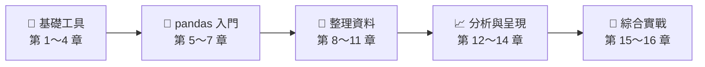

# Python 資料分析

用 **NumPy、pandas、Matplotlib** 把原始資料變成能做決策的報表與圖表。每一章都搭配 AI 協作的方法：學會怎麼向 AI 描述需求，也學會怎麼驗收 AI 的產出。

## 🧭 從哪裡開始？

| 你的情況 | 建議路線 |
| :--- | :--- |
| 想**系統學會**資料分析，看懂每一行程式 | 👉 從下方 [課程地圖](#course-map) 第 1 章依序學習 |
| **不熟悉程式**，想用 AI 完成資料分析 | 👉 [AI 協作資料分析｜十二個範例](./AI協作資料分析_12個範例/README.md)：建好環境後用 prompt 指揮 AI，完成 12 個範例就能走完完整流程 |

> [!TIP]
> 📦 每一章都附有「茶語時光」情境範例 Notebook 與可下載的**學生素材壓縮檔**，請見各章 README 的「學生素材下載」區塊。範例 Notebook 上方有 **Open in Colab** 按鈕，不用安裝也能直接在瀏覽器執行。

<a id="course-map"></a>

## 🗺️ 課程地圖



### 🧱 階段一｜基礎工具

| 章 | 主題 | 你會學到 |
| :---: | :--- | :--- |
| 1 | [Python](https://github.com/roberthsu2003/python) | Python 基礎語法（另一個 repo） |
| 2 | [檔案存取](./檔案存取/README.md) | 讀取 CSV 與 JSON，認識 UTF-8 編碼與中文亂碼 |
| 3 | [繪圖和視覺展示](./繪圖和視覺展示/README.md) | Matplotlib 的畫布結構，折線、長條、直方、圓餅圖 |
| 4 | [Numpy建立與計算](./Numpy建立與計算/README.md) | 用陣列整批計算總和、平均、最高最低與累計 |

### 🐼 階段二｜pandas 入門

| 章 | 主題 | 你會學到 |
| :---: | :--- | :--- |
| 5 | [初見pandas](./初見pandas/README.md) | Series 與 DataFrame，把資料變成「會說話的 Excel 表」 |
| 6 | [pandas的基礎功能](./pandas的基礎功能/README.md) | 選取、排序、排名、批次加工與描述統計 |
| 7 | [pandas的檔案存取](./pandas的檔案存取/README.md) | 一行讀寫 CSV、Excel、JSON、API 與資料庫 |

### 🧹 階段三｜整理資料

| 章 | 主題 | 你會學到 |
| :---: | :--- | :--- |
| 8 | [資料整理和使用前準備](./資料整理和使用前準備/README.md) | 缺值、重複、異常值、型態轉換與字串處理 |
| 9 | [數據整理：連接、合併和重塑](./數據整理_連接_合併_重塑/README.md) | merge、concat、stack／pivot，把表格拼成報表 |
| 10 | [視覺化表格](./視覺化表格/README.md) | 用 Styler 加上千分位、條件標色與資料條 |
| 11 | [群組資料和群組運算](./群組資料和群組運算/README.md) | groupby「分組 → 計算 → 合併」與樞紐分析表 |

### 📈 階段四｜分析與呈現

| 章 | 主題 | 你會學到 |
| :---: | :--- | :--- |
| 12 | [直接使用pandas繪制圖表](./直接使用pandas繪制圖表/README.md) | 表格一行出圖，再用 seaborn 畫統計圖 |
| 13 | [日期和時間](./日期和時間/README.md) | 時間索引、resample、shift、rolling 與時區 |
| 14 | [看懂資料與選對圖表](./看懂資料與選對圖表/README.md) | 判斷欄位類型、選對圖表，並把圖表交給 AI 解讀 |

### 🚀 階段五｜綜合實戰

| 章 | 主題 | 你會學到 |
| :---: | :--- | :--- |
| 15 | [全方面分析](./全方面分析/README.md) | 用台鐵 2023 年進出站資料走完一次完整分析流程 |
| 16 | [資料分析範例](./資料分析範例/README.md) | 政府開放資料、股票、網路紀錄等延伸範例 |

## 🧰 學習資源

| 資源 | 說明 |
| :--- | :--- |
| [AI 協作資料分析｜十二個範例](./AI協作資料分析_12個範例/README.md) | 12 個附資料的 AI 協作範例，從環境建立到綜合專題 |
| [介面工具比較表](./最適合搭配的介面工具比較表.md) | Pandas、NumPy、Matplotlib 最適合搭配的介面工具（Streamlit 等） |
| [學生素材產生器](./tools/build_student_materials.py) | 各章「茶語時光」範例 Notebook 與素材壓縮檔的產生程式 |

## 💻 在自己的電腦上執行

```bash
git clone https://github.com/roberthsu2003/PythonForDataAnalysis.git
cd PythonForDataAnalysis
python -m venv .venv
# macOS：source .venv/bin/activate
# Windows：.venv\Scripts\activate
pip install -r requirements.txt jupyter
```

用 VS Code 開啟資料夾，執行 Notebook 時選擇專案內的 `.venv` 當作 kernel。
