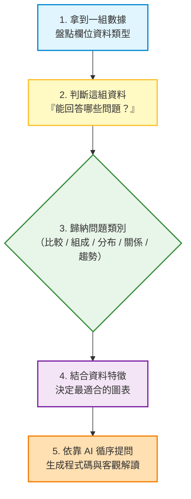
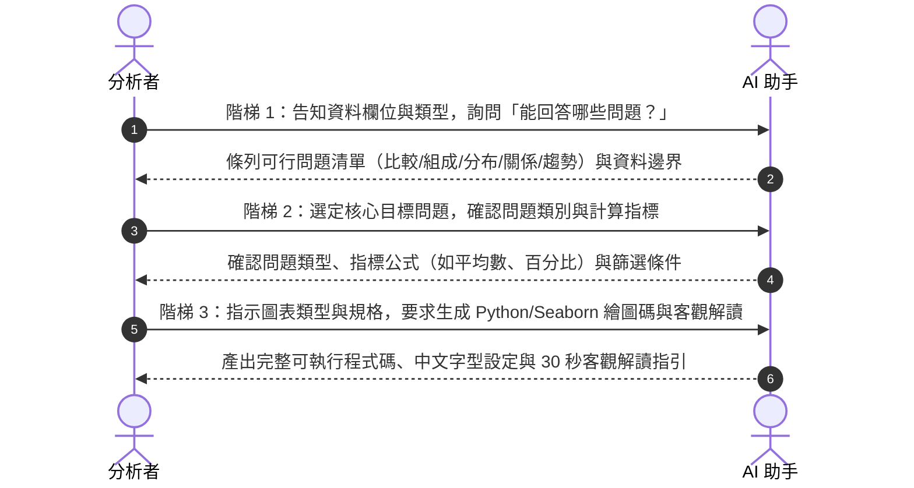

# 📊 看懂資料與選對圖表：從資料欄位到 AI 協作選圖指南

> [!IMPORTANT]
> **這一章給一般辦公室人員與分析初學者。** 不必先會寫程式，也不必先懂高深統計。你只要能打開 Excel 或數據表，跟著本章建立標準思維順序：
> **「檢驗欄位類型 ➔ 找出能回答的問題 ➔ 歸納問題類別 ➔ 決定最佳圖表 ➔ 循序引導 AI 協作」**。
> 當思維框架建立後，你就能指揮 AI 產出具備洞察力且符合商業規範的視覺化圖表！

---

## 🧭 選圖思維與 AI 協作全景流程

在動手畫圖或向 AI 提問前，請先建立這套由上而下的思考順序：



[](https://colab.research.google.com/github/roberthsu2003/PythonForDataAnalysis/blob/master/%E7%9C%8B%E6%87%82%E8%B3%87%E6%96%99%E8%88%87%E9%81%B8%E5%B0%8D%E5%9C%96%E8%A1%A8/README.ipynb) [開啟完整示範 Notebook](./README.ipynb) ｜ [💡 專題：數據提問思考規則](./數據欄位與提問思考規則/README.md) ｜ [🧭 專題：數據選圖思考規則](./數據選圖思考規則/README.md) ｜ [🌐 線上互動選圖工具](https://roberthsu2003.github.io/PythonForDataAnalysis/chart-selection/)

---

## 第一章 🔍 數據欄位類型與「提問思考規則」：看到數據，如何精準發問？

> 📖 **專題深入探討**：我們已將從數據欄位發想商業問題的完整思維流程、積木公式與防呆案例獨立整理成專屬指南。
> 👉 **請點此進入閱讀：[【數據欄位與提問思考規則：看到數據，如何精準發問？】](./數據欄位與提問思考規則/README.md)**

學生或初學者拿到數據時，最常卡的瓶頸不是「不會畫圖」，而是**「看著一堆欄位腦袋一片空白，不知道可以問什麼問題」**。一旦無法發問，後續就完全不知道要做什麼。

請建立以下**「數據提問三步思考規則」**，只要看到任何表格，依序走過這三步，就能立刻列出高價值的商業問題清單：

---

### 規則步驟 1：給欄位角色貼標籤（認識數據積木）

先不要看每筆數字，而是把表格的每一欄歸入三種角色之一：

1. 🟢 **指標 (Metric)**：連續或離散的數值（如：金額、工時、來客數、分數）➔ **代表「我想衡量的結果」**。
2. 🔵 **條件 (Dimension)**：用來分群的類別或時間（如：部門、產品線、日期、月份）➔ **代表「在什麼情況/誰身上發生」**。
3. ⚪ **標識 (Identifier)**：純識別碼（如：工號、採購單號、身分證）➔ **只能算筆數，絕不能算平均或加總！**

---

### 規則步驟 2：挑選 1~2 個欄位，套用「提問公式積木」

把貼好標籤的欄位當成積木，依據你想探索的角度，直接套用固定句型：

| 挑選的欄位積木 | 提問思考方向 | 標準發問句型 (可以直接問自己或問 AI) |
| :--- | :--- | :--- |
| **積木 A：單一指標**<br>*(例：通勤時間)* | **問現況與極端** | • 這項指標【大多集中在多少】？<br>• 【最高與最低】相差多少？有沒有極端的離群異常值？ |
| **積木 B-1：類別 ＋ 指標**<br>*(例：部門 ＋ 採購金額)* | **問排名比較** | • 在不同【類別】中，哪一個【指標】最高？哪一個最低？差距多大？ |
| **積木 B-2：類別 ＋ 指標**<br>*(例：採購類別 ＋ 金額)* | **問結構佔比** | • 各【類別】的總和，分別占了全體總額的百分之幾（%）？ |
| **積木 C：時間 ＋ 指標**<br>*(例：月份 ＋ 營收)* | **問走向與週期** | • 這個指標隨【時間】是成長還是衰退？哪一個時間點是旺季高峰？ |
| **積木 D：指標 ＋ 指標**<br>*(例：預估工時 ＋ 實際工時)* | **問連動與關聯** | • 當【指標 A】升高時，【指標 B】是否也會同步升高或降低？ |
| **積木 E：類別 ＋ 時間 ＋ 指標**<br>*(例：部門 ＋ 月份 ＋ 支出)* | **問跨群體趨勢** | • 各【類別】隨【時間】的變化走勢是否一致？誰在加速成長，誰在落後？ |

---

### 規則步驟 3：邊界反向檢核（畫出「絕對不能問」的紅線）

問出問題後，最後檢查這份資料是不是缺少關鍵欄位，避免問出不可行的假問題：
- ❌ **缺時間欄位** ➔ **絕對不能問**「趨勢如何、有沒有進步或成長」。
- ❌ **缺類別欄位** ➔ **絕對不能問**「哪一個群體表現好、誰高誰低」。
- ❌ **只有單一指標** ➔ **絕對不能問**「兩者有沒有相關、誰影響誰」。
- ❌ **只有相關數據** ➔ **絕對不能下因果結論**（例如不能說 A 導致 B）。
- ❌ **面對 ID 識別碼** ➔ **絕對不能問**「平均 ID 是多少」。

> 💡 **小結**：有了這套規則，學生看到數據就不再迷惘，而是能迅速列出：「這份資料能問哪 3~4 個具體問題」。接著便能順理成章進入第二章——辨識問題屬於哪一個類別！

---

## 第二章 🎯 有了問題後：它是哪一個類別的問題？

當你根據欄位提出具體想了解的事情後，第二步是將問題歸納為**資料分析的五大核心問題類別**。

視覺化圖表不是由「資料外觀」決定，而是由**「問題的本質」**決定。同一個資料表，問不同問題，就要歸入不同的問題類別：

```
       ┌─ 1. 比較 (Comparison) ── 比高低、比排名、比差距
       ├─ 2. 組成 (Composition) ─ 各部分占總額比例 (分母須為100%)
問題 ──┼─ 3. 分布 (Distribution) ─ 單一數字大多落在哪？有無極端值？
       ├─ 4. 關係 (Relationship) ─ 兩個數值是否同步升降 (相關性)
       └─ 5. 趨勢 (Trend) ──────── 數字隨時間如何推進與演變
```

### 五大問題類別定義與識別句型

| 問題類別 | 核心關注點 | 辨識關鍵句型 | 關鍵指標 / 核心概念 |
| :--- | :--- | :--- | :--- |
| **1. 比較 (Comparison)** | 項目或群體之間的大小、排名、差距 | 「哪一個部門花最多？」<br>「A 方案與 B 方案誰成效好？」 | 排序、平均值、最大最小值、相對差距 |
| **2. 組成 (Composition)** | 各個子部分占全體總量的結構與比例 | 「各類別支出各占公司總支出多少？」<br>「營收主要由哪幾條產品線構成？」 | 百分比 (%)、總和 (Sum)、整體 (100%) |
| **3. 分布 (Distribution)** | 單一數值資料的聚集區間、分散程度與極端值 | 「大部分同仁的年資落在幾年？」<br>「訂單處理時間是否有嚴重拖延的極端案例？」 | 中位數、四分位距、直方波峰、離群值 |
| **4. 關係 (Relationship)** | 兩個或多個連續數值變數之間是否共同變動 | 「行銷廣告費增加時，來客數是否同步增加？」<br>「預估工時與實際工時有沒有關聯？」 | 散佈點型態、相關係數 ($r$)、趨勢線 |
| **5. 趨勢 (Trend)** | 指標隨連續時間軸（日/月/季/年）的變化走向 | 「近三年各季營業額是在上升還是下滑？」<br>「週一到週五的客流量有何規律？」 | 時間順序、成長率、週期性、季節性 |

---

## 第三章 📈 最後一步：決定適合的圖表

一旦確定了「問題類別」，再結合「資料特性」（如項目數量、時間點多寡），就能迅速、精確地挑選出最佳圖表，避開視覺化地雷：

[](./圖解/%E5%95%8F%E9%A1%8C%E9%A1%9E%E5%9E%8B%E5%B0%8D%E6%87%89%E5%9C%96%E8%A1%A8.svg)

### 問題類別與推薦圖表對照

| 問題類別 | 推薦首選圖表 | 適用情境與資料特徵 | 關鍵規範與解讀提醒 |
| :--- | :--- | :--- | :--- |
| **比較** | **水平長條圖** (Bar)<br>**垂直長條圖** (Column)<br>**分組長條圖 / 點圖** | • 項目名稱長或項目多（$\ge 7$ 個）用水平長條<br>• 項目少（$< 7$ 個）用垂直長條<br>• 同時比較兩個指標（如目標 vs 實際）用分組長條 | • 長條圖 **Y 軸必須從 0 開始**，不可截斷基準線<br>• 依數值大小由大到小排序，切忌隨機雜亂 |
| **組成** | **百分比長條圖**<br>**堆疊長條圖**<br>**甜甜圈圖 / 圓餅圖** | • 類別 $\le 4$ 個且差異顯著時才用圓餅圖<br>• 類別 $> 4$ 個或需精準比較大小，一律改用百分比長條圖 | • **一定要交代分母是什麼**（各部分合起來須為 100%）<br>• 圓餅圖千萬不要做成 3D 傾斜 |
| **分布** | **直方圖 (Histogram)**<br>**箱形圖 (Box Plot)** | • 直方圖：看大量數據的集中區間與波峰分佈<br>• 箱形圖：看中位數、四分位距與離群極端值 | • 平均數要搭配中位數解讀，避免極端值誤導<br>• 直方圖的組距 (bins) 需合宜調整 |
| **關係** | **散佈圖 (Scatter Plot)**<br>**相關係數熱力圖** | • 散佈圖：檢視兩個連續數值是否同向/反向變動<br>• 熱力圖：多個數值變數兩兩之間的關聯強度 | • **相關不等於因果**（不可擅自推論因果機制）<br>• 散佈點之間不可用折線隨意串連 |
| **趨勢** | **折線圖 (Line Chart)**<br>**時間長條圖** | • 折線圖：時間點連續且較多（$> 5$ 個點）<br>• 時間長條圖：時間點極少（如 3~4 個季度或年） | • 時間軸必須由左至右、由早到晚嚴格排序<br>• 兩、三個時間點不足以推斷長期趨勢 |

> 📚 想要掌握更進階的挑圖決策樹與例外規則？請見：[🧭 數據選圖思考規則專題](./數據選圖思考規則/README.md)。

---

## 第四章 🤖 依序引導 AI：三階梯提問法 (Prompt 範本)

當你掌握「**欄位型態 ➔ 能回答的問題 ➔ 問題類別 ➔ 決定圖表**」的觀念後，就可以把這個邏輯轉化為與 AI 對話的提問框架。

很多人問 AI 往往只丟一句：「請幫我把這張表畫成圖」，結果 AI 產出雜亂無章、不切重點的圖表。**請改用以下三階梯向 AI 依序提問：**



### 階梯 1：探索問題（給欄位型態，問 AI 能回答什麼）

**【提問 Prompt 範本】**：
```text
我手上有一份資料，包含以下欄位與資料類型：
1. [欄位名稱 A]（型態：如日期型）
2. [欄位名稱 B]（型態：如文字類別型，例如部門名稱）
3. [欄位名稱 C]（型態：如數值型，例如支出金額）

請依據這些欄位屬性，幫我評估：
1. 這份資料在商業或管理上，最值得回答的 3~4 個具體問題是什麼？
2. 這些問題分別屬於哪種分析類別（比較、組成、分布、關係、趨勢）？
3. 這份資料受限於欄位，有哪些問題是「絕對無法回答」的？
```

---

### 階梯 2：鎖定目標與類別（確認分析方向與指標）

**【提問 Prompt 範本】**：
```text
我決定深入探討以下這個具體問題：
「[寫下你在第一步選定的問題，例如：各部門的每人平均支出誰最高？]」

請幫我確認：
1. 這個問題屬於哪一種問題類別？
2. 在繪圖前，數據需要做哪些前置聚合計算（例如計算分母百分比、分組求平均、或依數值排序）？
3. 是否有需要排除的空值或識別碼欄位？
```

---

### 階梯 3：生成圖表與商業解讀（給定規格，產出成果）

**【提問 Prompt 範本】**：
```text
確定為「[問題類別]」後，考慮到資料中有 [N] 個項目，請推薦最適合的圖表類型，並撰寫 Python (Pandas + Seaborn/Matplotlib) 繪圖程式碼。

請滿足以下視覺化與解讀要求：
1. 圖表規格：Y 軸依規範起算、長條依數值排序、圖表元素完整（包含清晰標題、單位、座標標籤，全部使用繁體中文）。
2. 請設定繁體中文字型（避免中文方塊亂碼）。
3. 程式執行完成後，請用兩到三句話提供「客觀解讀」，並提醒這張圖「不能證明什麼」（避免過度推論）。
```

---

## ✍️ 五個辦公室實戰小練習（五類問題演練）

以下練習對應教材提供的練習資料集，你可以直接複製提示詞向 AI 提問測試：

### A｜比較：部門支出
- **目標問題**：「哪一個部門的每人平均支出最高？」
- **欄位特徵**：部門名稱（類別）＋ 每人平均支出（數值）
- **建議圖表**：排序水平長條圖

```text
請讀取「五類圖表_練習資料.xlsx」的「比較_部門支出」工作表。
這個問題屬於「類別比較」。請先確認部門數與金額單位，並將每人平均支出由小到大排序。
使用 Python 繪製一張 Y 軸從 0 開始的水平長條圖，座標軸與標題使用繁體中文。
最後用兩句話提供客觀解讀：誰最高、與次高相差多少，並提醒不可將支出高直接評斷為浪費。
```

### B｜組成：採購類別
- **目標問題**：「各採購類別各占總採購金額的多少比例？」
- **欄位特徵**：採購類別（類別）＋ 金額（數值）
- **建議圖表**：百分比長條圖

```text
讀取「五類圖表_練習資料.xlsx」的「組成_採購類別」工作表。
這個問題屬於「整體組成」。請確認金額欄為數值，計算各類別金額占全體採購的百分比（合計必須為 100%）。
繪製依占比由大到小排序的百分比長條圖，並清楚標示分母為「全體採購總額」。
解讀時請提醒：本圖僅反映類別結構，無法得知各部門的採購多寡。
```

### C｜分布：通勤時間
- **目標問題**：「大部分同仁的通勤時間落在哪個區間？有沒有極端值？」
- **欄位特徵**：通勤時間（單一連續數值）
- **建議圖表**：直方圖 ＋ 箱形圖

```text
讀取「五類圖表_練習資料.xlsx」的「分布_通勤時間」工作表。
這個問題屬於「單一數值分布」。請計算平均數、中位數、最小值與最大值。
繪製直方圖（搭配適當組距）與箱形圖，觀察集中趨勢與是否有極端值。
請用白話解讀平均數與中位數差異的意涵，並說明為何不能單憑平均數下結論。
```

### D｜關係：專案工時
- **目標問題**：「專案的預估工時與實際工時是否存在連動關係？」
- **欄位特徵**：預估工時（數值）＋ 實際工時（數值）
- **建議圖表**：散佈圖 ＋ 趨勢輔助線

```text
讀取「五類圖表_練習資料.xlsx」的「關係_專案工時」工作表。
這個問題屬於「雙變數關係」。請以預估工時為 X 軸、實際工時為 Y 軸繪製散佈圖。
計算皮爾森相關係數 (r)，並說明其相關強度與方向。
文末務必提醒：相關性不等於因果性，不能斷定提高預估工時就會造成實際工時拉長。
```

### E｜趨勢：每月支出
- **目標問題**：「全年的採購支出隨月份是增加、減少，還是波動？」
- **欄位特徵**：月份（時間型）＋ 支出金額（數值）
- **建議圖表**：折線圖

```text
讀取「五類圖表_練習資料.xlsx」的「趨勢_每月支出」工作表。
這個問題屬於「時間趨勢」。確認月份欄位已依時間先後排序。
繪製折線圖，明確標註每個月的數值點。
標示出最高與最低月份，並說明此資料僅反映該年度現象，不可盲目推論至未來年度。
```

---

## 📦 學生素材與練習資料

本章全部使用**教材原創的辦公室模擬數據**，不含任何敏感資料：

| 檔案 | 格式 | 內容特色 | 練什麼 |
| :--- | :--- | :--- | :--- |
| [五類圖表_練習資料.xlsx](./學生素材/五類圖表_練習資料.xlsx) | Excel，5 個工作表 | 每個工作表純淨對應一種問題類別 | 比較、組成、分布、關係、趨勢五大練習 |
| [辦公室圖表練習資料.xlsx](./學生素材/辦公室圖表練習資料.xlsx) | Excel，4 個工作表 | 部門月報、問卷與專案工時綜合資料 | 跨欄位自主判斷與探索問題 |
| [辦公室採購明細.csv](./學生素材/辦公室採購明細.csv) | CSV，120 筆 | 包含日期、部門、類別、金額的明細帳 | 資料清洗、欄位辨識到選圖實戰 |

> 📖 欄位型態、記錄筆數與資料字典說明請見：[資料卡說明書 (DATA_CARD.md)](./學生素材/DATA_CARD.md)。

---

## 🧠 必懂的四個統計與解讀觀念

在與 AI 協作產出圖表時，千萬不要盲目相信數字表面，請牢記四大原則：

1. **平均數不是「每個人都一樣」**：
   - 範例：平均月薪 7 萬元，可能是一位主管領 30 萬拉高了全局。當資料有極端值時，**中位數**往往比平均數更能代表一般大眾。
2. **百分比必須問「分母是誰？」**：
   - 「軟體費用占了 40%」——是占資訊部的預算，還是全公司的總支出？更換了分母，百分比的意義截然不同。
3. **相關性絕對不代表因果關係**：
   - 冰淇淋銷量與溺水人數呈現顯著正相關，但吃冰淇淋不會導致溺水，兩者背後的共同推手是「炎熱的夏天氣溫」。
4. **一張誠實的圖表必須保留脈絡**：
   - 包含對象、指標、單位與時間區間；長條圖 Y 軸必須從 0 起算；切勿使用 3D 視覺效果扭曲資料比例。

---

## ✅ 圖表送出前的 30 秒防呆檢核清單

在把圖表貼入報告或簡報前，請快速打勾確認：

- [ ] **有目的**：這張圖回答了一個明確的商業問題，而非「有欄位就畫」。
- [ ] **選對圖**：圖表類型符合問題本質（比較/組成/分布/關係/趨勢）。
- [ ] **有座標**：長條圖 Y 軸從 0 開始；時間軸由早到晚嚴格排序。
- [ ] **有分母**：若出現百分比，已在圖上明確標註計算分母。
- [ ] **已排序**：比較類型的長條圖已依照數值大小排序，閱讀流暢。
- [ ] **懂邊界**：能清楚說出這張圖證明了什麼，以及**不能證明什麼**。

---

## 🚀 下一步：延伸學習

- 📖 **深入選圖決策與邊界案例**：閱讀 [數據選圖思考規則完整指引](./數據選圖思考規則/README.md)
- 🌐 **互動練習**：進入 [線上互動選圖工具（GitHub Pages）](https://roberthsu2003.github.io/PythonForDataAnalysis/chart-selection/)
- 💻 **實戰 Notebook 範例**：前往 [AI 協作資料分析｜十二個範例](../AI協作資料分析_12個範例/README.md)，體驗端到端的多輪數據分析專案。
