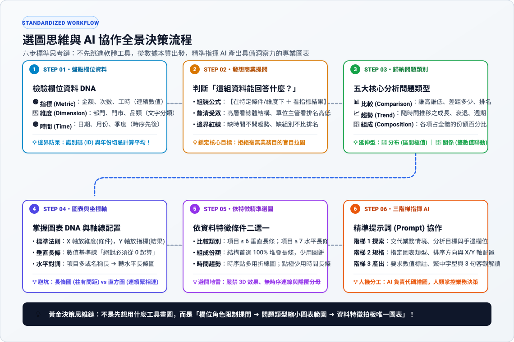
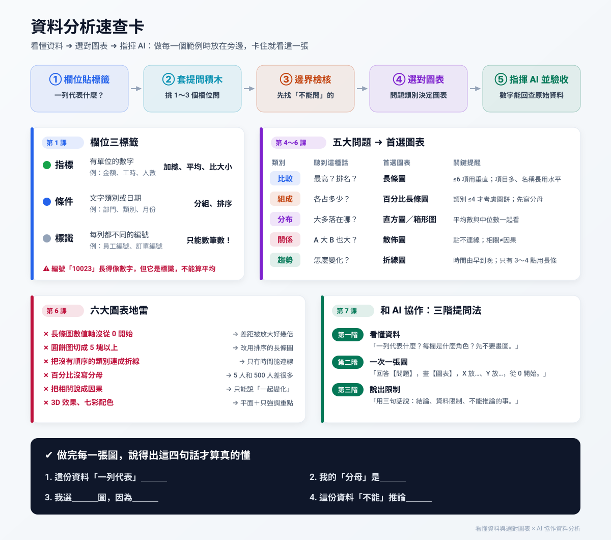

# 📊 看懂資料與選對圖表

> [!IMPORTANT]
> **這一章寫給「不會寫程式、但每天看 Excel」的你。**
> 你不用先懂統計，也不用先學 Python。這一章只教一件事：**拿到一份表格時，腦袋該照什麼順序想**——想清楚了，畫圖這件事就可以交給 AI。
>
> **學完你能做到**：看一份陌生的表格，說出「它能回答什麼問題、該用什麼圖、哪些結論不能下」，並寫出一段讓 AI 一次畫對的指令。

---

## 🧭 一張圖看懂整章

整章只有一條思考順序，**請背下來**：

> **① 欄位貼標籤 ➔ ② 套提問積木 ➔ ③ 邊界檢核 ➔ ④ 判斷問題類別 ➔ ⑤⑥ 選對圖表 ➔ ⑦ 交給 AI 並驗收**

🌐 想先動手玩玩看？ [線上互動實驗室](https://roberthsu2003.github.io/PythonForDataAnalysis/chart-selection/)

### 📇 一頁速查卡：整章重點濃縮在一張圖

上課或做範例時放在旁邊，卡住就看這一張（點圖可放大，也可以列印）：

---

## 🗺️ 學習地圖：7 堂課 ＋ 1 次動手做

由淺至深，**一次一課，照順序讀**。每課都有一句「帶走的重點」，讀完能說出那句話就可以往下。

| 課 | 主題 | 帶走的重點 | 教材 |
| :---: | :--- | :--- | :--- |
| 1 | 欄位貼標籤 | 每一欄先分成**指標、條件、標識**；編號不能拿來算 | 📖 [數據欄位與提問思考規則・步驟 1](./數據欄位與提問思考規則/README.md#步驟-1欄位角色貼標籤認識數據積木) |
| 2 | 套提問積木 | 挑 1～3 個欄位，套句型就能問出好問題 | 📖 [數據欄位與提問思考規則・步驟 2](./數據欄位與提問思考規則/README.md#步驟-2套用提問公式積木組合問句) |
| 3 | 邊界檢核 | 先找出**這份資料不能回答**的問題 | 📖 [數據欄位與提問思考規則・步驟 3](./數據欄位與提問思考規則/README.md#步驟-3邊界反向檢核防呆畫出不能問的紅線) |
| 4 | 五大問題類別 | 所有問題都屬於：**比較、組成、分布、關係、趨勢** | 📖 [五大問題類別與識別句型](./五大問題類別與識別句型/README.md) |
| 5 | 認識圖表與坐標軸 | X 軸放條件、Y 軸放指標；長條圖從 0 開始 | 📖 [常用圖表名稱與坐標軸說明](./常用圖表名稱與坐標軸說明/README.md) |
| 6 | 依條件選圖、避開地雷 | 同一類問題，項目多寡與名稱長短會改變最佳圖表 | 📖 [決定適合圖表的思考規則](./決定適合圖表的思考規則/README.md) |
| 7 | 和 AI 協作：三階提問法 | 先讓 AI 看懂資料，再一次只問一張圖，最後請它說出限制 | 📖 [和 AI 協作的三階提問法](./和AI協作的三階提問法/README.md) |
| ✋ | **動手做：五張圖由淺至深** | 用同一份辦公室資料，把 7 堂課完整走一遍 | 💻 [README.ipynb](./README.ipynb)（[在 Colab 開啟](https://colab.research.google.com/github/roberthsu2003/PythonForDataAnalysis/blob/master/%E7%9C%8B%E6%87%82%E8%B3%87%E6%96%99%E8%88%87%E9%81%B8%E5%B0%8D%E5%9C%96%E8%A1%A8/README.ipynb)） |
| 🚀 | 挑戰：陌生的真實資料 | 拿到沒看過的空氣品質資料，自己走完整套流程 | 💻 [範例_陌生資料挑戰_空氣品質.ipynb](./學生素材/範例_陌生資料挑戰_空氣品質.ipynb) |

---

## 每堂課的重點摘要

> 下面是每課的「一頁版」。細節、例子和練習請點各課的教材連結。

### 第 1 課｜欄位貼標籤：先認識每一欄

拿到資料**不要先想要畫什麼圖**，先把每一欄貼上三種標籤之一：

| 標籤 | 怎麼認 | 例子 | 可以做什麼 |
| :--- | :--- | :--- | :--- |
| 🟢 **指標** | 有單位的數字 | 金額（元）、工時（小時）、人數 | 加總、平均、比大小 |
| 🔵 **條件** | 文字類別或日期 | 部門、產品類別、月份 | 分組、排序 |
| ⚪ **標識** | 每列都不一樣的編號 | 員工編號、訂單編號 | **只能數有幾筆**，不能加總或平均 |

> ⚠️ 員工編號「10023」長得像數字，但它是**標識**，算它的平均沒有任何意義。

### 第 2 課｜套提問積木：挑欄位，套句型

| 挑的欄位 | 可以問 | 例子 |
| :--- | :--- | :--- |
| 1 個指標 | 大多集中在多少？有沒有極端值？ | 同仁通勤時間大多幾分鐘？ |
| 1 個類別 ＋ 1 個指標 | 誰最高？各占多少？ | 哪個部門支出最多？ |
| 1 個時間 ＋ 1 個指標 | 怎麼變化？哪個月最高？ | 每月支出是增加還是減少？ |
| 2 個指標 | 一個變大，另一個也變大嗎？ | 預估工時越長，實際工時也越長嗎？ |
| 類別 ＋ 時間 ＋ 指標 | 各組的走勢一樣嗎？ | 各部門每月支出走勢一致嗎？ |

### 第 3 課｜邊界檢核：先畫出「不能問」的紅線

| 資料的樣子 | 不能問 | 為什麼 |
| :--- | :--- | :--- |
| 沒有時間欄位 | 「業績有沒有進步？」 | 沒有過去可以比 |
| 沒有類別欄位 | 「業務部是不是比客服部好？」 | 沒辦法分組 |
| 兩個指標有關聯 | 「多喝咖啡會讓業績變好嗎？」 | **相關不等於因果** |
| 只有百分比 | 「滿意度 80%，所以大家都很滿意」 | 不知道**分母**是 5 人還是 500 人 |

### 第 4 課｜五大問題類別：你問的是哪一種？

| 類別 | 聽到這種句子 | 首選圖表 |
| :--- | :--- | :--- |
| **比較** | 「誰最高？」「排名？」 | 長條圖 |
| **組成** | 「各占多少？」「比例？」 | 百分比長條圖 |
| **分布** | 「大多落在哪？」「有沒有極端值？」 | 直方圖、箱形圖 |
| **關係** | 「A 變大，B 也變大嗎？」 | 散佈圖 |
| **趨勢** | 「怎麼變化？」「哪個月最高？」 | 折線圖 |

### 第 5 課｜認識圖表與坐標軸

- **X 軸（橫軸）放條件**：部門、類別、月份。
- **Y 軸（縱軸）放指標**：金額、人數、工時。
- **長條圖的數值軸一定從 0 開始**；項目多或名稱長時，改用**水平長條圖**（軸對調）。
- 跟 AI 溝通時，說出圖表的中英文名稱（例如「水平長條圖 Horizontal Bar Chart」）最不容易誤會。

### 第 6 課｜依條件選圖、避開六大地雷

同一類問題，資料條件不同，最佳圖表也不同：

| 問題類別 | 資料條件 | 選這個 |
| :--- | :--- | :--- |
| 比較 | 項目 ≤ 6 個、名稱短 | 垂直長條圖 |
| 比較 | 項目多或名稱長 | 水平長條圖（排序） |
| 組成 | 類別 ≤ 4 個 | 甜甜圈圖也可以 |
| 組成 | 類別 > 4 個 | 百分比長條圖 |
| 趨勢 | 時間點多 | 折線圖 |
| 趨勢 | 只有 3～4 個時間點 | 長條圖 |
| 關係 | 3 個以上的數值欄位 | 相關係數熱力圖 |

### 第 7 課｜和 AI 協作：三階提問法

這一課有 [**三個獨立的 xlsx＋Colab 範例**](./和AI協作的三階提問法/README.md)：社區服務案件（比較）、單車租借月報（趨勢）、閱讀時間與測驗（關係）。每例都有預寫的三階 prompt；第二階畫圖後，第三階接著做**核數字、挑戰推論、修訂結論**三輪對話。

| 階段 | 你對 AI 說 | 你要檢查 |
| :--- | :--- | :--- |
| **第一階：看懂資料** | 「讀取資料，告訴我一列代表什麼、每欄是什麼角色，**先不要畫圖**。」 | 筆數、欄位、缺值對嗎？ |
| **第二階：一次一張圖** | 「回答【一個問題】，畫【圖表名稱】，X 軸放…、Y 軸放…，從 0 開始，標上單位。」 | 圖上的數字和表格一樣嗎？ |
| **第三階：說出限制** | 「用三句話說：結論、資料限制、不能推論的事。」 | 有沒有把相關說成因果？ |

---

## ✋ 動手做：用辦公室資料畫五張圖

打開 [README.ipynb](./README.ipynb)（可在 Colab 執行），用 [五類圖表_練習資料.xlsx](./學生素材/五類圖表_練習資料.xlsx) 依序完成五張圖。**順序由淺至深**，每一張只多一個新觀念：

| 順序 | 問題 | 類別 | 圖表 | 這張圖多學的一件事 |
| :---: | :--- | :--- | :--- | :--- |
| 1 | 哪個部門每人平均支出最高？ | 比較 | 垂直長條圖 | 數值軸從 0 開始、標上單位 |
| 2 | 每月支出怎麼變化？ | 趨勢 | 折線圖 | 時間由早到晚排序才能連線 |
| 3 | 各採購類別各占多少？ | 組成 | 百分比長條圖 | 先講清楚**分母** |
| 4 | 同仁通勤時間大多多久？ | 分布 | 直方圖 | 平均數和中位數要一起看 |
| 5 | 預估工時和實際工時有關嗎？ | 關係 | 散佈圖 | **相關不等於因果** |

資料說明請看[學生素材資料卡](./學生素材/DATA_CARD.md)；本課五張圖的原有素材可下載：[看懂資料與選對圖表_學生素材.zip](./看懂資料與選對圖表_學生素材.zip)。第 7 課新增的三份 xlsx 請從[三階提問法教材](./和AI協作的三階提問法/README.md)各自下載。

---

## ✅ 學完這一章，檢查自己

拿任何一份表格，能不能說出這五句話？

1. 「這份資料**一列代表**＿＿＿；指標是＿＿＿，條件是＿＿＿，標識是＿＿＿。」
2. 「我想問的是＿＿＿，屬於**比較／組成／分布／關係／趨勢**中的＿＿＿。」
3. 「這份資料**不能**回答＿＿＿，因為缺少＿＿＿。」
4. 「我選＿＿＿圖，因為＿＿＿；X 軸放＿＿＿，Y 軸放＿＿＿。」
5. 「給 AI 的指令是：＿＿＿；我會檢查＿＿＿來確認它畫對了。」

---

## ➡️ 下一章：實際指揮 AI 做分析

學會了思考順序，下一章用 14 個由淺至深的範例，在 Colab 裡實際指揮 AI 完成分析：

👉 **[AI 協作資料分析｜14 個循序實作範例](../AI協作資料分析_12個範例/README.md)**

🌐 也可以從[互動版範例總覽](https://roberthsu2003.github.io/PythonForDataAnalysis/ai-examples/)挑範例、記錄進度。

[返回主教材](../README.md)
