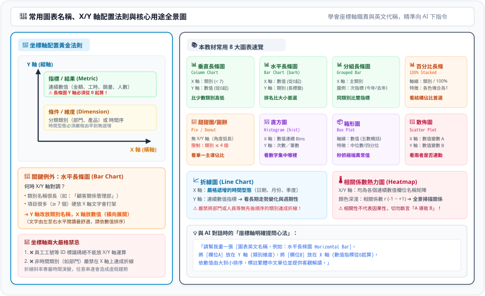
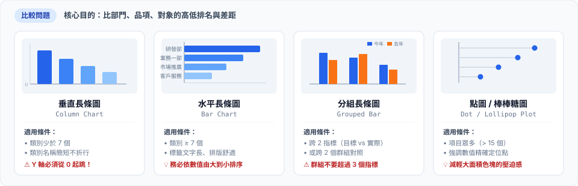
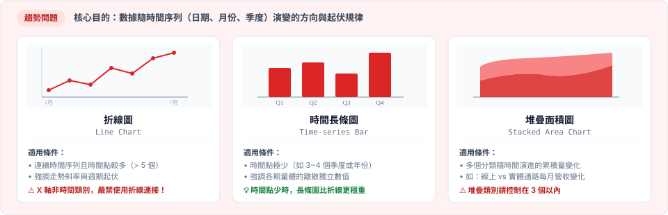
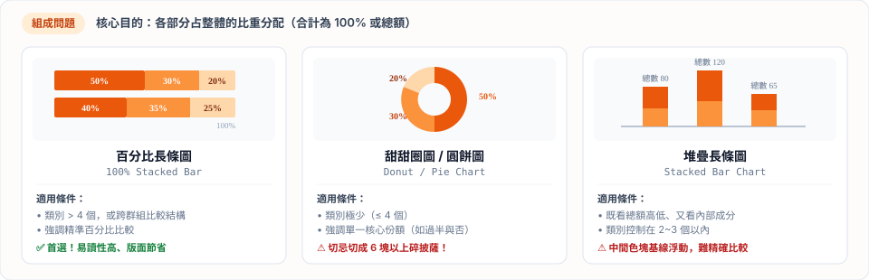

# 📊 常用圖表名稱與坐標軸說明：中英文對照、X/Y 軸原理與核心用途

> 💡 **核心原則：搞懂圖表 DNA 與坐標軸，才能正確表達與指揮 AI。**  
> 本章內容已同步建置為線上互動網頁，支援即時切換、縮圖預覽與 Python 代碼複製：  
> 👉 [🌐 前往線上互動網頁：常用圖表名稱與座標軸配置指南](https://roberthsu2003.github.io/PythonForDataAnalysis/chart-selection/chart-vocabulary.html)

---

## 🧭 一、X 軸與 Y 軸的配置黃金法則

坐標軸是圖表的骨架，搞清楚 X 軸（橫軸）與 Y 軸（縱軸）的職責，圖表就不會畫反：

[](../圖解/坐標軸配置與常用圖表說明.svg)

### 📌 兩大核心守則：
1. **標準配置（垂直方向）**：
   - **X 軸（橫軸 / 條件）**：放【維度 (Dimension)】，如部門、產品類別、或具有順序的時間（月/季/年）。
   - **Y 軸（縱軸 / 結果）**：放【指標 (Metric)】，如營業額、訪客數、毛利率。**長條圖數值基準線必須從 0 開始！**
2. **唯一關鍵例外：水平長條圖**：
   - 當項目名稱太長（如「顧客關係管理暨售後服務部」）或項目很多（> 7 個）時，**X/Y 軸對調**。
   - **Y 軸放類別名稱**（文字水平由左至右展開，不傾斜、好閱讀），**X 軸放數值指標**（由左向右長）。

---

## 📚 二、五大問題常用圖表 SVG 圖解與中英對照

以下為本教材最常用的 10 大核心圖表，每種圖表均附視覺化 SVG 圖解與坐標軸規範：

### 1. 比較類 (Comparison) 圖表
> 用於比較不同類別之間的數值高低與排名。

[](../圖解/選圖矩陣_比較.svg)

| 中文名稱 | 英文名稱 | X 軸 (橫軸) | Y 軸 (縱軸) | 核心用途與注意事項 |
| :--- | :--- | :--- | :--- | :--- |
| **垂直長條圖** | Column Chart | 類別名稱 ($\le 6$ 個) | 連續數值 (從 0 起算) | 比較少數項目數值，柱子間有空隙 |
| **水平長條圖** | Horizontal Bar Chart | 連續數值 (向右延伸) | 類別名稱 (文字水平閱讀) | 項目多或名稱長時的排名首選，建議排序 |
| **分組長條圖** | Grouped Bar Chart | 主要分類維度 | 連續數值 | 同時比對雙指標（如預算 vs 實際） |

---

### 2. 趨勢類 (Trend) 圖表
> 用於觀察數值隨時間先後推移的變化方向（上升、平穩、下跌）。

[](../圖解/選圖矩陣_趨勢.svg)

| 中文名稱 | 英文名稱 | X 軸 (橫軸) | Y 軸 (縱軸) | 核心用途與注意事項 |
| :--- | :--- | :--- | :--- | :--- |
| **折線圖** | Line Chart | 時間連續軸 (日/月/季) | 連續數值 | 觀察長期波動與轉折點，非時間軸不可連線 |
| **面積圖** | Area Chart | 時間連續軸 | 累積數值 / 百分比 | 強調總體量感與不同分組的堆疊貢獻 |

---

### 3. 組成類 (Composition) 圖表
> 用於分析部分占整體的結構比例（份額百分比）。

[](../圖解/選圖矩陣_組成.svg)

| 中文名稱 | 英文名稱 | 軸線配置 | 核心用途與注意事項 |
| :--- | :--- | :--- | :--- |
| **100% 百分比長條圖** | 100% Stacked Bar | 一軸類別，一軸百分比 | **商業報告首選！** 人眼比對長度最精準 |
| **甜甜圈圖 / 圓餅圖** | Donut / Pie Chart | 無坐標軸 (角度/面積) | 僅限 $\le 4$ 個項目且占比懸殊時使用，切忌 3D |

---

### 4. 分布類 (Distribution) 圖表
> 用於探查大量單一數值欄位的集中趨勢、分散程度與極端異常值。

[](../圖解/選圖矩陣_分佈.svg)

| 中文名稱 | 英文名稱 | X 軸 (橫軸) | Y 軸 (縱軸) | 核心用途與注意事項 |
| :--- | :--- | :--- | :--- | :--- |
| **直方圖** | Histogram | 等寬數值區間 (Bins) | 出現頻率 / 次數 | 看數據常態分布或偏態，**柱子緊密相連** |
| **箱形圖** | Box Plot | 連續數值 (或分組維度) | 5 數統計與離群值 | 檢驗中位數與排查極端值 (Outliers) 必備 |

---

### 5. 關係類 (Relationship) 圖表
> 用於檢驗兩個或多個連續變數之間是否存在關聯性或群聚現象。

[](../圖解/選圖矩陣_關聯.svg)

| 中文名稱 | 英文名稱 | X 軸 (橫軸) | Y 軸 (縱軸) | 核心用途與注意事項 |
| :--- | :--- | :--- | :--- | :--- |
| **散佈圖** | Scatter Plot | 連續數值變數 A | 連續數值變數 B | 觀察兩數值之正負相關與群聚，**點不可連線** |
| **氣泡圖** | Bubble Chart | 數值變數 A | 數值變數 B (圓大小=變數C) | 同時比較 3 個連續變數 |

---

## 🎯 快速檢驗：如何向 AI 精確下指令？

搞懂了中英文名稱與 X/Y 軸，跟 AI 溝通時就能一次到位：

```markdown
❌ 模糊指令：「幫我畫這張表格的圖。」
✅ 精確指令：「請使用 Python seaborn 繪製【水平長條圖 (Horizontal Bar Chart)】，
             X 軸放【客單價 (數值)】，Y 軸放【商品類別 (長名稱)】，
             數值由大到小排序，並在長條右側標註實際金額。」
```

---

## 🔗 下一步學習導引

- 👉 **繼續前往第四步**：[決定適合圖表的思考規則](../決定適合圖表的思考規則/README.md)
- 👉 **回顧第二步**：[看懂五大核心問題類型與選圖決策](../README.md#二看懂五大核心問題類型與選圖決策)
- 👉 **線上互動網頁體驗**：[常用圖表名稱與座標軸配置指南 (含互動篩選)](https://roberthsu2003.github.io/PythonForDataAnalysis/chart-selection/chart-vocabulary.html)
