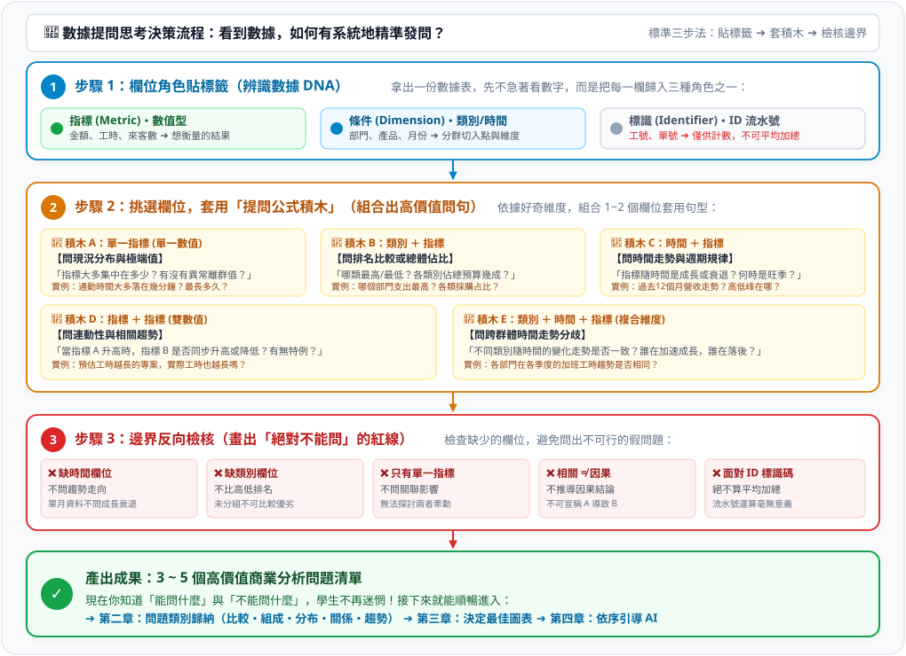

# 💡 數據欄位與提問思考規則：看到數據，如何精準發問？

> 💡 **核心原則：沒有好問題，就沒有好分析。**
> 
> 很多初學者或辦公室人員拿到一份 Excel 數據時，最常遇到的瓶頸不是「不會用軟體畫圖」，而是**「看著一堆欄位腦袋一片空白，不知道可以問什麼問題」**。如果無法發問，後續的分析、挑圖與 AI 協作就完全無從展開。
> 
> 本指南提供一套**標準化的「數據提問三步思考規則」**。只要按照這套規則，任何初學者都能在 1 分鐘內，有系統地列出高質量的商業問題清單！

---

## 🧭 數據提問思考決策圖

面對任何數據表，請依序執行以下三個思考步驟：

[](../圖解/數據提問思考決策流程.svg)

---

## 步驟 1：欄位角色貼標籤（認識數據積木）

拿到任何 Excel 表格或 CSV 檔時，先不要急著看每筆數字，而是把每一欄依「角色」貼上以下三種標籤之一：

| 欄位角色 | 性質說明 | 辨識方法 | 典型範例 | 扮演的角色 |
| :--- | :--- | :--- | :--- | :--- |
| 🟢 **指標 (Metric)**<br>*(數值型)* | 可以加總、平均、計算差距的連續數字 | 欄位內容都是數字，有單位（元、小時、人、個） | 採購金額、加班工時、營收、滿意度分數 | **「我想衡量的結果是什麼」** |
| 🔵 **條件 (Dimension)**<br>*(類別型 / 時間型)* | 用來切分、分群、排順序的維度 | 文字標籤、代號、有限的選項、或者日期時間 | 部門、產品類別、地區、職級、成交月份 | **「在什麼情況 / 誰的身上發生」** |
| ⚪ **標識 (Identifier)**<br>*(流水號 / ID)* | 僅用來標記某一筆資料，不具備分析含義 | 每一筆都不重複的號碼、身分證、訂單編號 | 員工工號、採購單號、會員編號 | **「算筆數專用，不可做數學運算」** |

> ⚠️ **新手陷阱**：
> - 員工編號「10023」、產品代碼「8801」雖然長得像數字，但它們是**標識 (ID)**，絕不能拿去算平均數！
> - 滿意度「非常滿意、普通、不滿意」是**類別 (條件)**，不能直接當成連續數值計算。

---

## 步驟 2：套用「提問公式積木」（組合問句）

當欄位標籤貼好後，請根據你想了解的角度，挑選 **1 到 3 個欄位**，直接套用下方的「提問公式句型」：

### 🧱 積木 A：挑選「單一數值欄位」（沒有任何條件欄）
> 🎯 **思考方向**：探索指標的「總體常態與極端狀況」。

- **標準提問句型**：
  1. 「全體同仁 / 所有訂單的【數值】，**大多集中在多少**？」
  2. 「這項數據中，**最高與最低**分別是多少？差距懸殊嗎？」
  3. 「有沒有**極端異常的數值**（例如異常高或異常低）拉偏了全體的代表性？」
- **實例示範**：
  - 欄位：`通勤時間（分鐘）`
  - 提出問題：「同仁的通勤時間大多落在哪個區間？最長的通勤時間是多久？有沒有極端長達 2 小時以上的案例？」

---

### 🧱 積木 B：挑選「1 個類別 ＋ 1 個數值」
> 🎯 **思考方向**：探索「群體高低落差」或「總量內部佔比」。

- **角度 1：比較高低（比表現、比差距）**
  - **標準句型**：「在不同的【類別】中，哪一個【數值】最高？哪一個最低？前三名佔據哪些位置？」
  - **實例**：`部門名稱` ＋ `每人平均支出` ➔ 「哪個部門的每人平均花費最高？與第二名差距多少？」
- **角度 2：組成佔比（看結構、看重點貢獻）**
  - **標準句型**：「各【類別】的【數值加總】，分別佔了總體的百分之幾（%）？主要的支出是由哪幾類造成的？」
  - **實例**：`採購類別` ＋ `採購金額` ➔ 「各類別採購費用各占全年度總採購金額的多少比例？」

---

### 🧱 積木 C：挑選「1 個時間 ＋ 1 個數值」
> 🎯 **思考方向**：探索「時間進程上的演變與規律」。

- **標準提問句型**：
  1. 「這項【數值】隨【時間】推移，呈現**成長、持平還是衰退**的走向？」
  2. 「這一年中，哪一個月份是【數值】的**最高峰（旺季）**？哪一個月份是**最低谷（淡季）**？」
  3. 「各週期（例如逐季或逐月）之間有沒有明顯規律的**波動節奏**？」
- **實例示範**：
  - 欄位：`月份` ＋ `營收`
  - 提出問題：「過去 12 個月營收是否有持續成長？哪一季是營收主力？有沒有突發性的下滑月份？」

---

### 🧱 積木 D：挑選「2 個數值欄位」
> 🎯 **思考方向**：探索「兩項指標是否互相牽動與連動」。

- **標準提問句型**：
  1. 「當【數值 A】升高時，【數值 B】通常會**跟著升高、還是降低**？」
  2. 「兩者之間是否存在明顯的正向或負向關聯趨勢？」
  3. 「有沒有哪些特例是【數值 A】很高，但【數值 B】卻異常低的離群點？」
- **實例示範**：
  - 欄位：`專案預估工時` ＋ `專案實際工時`
  - 提出問題：「預估工時較長的專案，實際工時是不是也普遍偏高？有沒有預估很短但實際嚴重超時的專案？」

---

### 🧱 積木 E：挑選「1 個類別 ＋ 1 個時間 ＋ 1 個數值」
> 🎯 **思考方向**：探索「不同群體在時間走勢上的分歧與競爭」。

- **標準提問句型**：
  1. 「在不同【類別】之間，他們隨【時間】演變的**走勢是否相同**？」
  2. 「是否有某個【類別】在特定時間點突然爆發成長或大幅萎縮？」
- **實例示範**：
  - 欄位：`部門` ＋ `月份` ＋ `加班時數`
  - 提出問題：「資訊部與業務部在下半年的加班時數走勢是否一致？哪一個部門在年底衝刺期加班激增？」

---

## 步驟 3：邊界反向檢核（防呆：畫出「不能問」的紅線）

問完問題後，最後一步是做**可行性檢查**。很多初學者被主管問倒，往往是因為「提出了一個這份資料根本無法回答的問題」：

```
       ┌─ 缺乏【時間欄位】 ── ❌ 絕對不能問「趨勢如何、有沒有成長衰退」
       ├─ 缺乏【類別欄位】 ── ❌ 絕對不能問「哪一組表現好、誰高誰低」
檢核 ──┼─ 只有【單一數值】 ── ❌ 絕對不能問「兩者是否相關、是否被影響」
       ├─ 只有【相關數據】 ── ❌ 絕對不能下「A 導致 B 發生」的因果結論
       └─ 面對【ID 標識碼】 ── ❌ 絕對不能問「平均 ID 是多少」
```

| 情況 | 常犯的錯誤發問 | 為什麼不能問？ | 正確的做法 |
| :--- | :--- | :--- | :--- |
| **資料只有單月報表**（無時間欄） | 「今年業績是否有進步？」 | 沒有過去的對比時間點，無法斷言進步或退步 | 只能改問：「本月各部門中誰業績最佳？」 |
| **資料只有全體總額**（無類別欄） | 「業務部的表現是不是比客服部好？」 | 沒有部門標籤，資料未經分組 | 若需比較，必須補齊部門分類欄位 |
| **資料只有兩個數值** | 「提升預估工時會不會直接改善專案品質？」 | 1. 相關不等於因果；2. 資料中根本沒有品質指標 | 只能問：「預估工時與實際工時兩者是否有正相關？」 |

---

## 📋 實戰演練：拿一張真實辦公室資料帶你看

假設你拿到一張名為 `辦公室採購明細.csv` 的檔案，欄位如下：

```text
1. 採購單號 (例如：PO-2025-001)
2. 採購日期 (例如：2025/03/15)
3. 申請部門 (例如：行銷部、研發部、行政部)
4. 採購類別 (例如：辦公耗材、硬體設備、軟體訂閱)
5. 採購金額 (例如：45,000)
```

### 依照三步規則思考：

1. **第一步（貼標籤）**：
   - 🟢 指標：`採購金額` (數值)
   - 🔵 條件：`採購日期` (時間)、`申請部門` (類別)、`採購類別` (類別)
   - ⚪ 標識：`採購單號` (ID)

2. **第二步（挑積木發問）**：
   - **套積木 A（單一數值）**：「公司單筆採購金額大多落在多少錢？有沒有超過 20 萬元的巨額異常採購？」
   - **套積木 B-1（類別比較）**：「哪一個申請部門的全年累積採購金額最高？差距多大？」
   - **套積木 B-2（組成佔比）**：「各採購類別（軟體、硬體、耗材）各占公司總採購預算的百分之多少？」
   - **套積木 C（時間趨勢）**：「各月份的採購總支出隨時間如何變化？哪幾個月是採購高峰？」
   - **套積木 E（複合交叉）**：「前三大採購部門在各個季度的支出走勢有一致嗎？」

3. **第三步（反向檢核邊界）**：
   - ❌ **不能問**：「哪一個部門的採購審核效率最高？」➔ *因為資料中沒有「核准日期」或「簽核天數」欄位！*
   - ❌ **不能問**：「多買硬體設備能不能提升同仁工作效率？」➔ *因為資料中沒有「員工績效」欄位，且無法推導因果！*

---

## 🤖 依靠 AI：直接將欄位規則交給 AI 發問

當你學會這套規則後，只要將你的資料欄位貼給 AI，AI 就能依照這套邏輯幫你產生高品質問題清單！

**【萬用 Prompt 範本】**：
```text
我手上有一份資料表，以下是欄位清單與屬性：
- 數值指標欄位：[如：採購金額、工時]
- 條件類別欄位：[如：部門名稱、產品類別]
- 時間欄位：[如：訂單日期]
- 識別碼欄位：[如：訂單編號]

請依照「數據提問思考規則」，幫我完成以下三件事：
1. 套用提問積木，針對這組資料提出 4~5 個不同面向（比較、組成、分布、關係、趨勢）的高價值商業分析問題。
2. 指出這些問題各自需要使用哪些欄位與運算指標（平均數、總合、百分比等）。
3. 根據目前資料欄位的限制，提醒我有哪 2 個常見的管理問題是「這份資料絕對無法回答」的？
```

---

> 🚀 **下一步**：當你問出具體問題後，請進入 [第二章：確認問題屬於哪一個類別](../README.md#第二章--有了問題後它是哪一個類別的問題) 以及 [🧭 決定適合圖表的思考規則](../決定適合圖表的思考規則/README.md) 挑選對應圖表！
