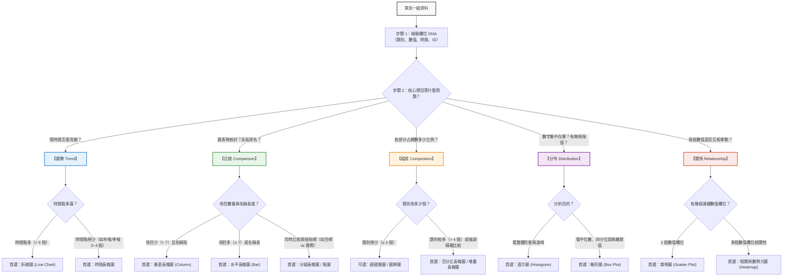

# 🧭 數據選圖思考規則：從資料特徵到最佳圖表的決策指引

> 💡 **核心原則：不是「我會畫哪種圖」，而是「我回答了誰的什麼問題」。**
> 
> 很多初學者拿到一組數據時，直覺就是隨便拉一張圓餅圖或折線圖，結果主管或同事看不懂。
> 本指南提供一套**標準化的思維決策流程（Decision Framework）**，只要按照以下步驟，就能在 1 分鐘內精準鎖定最適合的圖表。

---

## 🗺️ 選圖思維決策全景圖

拿到數據時，請依照下方流程圖依序思考：

---

## 🔍 第一步：盤點數據欄位屬性（數據 DNA）

在打開繪圖工具之前，先花 10 秒檢查手邊資料表欄位的「型態」：

| 欄位型態 | 定義與特徵 | 辦公室常見例子 | 處理規則 |
| --- | --- | --- | --- |
| **識別碼 (ID)** | 每一筆資料的唯一代號，無計算意義 | 員工編號、訂單編號、身分證號 | **千萬不要拿來加總、平均或當 X/Y 軸**。 |
| **類別型 (Categorical)** | 有限的分類或文字標籤（文字／離散） | 部門名稱、產品品類、縣市、性別 | 通常放於分類維度、圖例 (Legend) 或 X 軸。 |
| **數值型 (Numerical)** | 可以進行連續加總、平均、計算差額的數字 | 銷售額、成本、工時、滿意度分數、年齡 | 通常作為聚合指標 (Metric)、Y 軸數值。 |
| **時間型 (Temporal)** | 具有嚴格先後順序與間隔特徵的日期或時間 | 銷售日期、月份、季別、年度、打卡時間 | 必須由早到晚排序，作為連續趨勢觀察基準。 |

> ⚠️ **常見地雷**：
> - 把西元年份（如 `2024`）當成數值拿去計算平均數。
> - 把問卷滿意度代碼（1=非常不滿意，5=非常滿意）直接與人數混為一談。

---

## 🎯 第二步：問出具體問題（五大問題類型判斷）

問對問題，圖表就選對了一半。問問自己：「這張圖要幫誰回答什麼問題？」

### 1. 比較 (Comparison)
- **經典問法**：「哪一個品項賣得最好？」、「北中南各區的業績排名如何？」、「今年各部門的預算達成率誰最高？」
- **溝通核心**：突顯「高低差距」與「相對排名」。

### 2. 組成 (Composition)
- **經典問法**：「公司總成本裡，人事費占了幾成？」、「今年營業額主要是哪幾個產品線貢獻的？」
- **溝通核心**：突顯「部分相對於整體的份額」，所有部分加總必須為 100%（或等於整體總額）。

### 3. 分布 (Distribution)
- **經典問法**：「大部分員工的通勤時間落在哪個區間？」、「專案完成天數有沒有特別誇張的極端延遲個案？」
- **溝通核心**：突顯「數值的離散程度、集中趨勢與異常值（極端值）」。

### 4. 關係 (Relationship)
- **經典問法**：「業務的拜訪次數越多，成交金額真的越高嗎？」、「員工加班時數與專案錯誤率是否有連動關係？」
- **溝通核心**：探討「兩個連續數值變數之間是否共同變化（正相關／負相關／無關）」。

### 5. 趨勢 (Trend)
- **經典問法**：「過去 12 個月營收是在成長還是下滑？」、「網站流量在週末是否有週期性下跌？」
- **溝通核心**：觀察「數據隨時間序列演進的變化走勢、週期與轉折點」。

---

## 📊 第三步：依據資料條件精準挑圖（決策矩陣）

確認問題後，再根據資料筆數、類別數量等條件，挑選最適圖表：

---

## ⚡ 欄位組合速查手冊（我手上有這些欄位，該選什麼？）

| 手邊欄位組合 | 典型情境 | 推薦圖表 | 注意事項 |
| --- | --- | --- | --- |
| **1 個類別 + 1 個數值** | 比較 8 個部門的年支出 | **水平長條圖** | 依數值由大到小排序，Y 軸從 0 開始 |
| **1 個類別 + 1 個總額占比** | 4 種採購來源占總支出比例 | **百分比長條圖** 或 **甜甜圈圖** | 類別超過 5 個切忌用圓餅圖，請改用長條圖 |
| **1 個時間 + 1 個數值** | 過去 12 個月每月銷售額 | **折線圖** | 時間嚴格由早到晚，勿打亂時序 |
| **1 個連續數值（大量列）** | 300 名同仁的每週通勤時間 | **直方圖** 或 **箱形圖** | 同時標註中位數與平均數 |
| **2 個連續數值** | 50 個專案的「預估工時」與「實際工時」 | **散佈圖** | 兩軸皆為數值軸，不要用線條將點連起來 |
| **1 個類別 + 2 個數值** | 各部門「今年預算」vs「實際花費」 | **分組長條圖** | 圖例 (Legend) 要清楚標示顏色意義 |

---

## 🛑 新手最常踩的六大圖表地雷（Anti-Patterns）

1. **地雷 1：長條圖截斷 Y 軸起點**
   - ❌ 錯誤：從 80 開始起跳，讓 85 與 90 看起來差距 5 倍。
   - ✅ 正確：長條圖**必須從 0 開始**，避免視覺誇大。
2. **地雷 2：圓餅圖切成十幾塊披薩**
   - ❌ 錯誤：切成 12 等分，標籤重疊難以閱讀。
   - ✅ 正確：類別超過 5 個，一律改用「排序長條圖」或將小類別歸入「其他」。
3. **地雷 3：把無時間順序的類別連成折線**
   - ❌ 錯誤：X 軸是「行銷部、研發部、財務部」，卻用一條折線串在一起。
   - ✅ 正確：折線圖的斜率代表**隨時間變化的趨勢**。無時間先後關係的類別，只能用長條圖或點圖。
4. **地雷 4：忘記標註百分比的分母**
   - ❌ 錯誤：「客戶滿意度達 80%」（未說明只有 5 個人填答）。
   - ✅ 正確：圖表副標題或備註清楚註記「N=320 份有效問卷」。
5. **地雷 5：把相關性直接說成因果關係**
   - ❌ 錯誤：「喝咖啡量與業績高度正相關，因此逼業務喝咖啡能提高業績」。
   - ✅ 正確：散佈圖僅展示關聯，不可推導未經驗證的因果結論。
6. **地雷 6：花俏的 3D 效果與多餘色彩**
   - ❌ 錯誤：3D 柱狀圖造成透視偏差、彩虹色干擾視線。
   - ✅ 正確：平面簡潔、主題色搭配灰色（灰色代表背景基準，單一強調色突顯重點）。

---

## 📋 圖表送出前的「5 點防呆驗收清單」

每次產出圖表，請花 30 秒核對：

- [ ] **1. 目的明確**：標題是不是一眼就讓人看出結論？（例：「2025 年研發部支出居首，高於次名 32%」優於「部門支出統計圖」）
- [ ] **2. 軸線誠實**：長條圖 Y 軸是否從 0 開始？時間軸是否由左至右遞增？
- [ ] **3. 排序到位**：類別比較是否已依數值大小排序？（除非有固定的流程或等級順序）
- [ ] **4. 單位清楚**：標籤是否包含計量單位（萬元、%、小時、人次）？
- [ ] **5. 界線分明**：是否有說出這張圖「不能證明什麼」？（不妄下因果斷言）

---

## 🔗 相關章節與練習

- 📖 回到主題首頁：[看懂資料與選對圖表：辦公室人員的五種圖表入門](../README.md)
- 🧪 實機練習：[五類圖表練習資料（Excel）](../學生素材/五類圖表_練習資料.xlsx)
- 💻 線上執行範例：[開啟完整示範 Notebook (Colab)](https://colab.research.google.com/github/roberthsu2003/PythonForDataAnalysis/blob/master/%E7%9C%8B%E6%87%82%E8%B3%87%E6%96%99%E8%88%87%E9%81%B8%E5%B0%8D%E5%9C%96%E8%A1%A8/README.ipynb)
