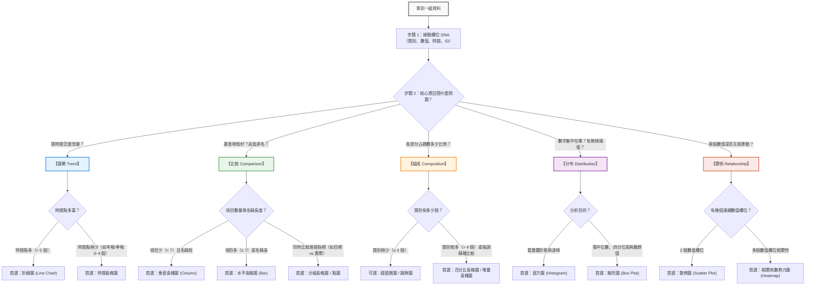

# 🧭 數據選圖思考規則：從資料特徵到最佳圖表的決策指引

> 💡 **核心原則：不是「我會畫哪種圖」，而是「我回答了誰的什麼問題」。**
> 
> 很多初學者拿到一組數據時，直覺就是隨便拉一張圓餅圖或折線圖，結果主管或同事看不懂。
> 本指南提供一套**標準化的思維決策流程（Decision Framework）**，只要按照以下步驟，就能在 1 分鐘內精準鎖定最適合的圖表。

---

## 🗺️ 選圖思維決策全景圖

拿到數據時，請依照下方流程圖依序思考：

---

## 🔍 第一步：盤點數據欄位屬性（數據 DNA）

在打開繪圖工具之前，先花 10 秒檢查手邊資料表欄位的「型態」：

| 欄位型態 | 定義與特徵 | 辦公室常見例子 | 處理規則 |
| --- | --- | --- | --- |
| **識別碼 (ID)** | 每一筆資料的唯一代號，無計算意義 | 員工編號、訂單編號、身分證號 | **千萬不要拿來加總、平均或當 X/Y 軸**。 |
| **類別型 (Categorical)** | 有限的分類或文字標籤（文字／離散） | 部門名稱、產品品類、縣市、性別 | 通常放於分類維度、圖例 (Legend) 或 X 軸。 |
| **數值型 (Numerical)** | 可以進行連續加總、平均、計算差額的數字 | 銷售額、成本、工時、滿意度分數、年齡 | 通常作為聚合指標 (Metric)、Y 軸數值。 |
| **時間型 (Temporal)** | 具有嚴格先後順序與間隔特徵的日期或時間 | 銷售日期、月份、季別、年度、打卡時間 | 必須由早到晚排序，作為連續趨勢觀察基準。 |

> ⚠️ **常見地雷**：
> - 把西元年份（如 `2024`）當成數值拿去計算平均數。
> - 把問卷滿意度代碼（1=非常不滿意，5=非常滿意）直接與人數混為一談。

---

## 🎯 第二步：問出具體問題（五大問題類型判斷）

問對問題，圖表就選對了一半。問問自己：「這張圖要幫誰回答什麼問題？」

> 🎬 **動態視覺化演示**：
> 想親眼看見「溝通核心」與「經典問法」如何對應到長條圖、甜甜圈圖、直方圖、散佈圖與折線圖的動態生長動畫嗎？
> 👉 **[開啟線上互動動畫網頁：五大問題與圖表動態展示](https://roberthsu2003.github.io/PythonForDataAnalysis/chart-selection/question-types.html)** ｜ [本機原始碼檢視](../../docs/chart-selection/question-types.html)

### 1. 比較 (Comparison)
- **溝通核心**：突顯「高低差距」與「相對排名」。
- **經典問法**：「哪一個品項賣得最好？」、「北中南各區的業績排名如何？」、「今年各部門的預算達成率誰最高？」

### 2. 組成 (Composition)
- **溝通核心**：突顯「部分相對於整體的份額」，所有部分加總必須為 100%（或等於整體總額）。
- **經典問法**：「公司總成本裡，人事費占了幾成？」、「今年營業額主要是哪幾個產品線貢獻的？」

### 3. 分布 (Distribution)
- **溝通核心**：突顯「數值的離散程度、集中趨勢與異常值（極端值）」。
- **經典問法**：「大部分員工的通勤時間落在哪個區間？」、「專案完成天數有沒有特別誇張的極端延遲個案？」

### 4. 關係 (Relationship)
- **溝通核心**：探討「兩個連續數值變數之間是否共同變化（正相關／負相關／無關）」。
- **經典問法**：「業務的拜訪次數越多，成交金額真的越高嗎？」、「員工加班時數與專案錯誤率是否有連動關係？」

### 5. 趨勢 (Trend)
- **溝通核心**：觀察「數據隨時間序列演進的變化走勢、週期與轉折點」。
- **經典問法**：「過去 12 個月營收是在成長還是下滑？」、「網站流量在週末是否有週期性下跌？」

---

## 📊 第三步：依據資料條件精準挑圖（5 大類型視覺化指南）

確認想問的問題後，還不能隨便挑一張圖就畫。因為同一個問題，會因為手上的「項目數量多寡、標籤長短、指標變數個數」等資料特徵，而挑選不同的圖表形式。
以下將 5 大問題類型逐一拆解，並以**圖表外觀縮圖與條件卡片**幫助你快速辨識：

> 🌐 **想在線上動手篩選條件與觀看圖表動態嗎？**
> 我們為這 5 大類型打造了**互動式條件挑圖指南網頁**！你可以直接點選資料特徵（如「類別少」、「標籤長」、「抓異常值」），即時高亮對應的最佳圖表，並觀看動態長出圖表與避坑準則：
> 👉 **[開啟線上資料條件挑圖指南（GitHub Pages 網頁版）](https://roberthsu2003.github.io/PythonForDataAnalysis/chart-selection/chart-matrix.html)** ｜ [本機原始碼檢視](../../docs/chart-selection/chart-matrix.html)

### 1. 比較 (Comparison) 的圖表選用

> 🎯 **核心提問**：「哪一個對象較高？」、「誰排第一名？」、「兩者差距多少？」

- **垂直長條圖 (Column Chart)**：適合類別數量少（≤ 7 個）且標籤文字簡短的情況。**關鍵：Y 軸絕對要從 0 開始**。
- **水平長條圖 (Bar Chart)**：當類別數量多（≥ 7 個）或項目名稱較長（如「智慧型手機零件採購」）時的最佳解，文字水平好閱讀，並請由大到小排序。
- **分組長條圖 (Grouped Bar)**：用在同一個類別內同時比對 2 個指標（例如「預算 vs 實際」或「今年 vs 去年」）。
- **點圖 / 棒棒糖圖 (Dot / Lollipop Plot)**：當項目極多且想要突顯精準數值時，能大幅減少長條圖大面積色塊的壓迫感。

---

### 2. 組成 (Composition) 的圖表選用

> 🎯 **核心提問**：「各部分占整體的幾成？」、「全部加起來是 100% 嗎？」

- **百分比長條圖 (100% Stacked Bar)**：**首選推薦！** 比圓餅圖更容易讓眼睛精準比較長度，不管單組或跨組比較都非常清晰。
- **甜甜圈圖 / 圓餅圖 (Donut / Pie Chart)**：**僅限於類別極少（≤ 4 個）**且想強調某個主導份額（例如「線上訂單已超過半數」）。切勿切成 5 塊以上的細碎披薩。
- **堆疊長條圖 (Stacked Bar Chart)**：適用於需要同時掌握「各類別總額」與「內部各成分份額」的情境（注意：除最底層外，上方色塊基準線浮動，難以精確比較高低）。

---

### 3. 分布 (Distribution) 的圖表選用

> 🎯 **核心提問**：「數據大部分集中在哪裡？」、「有沒有極端爆表的異常個案？」

- **直方圖 (Histogram)**：單一連續數值（如 300 筆薪資、通勤時間），觀察波峰是在中間（常態分布）還是偏向某一側。**柱子與柱子之間是相連的（代表連續區間 Bin），切勿與長條圖搞混**。
- **箱形圖 / 盒鬚圖 (Box Plot)**：檢視數據 5 數概括（最小值、Q1、中位數、Q3、最大值）與抓出極端離群值 (Outliers) 的最強工具，能一眼看穿「平均數是否被少數極端值拉偏」。

---

### 4. 關係 (Relationship) 的圖表選用

> 🎯 **核心提問**：「A 數值增加時，B 數值也會跟著上升或下降嗎？」

- **散佈圖 (Scatter Plot)**：2 個成對連續數值（例如「預估工時」與「實際工時」），觀察點群的集聚方向（正相關、負相關、無關）。**千萬不要用折線將散佈點連起來**！
- **氣泡圖 (Bubble Chart)**：散佈圖的延伸，以氣泡的「圓形面積」表達第 3 個連續數值指標（例如 X 軸為廣告費、Y 軸為營收、氣泡大小代表利潤）。
- **相關係數熱力圖 (Correlation Heatmap)**：當欄位有 3 個以上的連續變數時，用色彩矩陣全景掃描兩兩之間的相關係數數值。

---

### 5. 趨勢 (Trend) 的圖表選用

> 🎯 **核心提問**：「隨時間推移，數值是在成長、衰退，還是有週期性變化？」

- **折線圖 (Line Chart)**：時間序列較長（> 5 個時間點，例如每月、每日），透過斜率展示走勢變化。**X 軸必須是時間型態且嚴格由左至右遞增，非時間類別嚴禁連線**。
- **時間長條圖 (Time-series Bar)**：時間點極少時（例如僅有 3~4 個季度或年份），用長條圖比折線圖更加穩重大方。
- **堆疊面積圖 (Stacked Area Chart)**：多個類別隨時間演進的累積量變化（如不同通路營收隨月份的堆疊面積），類別應控制在 3 個以內以防視線混亂。

---

## ⚡ 欄位組合速查手冊（我手上有這些欄位，該選什麼？）

> 🌐 **想在線上動手點選看看嗎？**
> 我們為這個速查表格打造了**互動式網頁體驗版**！你可以直接點選按鈕切換不同欄位組合，親眼看見「真實資料表格長怎樣」、「老闆會怎麼問」以及「圖表的即時外觀」：
> 👉 **[開啟線上互動速查工具（GitHub Pages 網頁版）](https://roberthsu2003.github.io/PythonForDataAnalysis/chart-selection/field-combinations.html)** ｜ [本機原始碼檢視](../../docs/chart-selection/field-combinations.html)

| 手邊欄位組合 | 對應問題類型 | 典型情境 | 推薦圖表 | 注意事項 |
| --- | --- | --- | --- | --- |
| **只有 1 個類別（無數值）** | **分布 / 組成** | 300 份問卷的「付款方式偏好」或「客戶滿意度等級」 | **次數長條圖**（或甜甜圈圖） | 先用 `value_counts()` 計算出現次數，再依頻次由大到小排序 |
| **1 個類別 + 1 個數值** | **比較** | 比較 8 個部門的「年總支出」 | **水平長條圖**（或垂直長條圖） | 依數值由大到小排序，Y 軸必須從 0 開始 |
| **1 個類別 + 1 個總額占比** | **組成** | 4 種採購來源占「總支出比例」 | **百分比長條圖** 或 **甜甜圈圖** | 類別超過 5 個切忌用圓餅圖，請改用長條圖 |
| **1 個時間 + 1 個數值** | **趨勢** | 過去 12 個月「每月銷售額」 | **折線圖** | 時間嚴格由早到晚，勿打亂時序 |
| **1 個連續數值（大量列）** | **分布** | 300 名同仁的「每週通勤時間」 | **直方圖** 或 **箱形圖** | 同時標註中位數與平均數，直方圖柱子相連 |
| **2 個連續數值** | **關係** | 50 個專案的「預估工時」與「實際工時」 | **散佈圖** | 兩軸皆為數值軸，不要用線條將點連起來 |
| **1 個類別 + 2 個數值** | **比較** | 各部門「今年預算」vs「實際花費」 | **分組長條圖** | 圖例 (Legend) 要清楚標示顏色意義 |

---

## 🛑 新手最常踩的六大圖表地雷（Anti-Patterns）實務對照

> 💡 **核心原則：左邊正確（✅ Best Practice）vs 右邊錯誤（❌ Anti-Pattern）**  
> 一張誠實的圖表勝過千言萬語，而錯誤的視覺暗示往往比文字謊言更具誤導性。以下以**左右對比法**拆解常見的六大視覺化陷阱，幫助你在畫圖時建立嚴格的防呆習慣：

1. **地雷 1：長條圖截斷 Y 軸起點**

   

   - ✅ **正確（左）**：長條圖**必須從 0 開始**，忠實反映真實差距（85 與 90 差距僅 5.8%）。
   - ❌ **錯誤（右）**：從 80 截斷起跳，使視覺高度差擴大為 2 倍，造成誇大誤導。

2. **地雷 2：圓餅圖切成十幾塊披薩**

   

   - ✅ **正確（左）**：類別超過 4 個時，一律改用**排序水平長條圖**，文字由左至右水平展開，或將微小項目歸併入「其他」。
   - ❌ **錯誤（右）**：切成 12 等分，扇形細碎難辨大小，文字重疊打架。

3. **地雷 3：把無時間順序的類別連成折線**

   

   - ✅ **正確（左）**：非時間類別（行銷部、研發部、財務部）用**獨立長條圖**分隔展示，各組互不干擾。
   - ❌ **錯誤（右）**：硬將部門連成折線，折線的「斜率」專屬時間演變，非時間類別嚴禁連線。

4. **地雷 4：忘記標註百分比的分母**

   

   - ✅ **正確（左）**：副標題或圖卡下方清楚註記「有效樣本數 N = 400 份問卷」，數據誠實且具統計代表性。
   - ❌ **錯誤（右）**：只寫「客戶滿意度達 80%」，刻意隱瞞其實只有 5 人填答（4 人滿意），以假象高比率誤導決策。

5. **地雷 5：把相關性直接說成因果關係**

   

   - ✅ **正確（左）**：散佈圖呈現關聯點群與趨勢線，客觀標註相關係數 r，說明「僅具關聯，可能受工時或年資等第三變數干擾」。
   - ❌ **錯誤（右）**：粗暴畫上單向因果箭頭「喝咖啡 ➔ 業績暴增」，得出荒謬結論「逼業務喝咖啡以提高業績」。

6. **地雷 6：花俏的 3D 效果與多餘色彩**

   

   - ✅ **正確（左）**：平面 2D 扁平化，背景柱統一採用低飽和灰色，僅對核心目標（如冠軍門市 B）施加單一主題色彩，焦點一目了然。
   - ❌ **錯誤（右）**：傾斜 3D 圓柱體導致透視形變（後方柱子看似縮小），加上七彩雜亂色彩，嚴重分散視覺注意力。

---

## 📋 圖表送出前的「5 點防呆驗收清單」

每次產出圖表，請花 30 秒核對：

- [ ] **1. 目的明確**：標題是不是一眼就讓人看出結論？（例：「2025 年研發部支出居首，高於次名 32%」優於「部門支出統計圖」）
- [ ] **2. 軸線誠實**：長條圖 Y 軸是否從 0 開始？時間軸是否由左至右遞增？
- [ ] **3. 排序到位**：類別比較是否已依數值大小排序？（除非有固定的流程或等級順序）
- [ ] **4. 單位清楚**：標籤是否包含計量單位（萬元、%、小時、人次）？
- [ ] **5. 界線分明**：是否有說出這張圖「不能證明什麼」？（不妄下因果斷言）

---

## 🔗 相關章節與練習

- 📖 回到主題首頁：[看懂資料與選對圖表：辦公室人員的五種圖表入門](../README.md)
- 🧪 實機練習：[五類圖表練習資料（Excel）](../學生素材/五類圖表_練習資料.xlsx)
- 💻 線上執行範例：[開啟完整示範 Notebook (Colab)](https://colab.research.google.com/github/roberthsu2003/PythonForDataAnalysis/blob/master/%E7%9C%8B%E6%87%82%E8%B3%87%E6%96%99%E8%88%87%E9%81%B8%E5%B0%8D%E5%9C%96%E8%A1%A8/README.ipynb)
