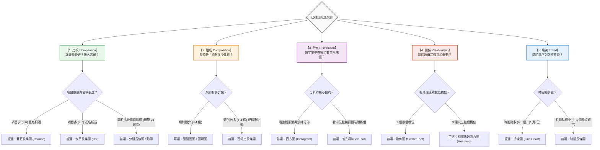

# 🧭 決定適合圖表的思考規則：從資料特徵到最佳圖表的決策指引

> 💡 **核心原則：問題決定類型，特徵決定圖表。**
> 
> 在完成 [第一章：數據欄位與提問思考](../數據欄位與提問思考規則/README.md) 並於 [第二章：辨識五大問題類型](../README.md#第二章--有了問題後它是哪一個類別的問題) 鎖定分析目標後，視覺化的最後關鍵一步就是：**「決定最適合的圖表」**。
> 
> 很多初學者常犯的錯誤是「只要比大小就畫柱狀圖、只要看時間就畫折線圖」。然而，即使回答同一個問題，手邊資料的**項目多寡、名稱長短、時間點長度、指標變數個數**等特徵不同，最適合的圖表就會截然不同！

---

## 🌐 本章專屬互動網頁實驗室（GitHub Pages）

為了幫助你擺脫死記硬背，我們打造了 3 個可即時動手操作的互動網頁工具，強烈建議搭配閱讀：

| 互動實驗室單元 | 體驗內容與特色 | 網頁連結 |
| :--- | :--- | :--- |
| **單元一・核心提問篇** | 觀看比較、組成、分布、關係、趨勢 5 種圖表的**動態生長動畫** | 👉 **[五大問題與圖表動態展示](https://roberthsu2003.github.io/PythonForDataAnalysis/chart-selection/question-types.html)** |
| **單元二・條件挑圖篇** | 點選「項目多/少」、「標籤長/短」等特徵，**即時過濾高亮最佳圖表** | 👉 **[依資料條件挑圖指南](https://roberthsu2003.github.io/PythonForDataAnalysis/chart-selection/chart-matrix.html)** |
| **單元三・欄位速查篇** | 點選手上的欄位組合，**即時對照真實資料表長相與推薦圖表** | 👉 **[資料欄位 ➔ 圖表速查工具](https://roberthsu2003.github.io/PythonForDataAnalysis/chart-selection/field-combinations.html)** |

---

## 🗺️ 全景圖表決策樹

確定問題類型後，請依照手邊的資料條件特徵進行分流篩選：

---

## 📊 第一節：五大類型深度挑圖指南（依資料特徵條件篩選）

> 💡 想在線上點選特徵即時看圖？歡迎前往：[🌐 網頁版條件挑圖指南](https://roberthsu2003.github.io/PythonForDataAnalysis/chart-selection/chart-matrix.html)。

### 1. 比較 (Comparison) 的圖表選用

> 🎯 **核心提問**：「哪一個對象較高？」、「誰排第一名？」、「兩者差距多少？」

- **水平長條圖 (Bar Chart)**：
  - **適用條件**：類別數量多（$\ge 7$ 個）或項目名稱較長（如「智慧型手機零件採購部」）。
  - **優點**：文字水平排列，閱讀最自然；請**務必由大到小排序**。
- **垂直長條圖 (Column Chart)**：
  - **適用條件**：類別數量少（$\le 6$ 個）且標籤簡短。
  - **防呆底線**：**Y 軸絕對要從 0 開始**，不可截斷基準線！
- **分組長條圖 (Grouped Bar)**：
  - **適用條件**：同一個類別內同時比對 2 個指標（例如「預算 vs 實際」或「今年 vs 去年」）。
- **點圖 / 棒棒糖圖 (Dot / Lollipop Plot)**：
  - **適用條件**：當比較項目極多（例如 20 個門市）且想突顯精準數值時，能大幅減少長條圖大面積色塊的視覺壓迫感。

---

### 2. 組成 (Composition) 的圖表選用

> 🎯 **核心提問**：「各部分占整體的幾成？」、「全部加起來是 100% 嗎？」

- **百分比長條圖 (100% Stacked Bar)**：
  - **首選推薦！** 比圓餅圖更容易讓眼睛精準比對長度差距，不管單一總體或跨群組比較結構都非常清晰。
- **甜甜圈圖 / 圓餅圖 (Donut / Pie Chart)**：
  - **限制條件**：**僅限於類別極少（$\le 4$ 個）**且想強調某個主導份額（例如「線上訂單已超過半數」）。
  - **禁忌**：切勿切成 5 塊以上的細碎披薩，嚴禁使用 3D 傾斜視角。
- **堆疊長條圖 (Stacked Bar Chart)**：
  - **適用條件**：需要同時掌握「各類別總額」與「內部各成分份額」的情境（注意：除最底層外，上方色塊基準線浮動，較難精確比較高低）。

---

### 3. 分布 (Distribution) 的圖表選用

> 🎯 **核心提問**：「數據大部分集中在哪裡？」、「有沒有極端爆表的異常個案？」

- **直方圖 (Histogram)**：
  - **適用條件**：單一連續數值（如 300 筆薪資、通勤時間），觀察波峰是在中間（常態分布）還是偏向某一側。
  - **關鍵**：柱子與柱子之間是緊密相連的（代表連續區間 Bin），切勿與類別長條圖搞混。
- **箱形圖 / 盒鬚圖 (Box Plot)**：
  - **適用條件**：檢視數據 5 數概括（最小值、Q1、中位數、Q3、最大值）與抓出極端離群值 (Outliers) 的最強工具。
  - **商業價值**：一眼看穿「平均數是否被少數極端高薪拉偏」。

---

### 4. 關係 (Relationship) 的圖表選用

> 🎯 **核心提問**：「A 數值增加時，B 數值也會跟著上升或下降嗎？」

- **散佈圖 (Scatter Plot)**：
  - **適用條件**：2 個連續數值（例如「預估工時」與「實際工時」），觀察點群的集聚方向（正相關、負相關、無關）。
  - **禁忌**：**千萬不要用折線將散佈點連起來**！
- **相關係數熱力圖 (Correlation Heatmap)**：
  - **適用條件**：欄位有 3 個以上的連續數值變數時，用色彩矩陣全景掃描兩兩之間的相關係數數值。
- **氣泡圖 (Bubble Chart)**：
  - **適用條件**：散佈圖的延伸，以氣泡的「圓形面積」表達第 3 個連續數值指標（例如 X 軸為廣告費、Y 軸為營收、氣泡大小代表利潤）。

---

### 5. 趨勢 (Trend) 的圖表選用

> 🎯 **核心提問**：「隨時間推移，數值是在成長、衰退，還是有週期性變化？」

- **折線圖 (Line Chart)**：
  - **適用條件**：時間序列較長（$> 5$ 個時間點，例如每月、每日），透過斜率展示走勢變化。
  - **防呆底線**：**X 軸必須是時間型態且嚴格由左至右遞增，非時間類別嚴禁連線**。
- **時間長條圖 (Time-series Bar)**：
  - **適用條件**：時間點極少時（例如僅有 3~4 個季度或年份），用長條圖比折線圖更加穩重大方。
- **堆疊面積圖 (Stacked Area Chart)**：
  - **適用條件**：多個類別隨時間演進的累積量變化，類別應控制在 3 個以內以防視線混亂。

---

## ⚡ 第二節：欄位組合速查手冊（手邊欄位該挑什麼圖？）

> 🌐 想親自切換欄位並看真實表格長相？歡迎開啟：[🌐 網頁版欄位組合速查工具](https://roberthsu2003.github.io/PythonForDataAnalysis/chart-selection/field-combinations.html)。

| 手邊欄位組合 | 對應問題類型 | 典型情境範例 | 推薦圖表 | 繪圖關鍵提醒 |
| :--- | :--- | :--- | :--- | :--- |
| **只有 1 個類別（無數值）** | **分布 / 組成** | 300 份問卷的「滿意度等級」或「付款偏好」 | **次數長條圖**（或甜甜圈圖） | 先計算次數 (value_counts)，再依頻次排序 |
| **1 個類別 ＋ 1 個數值** | **比較** | 比較 8 個部門的「年總支出」 | **水平長條圖** | 依數值由大到小排序，Y 軸必須從 0 開始 |
| **1 個類別 ＋ 1 個總額佔比** | **組成** | 4 種採購來源占「全年度總支出比例」 | **百分比長條圖** 或 **甜甜圈圖** | 類別超過 4 個切忌用圓餅圖，請改用長條圖 |
| **1 個時間 ＋ 1 個數值** | **趨勢** | 過去 12 個月的「每月營業額」 | **折線圖** | 時間由早到晚嚴格排序，勿打亂時序 |
| **1 個連續數值（大量列）** | **分布** | 300 名同仁的「每週通勤時間」 | **直方圖** 或 **箱形圖** | 同時標註中位數與平均數，直方圖柱子相連 |
| **2 個連續數值** | **關係** | 50 個專案的「預估工時」與「實際工時」 | **散佈圖** | 兩軸皆為數值軸，不要用線條將點連起來 |
| **1 個類別 ＋ 2 個數值** | **比較** | 各部門「今年預算」vs「實際花費」 | **分組長條圖** | 圖例 (Legend) 要清楚標示顏色意義 |

---

## 🛑 第三節：職場實務・六大圖表地雷（Anti-Patterns）實務對照

> 💡 **核心原則：左邊正確（✅ Best Practice）vs 右邊錯誤（❌ Anti-Pattern）**  
> 一張誠實的圖表勝過千言萬語，而錯誤的視覺暗示往往比文字謊言更具誤導性。以下以**左右對比法**拆解常見的六大視覺化陷阱：

### 地雷 1：長條圖截斷 Y 軸起點

- ✅ **正確（左）**：長條圖**必須從 0 開始**，忠實反映真實差距（85 與 90 差距僅 5.8%）。
- ❌ **錯誤（右）**：從 80 截斷起跳，使視覺高度差放大為 2 倍，造成誇大誤導。

---

### 地雷 2：圓餅圖切成十幾塊披薩

- ✅ **正確（左）**：類別超過 4 個時，一律改用**排序水平長條圖**，文字水平展開，或將微小項目歸併入「其他」。
- ❌ **錯誤（右）**：切成 12 等分，扇形細碎難辨大小，文字重疊打架。

---

### 地雷 3：把無時間順序的類別連成折線

- ✅ **正確（左）**：非時間類別（行銷部、研發部、財務部）用**獨立長條圖**分隔展示，各組互不干擾。
- ❌ **錯誤（右）**：硬將部門連成折線，折線的「斜率」專屬時間演變，非時間類別嚴禁連線。

---

### 地雷 4：忘記標註百分比的分母

- ✅ **正確（左）**：副標題或圖卡下方清楚註記「有效樣本數 N = 400 份問卷」，數據誠實且具統計代表性。
- ❌ **錯誤（右）**：只寫「客戶滿意度達 80%」，刻意隱瞞其實只有 5 人填答（4 人滿意），以假象高比率誤導決策。

---

### 地雷 5：把相關性直接說成因果關係

- ✅ **正確（左）**：散佈圖呈現關聯點群與趨勢線，客觀標註相關係數 r，說明「僅具關聯，可能受年資或專案難度等第三變數干擾」。
- ❌ **錯誤（右）**：粗暴畫上單向因果箭頭「喝咖啡 ➔ 業績暴增」，得出荒謬結論「逼業務喝咖啡以提高業績」。

---

### 地雷 6：花俏的 3D 效果與多餘色彩

- ✅ **正確（左）**：平面 2D 扁平化，背景柱統一採用低飽和灰色，僅對核心目標（如冠軍門市 B）施加單一主題色彩，焦點一目了然。
- ❌ **錯誤（右）**：傾斜 3D 圓柱體導致透視形變（後方柱子看似縮小），加上七彩雜亂色彩，嚴重分散視覺注意力。

---

## 📋 第四節：圖表送出前的「5 點防呆驗收清單」

每次產出圖表，請花 30 秒核對：

- [ ] **1. 目的明確**：標題是不是一眼就讓人看出結論？（例：「2025 年研發部支出居首，高於次名 32%」優於「部門支出統計圖」）
- [ ] **2. 軸線誠實**：長條圖 Y 軸是否從 0 開始？時間軸是否由左至右遞增？
- [ ] **3. 排序到位**：類別比較是否已依數值大小排序？（除非有固定的流程或等級順序）
- [ ] **4. 單位清楚**：標籤是否包含計量單位（萬元、%、小時、人次）？
- [ ] **5. 界線分明**：是否有說出這張圖「不能證明什麼」？（不妄下因果斷言）

---

## 🔗 相關章節與練習

- 📖 回到主題首頁：[看懂資料與選對圖表：辦公室人員的五種圖表入門](../README.md)
- 💡 上一步：[第一章：數據欄位與提問思考規則](../數據欄位與提問思考規則/README.md)
- 🤖 下一步：[第四章：依靠 AI 循序協作三階提問法](../README.md#第四章--依序引導-ai三階梯提問法-prompt-範本)
- 🧪 實機練習：[五類圖表練習資料（Excel）](../學生素材/五類圖表_練習資料.xlsx)
- 💻 線上執行範例：[開啟完整示範 Notebook (Colab)](https://colab.research.google.com/github/roberthsu2003/PythonForDataAnalysis/blob/master/%E7%9C%8B%E6%87%82%E8%B3%87%E6%96%99%E8%88%87%E9%81%B8%E5%B0%8D%E5%9C%96%E8%A1%A8/README.ipynb)
